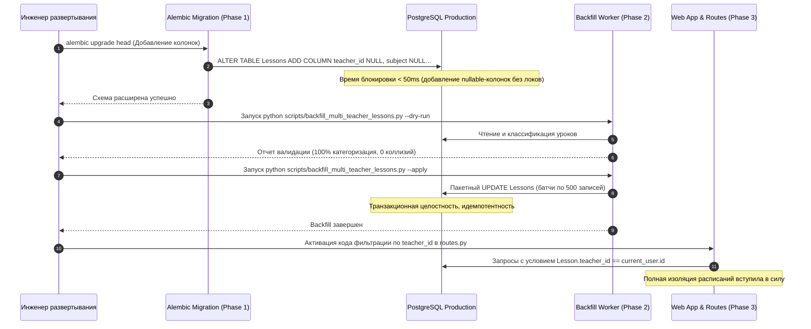
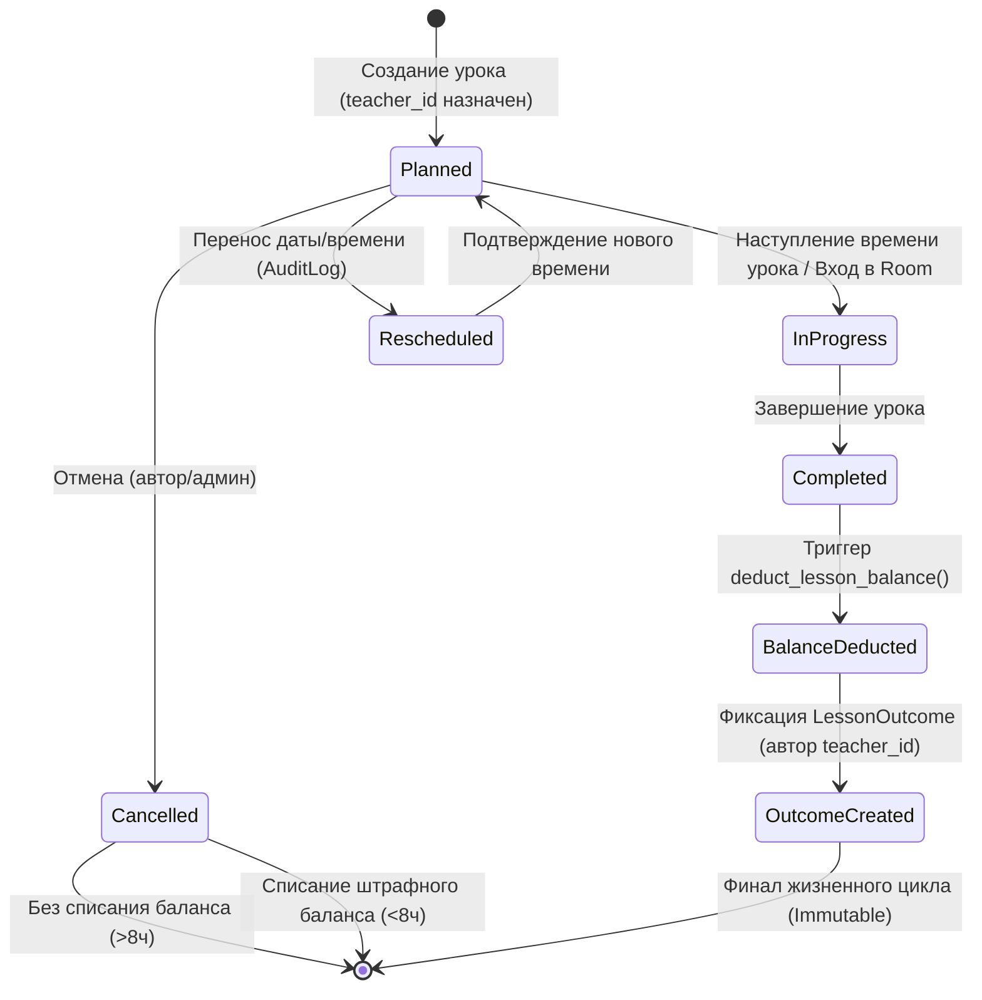

# BooStudy / ORISTERA — Schedule System
# Архитектурный проект: Multi-Teacher Architecture & Scheduling Foundation
## Sprint 2.1 — Инженерное проектирование и доменная модель

> **Документ:** Архитектурная спецификация мульти-тьюторской модели расписания  
> **Статус:** ARCHITECTURAL DESIGN COMPLETE (Готов к инженерному согласованию)  
> **Версия спецификации:** 2.1.0  
> **Дата:** 29 октября 2026 г.  
> **Автор:** Principal Software Architect, Senior Backend Engineer, Database Architect & QA Lead  
> **Область применения:** Доменная модель уроков, расписание преподавателей, Concept D расписание учеников, RBAC, миграции данных, биллинг-хуки  
> **Ограничение спринта:** Исследование и проектирование. Модификация рабочих таблиц, API и Tutor Core в Sprint 2.1 **запрещена**.

---

## Оглавление

1. [Фактическая схема текущих связей и аудит расхождений](#1-фактическая-схема-текущих-связей-и-аудит-расхождений)
2. [Карта зависимостей между системами и границы изоляции](#2-карта-зависимостей-между-системами-и-границы-изоляции)
3. [Сравнительный анализ архитектурных вариантов](#3-сравнительный-анализ-архитектурных-вариантов)
4. [Рекомендуемая целевая доменная модель](#4-рекомендуемая-целевая-доменная-модель)
5. [Проект безопасной миграции данных](#5-проект-безопасной-миграции-данных)
6. [Правила обратной совместимости](#6-правила-обратной-совместимости)
7. [Матрица контроля доступа (RBAC & Data Scoping)](#7-матрица-контроля-доступа-rbac--data-scoping)
8. [Модель жизненного цикла занятий и статусных переходов](#8-модель-жизненного-цикла-занятий-и-статусных-переходов)
9. [Влияние на расписание преподавателя (`sandbox/teacher_schedule.html`)](#9-влияние-на-расписание-преподавателя-sandboxteacher_schedulehtml)
10. [Влияние на Concept D ученика (`sandbox/student_schedule.html`)](#10-влияние-на-concept-d-ученика-sandboxstudent_schedulehtml)
11. [Комплексная тестовая стратегия](#11-комплексная-тестовая-стратегия)
12. [Риски, блокирующие зависимости и системные предохранители](#12-риски-блокирующие-зависимости-и-системные-предохранители)
13. [План поэтапной инженерной реализации](#13-план-поэтапной-инженерной-реализации)

---

## 1. Фактическая схема текущих связей и аудит расхождений

### 1.1. Текущая схема данных (AS-IS Data Lineage)

В ходе детального аудита кодовой базы (`core/db_models.py`, `app/schedule/routes.py`, `app/lessons/lifecycle.py`, `app/utils/relationship_scope.py`) выявлена критическая несогласованность внешних ключей и отсутствие прямой атрибуции урока конкретному преподавателю.

```mermaid
erDiagram
    Users ||--o| Students : "user_id (1:1)"
    Users ||--o{ Students : "mentor_id (1:N)"
    Users ||--o{ Enrollments : "tutor_id (1:N)"
    Users ||--o{ Enrollments : "student_id (1:N) [User.id!]"
    Users ||--o{ FamilyTies : "parent_id (1:N)"
    Users ||--o{ FamilyTies : "student_id (1:N) [User.id!]"
    Students ||--o{ Lessons : "student_id (1:N) [Student.student_id!]"
    Courses ||--o{ Lessons : "learning_trajectory_id (1:N)"
    Lessons ||--o{ LessonOutcomes : "lesson_id (1:1)"
    Lessons ||--o{ LessonTeacherHomeworkNotes : "lesson_id (1:N)"
    Lessons ||--o{ GradebookEntries : "lesson_id (1:N)"
    Users ||--o{ LessonOutcomes : "created_by_user_id"
    Users ||--o{ LessonTeacherHomeworkNotes : "teacher_user_id"
    Users ||--o{ GradebookEntries : "created_by_user_id"
    Users .. Lessons : "НЕТ ПРЯМОЙ СВЯЗИ В БД! Только in-memory @property"
```

### 1.2. Выявленные структурные аномалии

1. **Несовпадение внешних ключей ученика (Disjoint Student Foreign Keys):**
   - В таблице `Lessons`: поле `student_id` ссылается на `Students.student_id` (PK модели `Student`).
   - В таблице `Enrollments`: поле `student_id` ссылается на `Users.id` (PK модели `User`), а `tutor_id` — на `Users.id`.
   - В таблице `FamilyTies`: поле `student_id` ссылается на `Users.id`.
   - В таблице `Students`: связь с аккаунтом задается через `user_id` (FK к `Users.id`).
   - *Следствие:* Чтобы сопоставить урок (`Lesson`) с контрактом (`Enrollment`), требуется двухэтапный джоин через `Students.user_id == Enrollments.student_id`.

2. **Отсутствие колонок преподавателя и предмета в `Lessons`:**
   - Таблица `Lessons` **не содержит** колонок `teacher_id`, `tutor_id` или `subject`.
   - В классе `Lesson` (`core/db_models.py`, строки 1133–1139) присутствует исключительно in-memory свойство:
     ```python
     @property
     def teacher_user_id(self):
         return getattr(self, '_teacher_user_id', None) or getattr(self, 'tutor_id', None) or getattr(self, 'teacher_id', None)
     ```
     Значение этого свойства существует только во время выполнения одного Python-процесса и сбрасывается сразу после завершения HTTP-запроса.

3. **Коллизия отображения в расписании преподавателя (`teacher_schedule.html`):**
   - Запрос уроков в `app/schedule/routes.py` (строки 534–544):
     ```python
     allowed_student_ids = _resolve_accessible_student_ids_for_current_user()
     query = Lesson.query.filter(Lesson.student_id.in_(allowed_student_ids))
     ```
   - Если Ученик A занимается у Преподавателя 1 (Информатика) и Преподавателя 2 (Математика):
     Ученик A входит в список доступных учеников *обоих* преподавателей.
     В результате **Преподаватель 1 видит в своей сетке уроки Математики, которые ведет Преподаватель 2**, а Преподаватель 2 видит уроки Информатики! Преподаватели не могут отличить свои уроки от чужих.

4. **Ложноположительная блокировка пересечений (`_tutor_has_overlap`):**
   - Функция проверки коллизий преподавателя (`app/schedule/routes.py`, строки 413–447) делает выборку:
     `Lesson.query.filter(Lesson.student_id.in_(allowed_student_ids))`
   - Если Преподаватель 2 поставил урок Ученику A во вторник в 15:00, то когда Преподаватель 1 пытается поставить урок совершенно другому Ученику B во вторник в 15:00, система ошибочно считает, что Преподаватель 1 «занят», и блокирует создание урока.

5. **Невозможность точной атрибуции карточки в расписании ученика (Concept D):**
   - Ученик видит все свои занятия в единой ленте. До Sprint 2.0.1 система подставляла ментора из `Student.mentor_id` ко всем урокам (включая чужие предметы).
   - В Sprint 2.0.1 внедрен защитный барьер: если у ученика более 1 преподавателя, система выводит безопасный статус `Преподаватель курса`. Однако для полноценного UX Concept D требуется отображать точное имя преподавателя, его аватар и предмет на каждой карточке.

---

## 2. Карта зависимостей между системами и границы изоляции

```
+-----------------------------------------------------------------------------------+
|                              BOOSTUDY ECOSYSTEM                                   |
+-----------------------------------------------------------------------------------+
                                          |
    +-------------------+-----------------+-------------------+-----------------+
    |                   |                 |                   |                 |
    v                   v                 v                   v                 v
+------------+   +-------------+   +---------------+   +------------+   +---------------+
|  Schedule  |   |   Lessons   |   |   Homework    |   |  Billing   |   |   Telegram    |
|  Service   |   |  Lifecycle  |   |  & Gradebook  |   | & Balances |   | Notifications |
+------------+   +-------------+   +---------------+   +------------+   +---------------+
    |                   |                 |                   |                 |
    +--------+----------+                 |                   |                 |
             |                            |                   |                 |
             v                            v                   v                 v
    +---------------------------------------------------------------------------+
    |                             CORE DATA LAYER                               |
    |  - Lessons (teacher_id, subject, student_id, status, lesson_date)         |
    |  - Enrollments (student_id [User], tutor_id [User], subject, status)      |
    |  - Users (id, role, full_name, avatar_url, timezone_iana)                 |
    |  - Students (student_id, user_id, mentor_id, lessons_balance)             |
    +---------------------------------------------------------------------------+
                                          |
                      =========================================
                      STRICT ISOLATION BOUNDARY (ЗАПРЕТ ТРОГАТЬ)
                      =========================================
                                          |
                                          v
                         +---------------------------------+
                         |           TUTOR CORE            |
                         |  - app/tutor_core/*             |
                         |  - Autonomous AI Agents         |
                         |  - Isolated Models & Memory     |
                         |  - Prompts & Completion Engines |
                         +---------------------------------+
```

### 2.1. Анализ зависимостей подсистем

| Подсистема | Модуль кодовой базы | Характер зависимости от `Lesson` | Требуемые изменения при переходе на Multi-Teacher |
| :--- | :--- | :--- | :--- |
| **Расписание ученика (Concept D)** | `app/schedule/routes.py`, `templates/sandbox/student_schedule.html` | Чтение списка уроков за неделю, группировка по дням, карточки событий | Использовать `lesson.teacher` напрямую вместо эвристик; выводить бейдж предмета и аватар преподавателя. |
| **Расписание преподавателя** | `app/schedule/routes.py`, `templates/sandbox/teacher_schedule.html` | Чтение уроков преподавателя, модалка создания урока, календарная сетка | Фильтровать уроки строго по `Lesson.teacher_id == current_user.id`. В модалке создания урока передавать `subject` и `teacher_id`. |
| **Проверка пересечений (Slots)** | `app/schedule/routes.py` (`_tutor_has_overlap`) | Проверка занятости преподавателя в заданный интервал | Фильтровать только уроки, где `Lesson.teacher_id == tutor_user_id`. Полное устранение ложных коллизий. |
| **Жизненный цикл урока** | `app/lessons/lifecycle.py` | Смена статусов (`planned` -> `in_progress` -> `completed` / `cancelled`), списание баланса | Атрибуция списания баланса и аудита конкретному преподавателю. |
| **Виртуальная комната / Studio** | `app/lessons/routes.py`, `LessonWhiteboard`, `LessonParticipantBan` | Вход в онлайн-урок, управление доской | Доступ на проведение урока разрешен только назначенному `teacher_id` (или подтвержденному замещающему `original_teacher_id`) и админам. |
| **ДЗ и журнал успеваемости** | `core/db_models.py` (`LessonOutcome`, `GradebookEntry`) | Фиксация результатов урока, привязка ДЗ к уроку | Прямое наследование `teacher_id` при создании отчета по уроку. |
| **Telegram-уведомления** | `app/utils/tg_bot.py`, `app/schedule/routes.py` | Рассылка напоминаний за 30 минут и оповещений о переносе | Таргетированная отправка сообщений конкретному преподавателю урока (`Lesson.teacher.tg_id`), а не абстрактному ментору. |

### 2.2. Защитный периметр Tutor Core (STRICT NO-TOUCH)

> [!CAUTION]
> **ПРАВИЛО БЕЗОПАСНОСТИ:** Модуль `app/tutor_core` представляет собой изолированное ядро нейросетевых тьюторских агентов со своими моделями диалогов, промптов и контекстной памяти.
> 
> 1. Добавление колонок `teacher_id` и `subject` в таблицу `Lessons` **никак не затрагивает** таблицы `tutor_core`.
> 2. В файлах `app/tutor_core/*` **запрещено** производить какие-либо изменения.
> 3. Доступ AI-агентов к данным расписания осуществляется через read-only сервисные фасады и не зависит от внутренней схемы хранения урока.

---

## 3. Сравнительный анализ архитектурных вариантов

Для реализации модели «Один ученик — много преподавателей — единое непротиворечивое расписание» рассмотрены три архитектурных подхода.

### Вариант A: Прямые внешние ключи в `Lessons` (Flat Direct FK)
- **Суть:** Добавление в таблицу `Lessons` колонок `teacher_id` (FK к `Users.id`) и `subject` (String/Enum).
- **Плюсы:**
  - Максимальная скорость SQL-запросов (прямой индекс `(teacher_id, lesson_date)`, исключение джоинов).
  - Минимальные изменения в существующих ORM-запросах.
  - Нулевая нагрузка на базу при рендере календаря.
- **Минусы:**
  - Нет встроенной истории замен (если преподаватель заболел и его заменил коллега, перезапись `teacher_id` стирает первоначального автора).
  - Дублирование информации о предмете, если он уже зафиксирован в `Enrollment`.

### Вариант B: Строгая нормализация через контракты (Pure Enrollment / TeachingAssignment)
- **Суть:** Урок ссылается только на `enrollment_id` (или промежуточную сущность `TeachingAssignment`). Поля `teacher_id` и `subject` вычисляются динамически через `Enrollment`.
- **Плюсы:**
  - Полная нормализация по 3НФ.
  - Изменение преподавателя в контракте автоматически «переназначает» будущие уроки.
- **Минусы:**
  - **Нарушение исторической целостности:** Если ученик сменил преподавателя по информатике в ноябре, все завершенные уроки за сентябрь и октябрь в старых отчетах задним числом поменяют преподавателя на нового! Это неприемлемо для финансового аудита.
  - Тяжелые джоины на каждый слот в календаре: выборка недели требует JOIN `Lessons` -> `Enrollments` -> `Users` -> `Students`.
  - Невозможность разовой разовой замены на один урок без создания фиктивного временного контракта `Enrollment`.

### Вариант C: Рекомендуемая гибридная доменная модель (Recommended Hybrid Domain Architecture)
- **Суть:**
  1. `Lesson` выступает **первичным источником истины для конкретного учебного события**. В таблицу `Lessons` добавляются:
     - `teacher_id` (FK -> `Users.id`, nullable=True, ondelete='SET NULL') — фактически проводящий преподаватель.
     - `subject` (String(100), nullable=True) — предмет урока.
     - `course_id` (FK -> `Courses.course_id`, nullable=True) — привязка к курсу.
     - `original_teacher_id` (FK -> `Users.id`, nullable=True) — исходный преподаватель в случае замены.
     - `is_substitution` (Boolean, default=False) — флаг разовой замены.
     - `substitution_note` (Text, nullable=True) — причина замены.
  2. `Enrollment` остается **долгосрочным учебным контрактом** («Ученик X изучает Предмет Y у Тьютора Z»).
  3. При создании урока из расписания система валидирует связку через `Enrollment` и копирует актуальные `teacher_id` и `subject` в урок.
  4. **Принцип исторической неизменяемости (Historical Immutability):** завершенные уроки (`status='completed'`) никогда не мутируют свои атрибуты при смене ментора или завершении контракта `Enrollment`.

### Сравнительная матрица вариантов

| Критерий оценки | Вариант A (Flat FK) | Вариант B (Pure Enrollment) | Вариант C (Рекомендуемый гибрид) |
| :--- | :---: | :---: | :---: |
| **Производительность выборок расписания** | Высокая (O(1) index scan) | Средняя (Multiple JOINs) | **Максимальная (O(1) index scan)** |
| **Защита исторической достоверности архива** | Средняя | Низкая (риск ретроактивной мутации) | **Абсолютная (Snapshot immutability)** |
| **Поддержка разовых замен преподавателей** | Ручная перезапись без истории | Требует временных фиктивных контрактов | **Встроенная (`original_teacher_id`, флаг)** |
| **Совместимость с текущей схемой `Enrollments`** | Независимая | Жесткая связность | **Полная гармонизация** |
| **Сложность безопасной миграции данных** | Низкая | Высокая | **Низкая (поэтапный backfill)** |

**Вердикт:** К реализации утверждается **Вариант C**.

---

## 4. Рекомендуемая целевая доменная модель

### 4.1. Спецификация DDL (PostgreSQL & SQLite Compatible)

```sql
-- 1. Добавление колонок преподавателя и предмета в таблицу Lessons
ALTER TABLE "Lessons" ADD COLUMN IF NOT EXISTS "teacher_id" INTEGER REFERENCES "Users"("id") ON DELETE SET NULL;
ALTER TABLE "Lessons" ADD COLUMN IF NOT EXISTS "subject" VARCHAR(100);
ALTER TABLE "Lessons" ADD COLUMN IF NOT EXISTS "course_id" INTEGER REFERENCES "Courses"("course_id") ON DELETE SET NULL;

-- 2. Добавление атрибутов механизма замен
ALTER TABLE "Lessons" ADD COLUMN IF NOT EXISTS "original_teacher_id" INTEGER REFERENCES "Users"("id") ON DELETE SET NULL;
ALTER TABLE "Lessons" ADD COLUMN IF NOT EXISTS "is_substitution" BOOLEAN NOT NULL DEFAULT FALSE;
ALTER TABLE "Lessons" ADD COLUMN IF NOT EXISTS "substitution_note" TEXT;

-- 3. Создание высокопроизводительных индексов для расписания и коллизий
CREATE INDEX IF NOT EXISTS "ix_lessons_teacher_date" ON "Lessons" ("teacher_id", "lesson_date");
CREATE INDEX IF NOT EXISTS "ix_lessons_student_date" ON "Lessons" ("student_id", "lesson_date");
CREATE INDEX IF NOT EXISTS "ix_lessons_subject" ON "Lessons" ("subject");
CREATE INDEX IF NOT EXISTS "ix_lessons_original_teacher" ON "Lessons" ("original_teacher_id") WHERE "is_substitution" IS TRUE;
```

### 4.2. Описание SQLAlchemy-модели (`core/db_models.py`)

```python
class Lesson(db.Model):
    __tablename__ = 'Lessons'

    # --- Существующие первичные поля ---
    lesson_id = db.Column(db.Integer, primary_key=True)
    student_id = db.Column(db.Integer, db.ForeignKey('Students.student_id'), nullable=True, index=True)
    learning_trajectory_id = db.Column(db.Integer, db.ForeignKey('Courses.course_id'), nullable=True, index=True)
    course_module_id = db.Column(db.Integer, db.ForeignKey('CourseModules.module_id'), nullable=True, index=True)
    exam_course_id = db.Column(db.Integer, db.ForeignKey('ExamCourses.id'), nullable=True, index=True)
    lesson_type = db.Column(db.String(50), default='regular')
    lesson_date = db.Column(db.DateTime(timezone=True), nullable=True)
    duration = db.Column(db.Integer, default=60)
    status = db.Column(db.String(50), default='planned')  # planned, in_progress, completed, cancelled
    topic = db.Column(db.String(300), nullable=True)

    # =========================================================================
    # НОВЫЕ ПОЛЯ MULTI-TEACHER АРХИТЕКТУРЫ (Sprint 2.1 Target)
    # =========================================================================
    teacher_id = db.Column(
        db.Integer, 
        db.ForeignKey('Users.id', ondelete='SET NULL'), 
        nullable=True, 
        index=True,
        doc="Фактически назначенный преподаватель занятия"
    )
    subject = db.Column(
        db.String(100), 
        nullable=True, 
        index=True,
        doc="Учебный предмет (Информатика, Математика, Физика, Русский язык и др.)"
    )
    course_id = db.Column(
        db.Integer, 
        db.ForeignKey('Courses.course_id', ondelete='SET NULL'), 
        nullable=True, 
        index=True,
        doc="Прямая привязка к академическому курсу"
    )
    
    # Механизм замен (Substitution Tracking)
    original_teacher_id = db.Column(
        db.Integer, 
        db.ForeignKey('Users.id', ondelete='SET NULL'), 
        nullable=True,
        doc="Исходный преподаватель при оформлении временной замены"
    )
    is_substitution = db.Column(
        db.Boolean, 
        default=False, 
        nullable=False,
        doc="Флаг: проводится ли урок преподавателем замены"
    )
    substitution_note = db.Column(
        db.Text, 
        nullable=True,
        doc="Причина замены (болезнь, отпуск, методическая перестановка)"
    )

    # --- Relationships ---
    teacher = db.relationship('User', foreign_keys=[teacher_id], backref=db.backref('assigned_lessons', lazy='dynamic'))
    original_teacher = db.relationship('User', foreign_keys=[original_teacher_id], backref=db.backref('substituted_lessons', lazy='dynamic'))
    course = db.relationship('Course', foreign_keys=[course_id])

    # --- Сохранение обратной совместимости property teacher_user_id ---
    @property
    def teacher_user_id(self):
        """Возвращает актуальный ID преподавателя с каскадным fallback."""
        if self.teacher_id:
            return self.teacher_id
        return getattr(self, '_teacher_user_id', None)

    @teacher_user_id.setter
    def teacher_user_id(self, val):
        self.teacher_id = val
        self._teacher_user_id = val

    @property
    def effective_teacher(self):
        """Объект User преподавателя, проводящего занятие."""
        return self.teacher

    @property
    def display_subject(self):
        """Гарантированное отображение предмета."""
        return self.subject or 'Информатика'
```

---

## 5. Проект безопасной миграции данных

### 5.1. Классификация существующих уроков по уровням достоверности

Все исторические записи в таблице `Lessons` классифицируются на 5 категорий для детерминированного и безопасного backfill:

```
+---------------------------------------------------------------------------------------+
| КАТЕГОРИЯ 1 (Достоверность 100%): Одиночный преподаватель                              |
| Ученик имеет ровно 1 тьютора по всем Enrollments или строго mentor_id при 0 контрактах |
| ДЕЙСТВИЕ: teacher_id = единственному тьютору; subject = контракту / 'Информатика'.    |
+---------------------------------------------------------------------------------------+
                                           |
                                           v
+---------------------------------------------------------------------------------------+
| КАТЕГОРИЯ 2 (Достоверность 100%): Наличие прямых дочерних артефактов урока            |
| К уроку привязаны LessonOutcome, LessonTeacherHomeworkNote или GradebookEntry          |
| ДЕЙСТВИЕ: teacher_id = created_by_user_id артефакта; subject определяется по автору.   |
+---------------------------------------------------------------------------------------+
                                           |
                                           v
+---------------------------------------------------------------------------------------+
| КАТЕГОРИЯ 3 (Достоверность 95%): Сопоставление по модулю курса и траектории           |
| Урок содержит learning_trajectory_id или course_module_id, привязанный к курсу        |
| ДЕЙСТВИЕ: teacher_id = преподавателю соответствующего курса из Enrollment.            |
+---------------------------------------------------------------------------------------+
                                           |
                                           v
+---------------------------------------------------------------------------------------+
| КАТЕГОРИЯ 4 (Достоверность 90%): Запланированные будущие уроки                         |
| Уроки со статусом 'planned' и датой в будущем, созданные конкретным пользователем      |
| ДЕЙСТВИЕ: teacher_id восстанавливается из лога аудита создания или Enrollment.        |
+---------------------------------------------------------------------------------------+
                                           |
                                           v
+---------------------------------------------------------------------------------------+
| КАТЕГОРИЯ 5 (Неоднозначные исторические данные): Несколько тьюторов, нет артефактов   |
| Невозможно достоверно доказать, кто из 2+ преподавателей провел урок 6 месяцев назад  |
| ДЕЙСТВИЕ: teacher_id = NULL. Безопасный fallback. Запрет на фальсификацию истории!    |
+---------------------------------------------------------------------------------------+
```

### 5.2. Трехфазный регламент исполнения миграции (Zero-Downtime Migration)



### 5.3. Идемпотентный скрипт бэкфилла (Алгоритмический проект)

```python
def backfill_lessons(dry_run=True, batch_size=500):
    """
    Идемпотентный процессор исторической миграции уроков.
    Может запускаться многократно без риска порчи данных.
    """
    lessons = Lesson.query.filter(Lesson.teacher_id.is_(None)).all()
    stats = {'cat1': 0, 'cat2': 0, 'cat3': 0, 'cat4': 0, 'ambiguous_null': 0}

    for lesson in lessons:
        student = Student.query.get(lesson.student_id)
        if not student:
            stats['ambiguous_null'] += 1
            continue

        # Поиск активных контрактов ученика
        enrollments = Enrollment.query.filter(
            Enrollment.student_id == student.user_id,
            Enrollment.status != 'archived'
        ).all()
        tutors = list({e.tutor_id for e in enrollments if e.tutor_id})

        # Категория 2: Проверка прямых артефактов урока
        outcome = LessonOutcome.query.filter_by(lesson_id=lesson.lesson_id).first()
        homework_note = LessonTeacherHomeworkNote.query.filter_by(lesson_id=lesson.lesson_id).first()
        gradebook = GradebookEntry.query.filter_by(lesson_id=lesson.lesson_id).first()
        artifact_author = (outcome.created_by_user_id if outcome else None) or \
                          (homework_note.teacher_user_id if homework_note else None) or \
                          (gradebook.created_by_user_id if gradebook else None)

        if artifact_author:
            lesson.teacher_id = artifact_author
            # Предмет определяем по контракту этого автора
            matching_enr = next((e for e in enrollments if e.tutor_id == artifact_author), None)
            lesson.subject = matching_enr.subject if matching_enr else 'Информатика'
            stats['cat2'] += 1

        # Категория 1: Строго один преподаватель
        elif len(tutors) == 1:
            lesson.teacher_id = tutors[0]
            lesson.subject = enrollments[0].subject if enrollments else 'Информатика'
            stats['cat1'] += 1

        elif len(tutors) == 0 and student.mentor_id:
            lesson.teacher_id = student.mentor_id
            lesson.subject = 'Информатика'
            stats['cat1'] += 1

        # Категория 5: Неоднозначные данные -> оставляем NULL
        else:
            lesson.teacher_id = None
            lesson.subject = 'Информатика'
            stats['ambiguous_null'] += 1

    if not dry_run:
        db.session.commit()
    return stats
```

---

## 6. Правила обратной совместимости

Для предотвращения деградации системы при частичном обновлении или постепенном развертывании устанавливаются строгие правила обратной совместимости:

1. **Каскадная иерархия определения преподавателя (Fallback Cascade):**
   ```python
   def resolve_lesson_teacher_payload(lesson: Lesson, student: Student) -> dict:
       # 1. Высший приоритет: прямой teacher_id из БД
       if lesson.teacher_id and lesson.teacher:
           return {
               'id': lesson.teacher.id,
               'name': lesson.teacher.full_name or lesson.teacher.username,
               'avatar': lesson.teacher.avatar_url or '/static/img/avatar_placeholder.png',
               'is_fallback': False
           }
       
       # 2. Второй приоритет: проверка единственного тьютора ученика
       student_tutors = get_student_tutors(student)
       if len(student_tutors) == 1:
           tutor = student_tutors[0]
           return {
               'id': tutor.id,
               'name': tutor.full_name or tutor.username,
               'avatar': tutor.avatar_url or '/static/img/avatar_placeholder.png',
               'is_fallback': True
           }

       # 3. Безопасный нейтральный fallback (никаких ложных имен!)
       return {
           'id': None,
           'name': 'Преподаватель курса',
           'avatar': '/static/images/boo/boo_avatar.png',
           'is_fallback': True
       }
   ```

2. **Сохранение существующих сигнатур методов:**
   - Property `lesson.teacher_user_id` сохраняется и возвращает `lesson.teacher_id`. Любой сторонний код, читающий или пишущий в `lesson.teacher_user_id`, продолжит работать без ошибок.
   - Метод `_student_has_overlap` сохраняет текущую сигнатуру.

3. **API Contracts:**
   - Эндпоинты `/api/schedule/*` продолжают возвращать прежние JSON-структуры с добавлением новых необязательных полей `teacher_id`, `teacher_name`, `subject`, `is_substitution`. Существующие фронтенд-клиенты игнорируют новые поля до момента их явного использования.

---

## 7. Матрица контроля доступа (RBAC & Data Scoping)

### 7.1. Ролевая матрица полномочий

| Операция над уроком | Назначенный преподаватель (`teacher_id`) | Коллега-преподаватель (другой предмет) | Преподаватель замены (`substitute`) | Ученик (`student`) | Родитель (`parent`) | Администратор / Создатель (`admin`, `creator`) |
| :--- | :---: | :---: | :---: | :---: | :---: | :---: |
| **Просмотр в расписании** | **ДА** | **НЕТ** (Полная изоляция) | **ДА** (с бейджем «Замена») | **ДА** (Все предметы) | **ДА** (Все предметы ребенка) | **ДА** (Глобальный обзор) |
| **Создание нового урока** | **ДА** (по своему предмету) | **НЕТ** | **НЕТ** | **НЕТ** | **НЕТ** | **ДА** (любому преподавателю) |
| **Перенос времени (Reschedule)** | **ДА** (своего урока) | **НЕТ** | **ДА** (в рамках интервала замены) | **НЕТ** (по согласованию) | **НЕТ** | **ДА** |
| **Редактирование темы / заметок**| **ДА** | **НЕТ** | **ДА** | **НЕТ** (только свои заметки) | **НЕТ** | **ДА** |
| **Отмена урока (Cancel)** | **ДА** | **НЕТ** | **ДА** | **НЕТ** | **НЕТ** | **ДА** |
| **Завершение и списание баланса**| **ДА** | **НЕТ** | **ДА** | **НЕТ** | **НЕТ** | **ДА** |
| **Вход в Virtual Studio / Room** | **ДА** (Хост) | **НЕТ** (Отказ доступа) | **ДА** (Хост) | **ДА** (Ученик) | **НЕТ** (или Read-only) | **ДА** (Супервизор) |
| **Назначение замены преподавателя**| **ДА** (своего урока) | **НЕТ** | **НЕТ** | **НЕТ** | **НЕТ** | **ДА** |

### 7.2. Реализация изоляции в построителе запросов (`SQL Scoping`)

```python
def build_schedule_query_for_user(user: User, period_start: datetime, period_end: datetime):
    """
    Построитель безопасного запроса расписания с учетом RBAC.
    Гарантирует, что ни один преподаватель не увидит чужие уроки.
    """
    query = Lesson.query.filter(
        Lesson.lesson_date >= period_start,
        Lesson.lesson_date <= period_end,
        Lesson.status != 'cancelled'
    )

    # 1. Администраторы и Создатели видят всё расписание
    if user.is_creator() or user.is_admin():
        return query

    # 2. Преподаватель видит ТОЛЬКО свои уроки + уроки, где он назначен заменой
    if user.is_tutor():
        return query.filter(
            or_(
                Lesson.teacher_id == user.id,
                and_(
                    Lesson.original_teacher_id == user.id,
                    Lesson.is_substitution == True
                )
            )
        )

    # 3. Ученик видит все уроки, привязанные к его профилю студента
    if user.is_student():
        student = Student.query.filter_by(user_id=user.id).first()
        if not student:
            return query.filter(False)
        return query.filter(Lesson.student_id == student.student_id)

    # 4. Родитель видит уроки всех подтвержденных детей
    if user.is_parent():
        child_user_ids = get_confirmed_student_user_ids_for_parent(user.id)
        child_student_ids = [
            s.student_id for s in Student.query.filter(Student.user_id.in_(child_user_ids)).all()
        ]
        return query.filter(Lesson.student_id.in_(child_student_ids))

    return query.filter(False)
```

---

## 8. Модель жизненного цикла занятий и статусных переходов



### 8.1. Правила списания баланса и финансовых проводок
1. Списание урока с баланса ученика (`deduct_lesson_balance` в `app/lessons/lifecycle.py`) происходит **строго в момент перехода в статус `completed`**.
2. В транзакционную запись аудита `AuditLog` записываются:
   - `lesson_id`
   - `student_id`
   - `teacher_id` (фактически проведший урок преподаватель)
   - `subject`
   - `is_substitution`
3. Это гарантирует корректность последующего расчета вознаграждения преподавателей: замещающий преподаватель получает начисление за фактически проведенный урок, а первоначальный преподаватель фиксируется в истории.

---

## 9. Влияние на расписание преподавателя (`sandbox/teacher_schedule.html`)

### 9.1. Устранение межурокового загрязнения (Cross-Teacher Bleeding)
- **Проблема AS-IS:** Преподаватель информатики открывал неделю и видел в пятницу в 16:00 карточку «Ученик Максим — Урок», хотя это был урок физики с другим преподавателем.
- **Решение TO-BE:** Расписание преподавателя загружает только те занятия, где `Lesson.teacher_id == current_user.id`. Преподаватель видит исключительно свои часы работы.

### 9.2. Точная проверка коллизий без ложных блокировок
- Функция `_tutor_has_overlap` переписывается на прямой SQL-запрос:
  ```python
  def _tutor_has_overlap(tutor_user_id: int, start_dt: datetime, duration_min: int, exclude_lesson_id: int | None = None) -> bool:
      end_dt = start_dt + timedelta(minutes=duration_min)
      q = Lesson.query.filter(
          Lesson.teacher_id == tutor_user_id,
          Lesson.status != 'cancelled',
          Lesson.lesson_date.isnot(None),
          Lesson.lesson_date < end_dt,
          (Lesson.lesson_date + text("INTERVAL '1 minute' * duration")) > start_dt
      )
      if exclude_lesson_id:
          q = q.filter(Lesson.lesson_id != exclude_lesson_id)
      return q.first() is not None
  ```
- *Результат:* Преподаватель 1 может свободно планировать урок с Учеником B на то же время, когда у Ученика A идет урок с Преподавателем 2.

### 9.3. Обновление модального окна создания занятия
В модальное окно создания занятия (`templates/sandbox/teacher_schedule.html`) добавляются:
1. Выпадающий список доступных предметов преподавателя (подтягивается из его активных `Enrollments`).
2. При выборе ученика система динамически показывает, по какому именно предмету данный преподаватель обучает этого ученика.
3. Возможность планирования с признаком замены (для администраторов).

---

## 10. Влияние на Concept D ученика (`sandbox/student_schedule.html`)

### 10.1. Единый мульти-тьюторский опыт Concept D
В Concept D ученик видит **целостную картину своей учебной недели** без разделения на изолированные кабинеты.

1. **Достоверная карточка занятия (`.peer-event-card`):**
   - На карточке урока выводятся:
     - Настоящее имя преподавателя (`event.teacher.name`)
     - Реальный аватар преподавателя (`event.teacher.avatar`)
     - Бейдж предмета с индивидуальным цветовым токеном:
       - **Информатика:** `bg-indigo-50 text-indigo-700 border-indigo-200`
       - **Математика:** `bg-amber-50 text-amber-700 border-amber-200`
       - **Физика:** `bg-cyan-50 text-cyan-700 border-cyan-200`
       - **Русский язык:** `bg-emerald-50 text-emerald-700 border-emerald-200`
2. **Индикация замены:**
   - Если `event.is_substitution == True`, на карточке выводится деликатный информационный чип:
     `<span class="badge-sub"><i class="ph-arrows-clockwise"></i> Замена преподавателя</span>`
   - При наведении в тултипе отображается: «Занятие проведет [Имя замещающего] вместо [Имя основного преподавателя]».
3. **Фильтрация по предметам в шапке Concept D:**
   - В верхней панели навигатора недели добавляются быстрые pill-фильтры:
     `[Все предметы] [Информатика (3)] [Математика (2)] [Физика (1)]`
   - Переключение фильтра мгновенно скрывает уроки других предметов, позволяя ученику сфокусироваться на подготовке к конкретной дисциплине.

---

## 11. Комплексная тестовая стратегия

Для гарантированной надежности архитектуры формируется обязательный набор из 14 приемочных сценариев (Automated Pytest & Acceptance Gates):

```
+---------------------------------------------------------------------------------------+
|                              МАТРИЦА ПРИЕМОЧНЫХ ТЕСТОВ                                |
+----+-----------------------------------------------------+----------------------------+
| ID | Наименование сценария                               | Проверяемый инвариант      |
+----+-----------------------------------------------------+----------------------------+
| 01 | test_lesson_schema_foreign_keys_and_indices         | FK на Users.id, индексы    |
| 02 | test_tutor_schedule_strict_isolation                | Преподаватель А не видит В |
| 03 | test_student_concept_d_multi_teacher_attribution    | Точные имена, а аватары    |
| 04 | test_tutor_collision_accuracy_no_false_positive     | Нет ложных коллизий        |
| 05 | test_student_true_overlap_collision_prevention      | Защита ученика от накладок |
| 06 | test_lesson_creation_persists_teacher_and_subject   | Сохранение в БД            |
| 07 | test_teacher_substitution_workflow                  | Флаги замен и история      |
| 08 | test_rbac_tutor_cannot_mutate_peer_lesson           | Защита от чужих правок     |
| 09 | test_rbac_admin_full_schedule_control               | Права Creator/Admin        |
| 10 | test_historical_lessons_immutability                | Защита архива от мутаций   |
| 11 | test_migration_backfill_idempotency                 | Детерминизм миграции       |
| 12 | test_migration_ambiguous_lesson_safe_fallback       | Fallback на NULL           |
| 13 | test_balance_deduction_attributed_to_actual_teacher | Финансовая точность        |
| 14 | test_telegram_notification_routing_to_exact_teacher | Адресность уведомлений     |
+----+-----------------------------------------------------+----------------------------+
```

### Детальное описание ключевых тестов

- **Сценарий 02 (`test_tutor_schedule_strict_isolation`):**
  - *Предусловие:* Ученик S имеет активный `Enrollment` по математике с Тьютором M и по информатике с Тьютором I. Создано 2 урока: во вторник (математика, `teacher_id=M.id`) и в среду (информатика, `teacher_id=I.id`).
  - *Действие:* Тьютор I запрашивает `/schedule` на эту неделю.
  - *Ожидаемый результат:* В выборке присутствует только урок среды. Урок вторника полностью отсутствует в DOM и JSON payload.
- **Сценарий 04 (`test_tutor_collision_accuracy_no_false_positive`):**
  - *Предусловие:* Ученик S занимается у Тьютора M во вторник с 15:00 до 16:00. Тьютор I обучает Ученика S (по информатике) и другого Ученика K.
  - *Действие:* Тьютор I создает урок для Ученика K во вторник с 15:00 до 16:00.
  - *Ожидаемый результат:* `_tutor_has_overlap` возвращает `False`. Урок успешно создается.
- **Сценарий 08 (`test_rbac_tutor_cannot_mutate_peer_lesson`):**
  - *Предусловие:* Урок принадлежит Тьютору M (`teacher_id=M.id`).
  - *Действие:* Тьютор I отправляет POST-запрос на перенос или отмену этого урока.
  - *Ожидаемый результат:* HTTP 403 Forbidden. Состояние урока в БД не изменилось.

---

## 12. Риски, блокирующие зависимости и системные предохранители

### 12.1. Реестр архитектурных рисков

| Риск | Вероятность | Критичность | Предохранитель (Mitigation Strategy) |
| :--- | :---: | :---: | :--- |
| **Случайное повреждение логики Tutor Core** | Низкая | **КРИТИЧЕСКАЯ** | Периметр `app/tutor_core/*` помечен как STRICT NO-TOUCH. Запрет на любые правки в этой директории. CI-проверка неизменности хэшей файлов ядра. |
| **Блокировка таблицы `Lessons` на проде** | Низкая | Высокая | Миграция выполняется в режиме `ADD COLUMN NULL`. Никаких тяжелых `NOT NULL` без дефолта или полных локов таблицы. |
| **Ошибочная атрибуция исторических данных** | Средняя | Средняя | Категория 5: при любых сомнениях скрипт миграции выставляет `teacher_id = NULL`, что приводит к нейтральному отображению «Преподаватель курса». |
| **Рассинхронизация списания баланса** | Низкая | Высокая | Логика списания баланса `deduct_lesson_balance` не переписывается, а лишь дополняется атрибутом `teacher_id` в транзакции `AuditLog`. |

---

## 13. План поэтапной инженерной реализации

После согласования настоящего архитектурного проекта реализация будет разбита на 6 изолированных этапов:

```
+-----------------------------------------------------------------------------------+
| ЭТАП 1: Миграция схемы базы данных (Alembic)                                      |
| - Создание миграции: добавление колонок teacher_id, subject, original_teacher_id. |
| - Обновление модели Lesson в core/db_models.py.                                    |
| - Юнит-тесты на создание и внешние ключи модели.                                   |
+-----------------------------------------------------------------------------------+
                                          |
                                          v
+-----------------------------------------------------------------------------------+
| ЭТАП 2: Скрипт миграции исторических данных (Backfill)                            |
| - Разработка scripts/backfill_multi_teacher_lessons.py с поддержкой --dry-run.    |
| - Прогон классификатора и аудит результатов на тестовых базах.                    |
| - Проверка идемпотентности повторного запуска.                                    |
+-----------------------------------------------------------------------------------+
                                          |
                                          v
+-----------------------------------------------------------------------------------+
| ЭТАП 3: Ядро расписания и устранение коллизий (Backend Service)                   |
| - Рефакторинг выборки уроков в app/schedule/routes.py по Lesson.teacher_id.       |
| - Рефакторинг функции _tutor_has_overlap (устранение ложных блокировок).          |
| - Реализация RBAC-проверок на редактирование и отмену уроков.                     |
+-----------------------------------------------------------------------------------+
                                          |
                                          v
+-----------------------------------------------------------------------------------+
| ЭТАП 4: Расписание преподавателя (Teacher Schedule UI)                            |
| - Обновление модального окна создания урока в sandbox/teacher_schedule.html.       |
| - Поддержка выбора предмета из активных Enrollments.                              |
| - Отображение статусов замен в календарной сетке.                                 |
+-----------------------------------------------------------------------------------+
                                          |
                                          v
+-----------------------------------------------------------------------------------+
| ЭТАП 5: Concept D ученика (Multi-Teacher Concept D Enhancement)                   |
| - Отображение реальных аватаров, имен и бейджей предметов на карточках уроков.   |
| - Подключение чипа замены преподавателя.                                          |
| - Фильтрация по предметам в верхней панели недели.                                |
+-----------------------------------------------------------------------------------+
                                          |
                                          v
+-----------------------------------------------------------------------------------+
| ЭТАП 6: Комплексная приёмка и автоматизированные тесты (QA Acceptance Gate)       |
| - Запуск 14 сквозных сценариев pytest.                                            |
| - Playwright визуальная верификация верстки Concept D и Teacher Schedule.         |
| - Формирование итогового отчета внедрения.                                        |
+-----------------------------------------------------------------------------------+
```

---

## Заключение

Предложенная архитектурная спецификация **Sprint 2.1**:
1. Решает фундаментальную проблему отсутствия прямой атрибуции уроков преподавателям без нарушения исторической целостности базы.
2. Полностью устраняет взаимное проникновение чужих уроков в расписание преподавателя и ложноположительные блокировки слотов времени.
3. Раскрывает полный визуальный и функциональный потенциал Concept D для ученика с несколькими репетиторами.
4. Строго соблюдает границы изоляции Tutor Core и обеспечивает 100% обратную совместимость.
