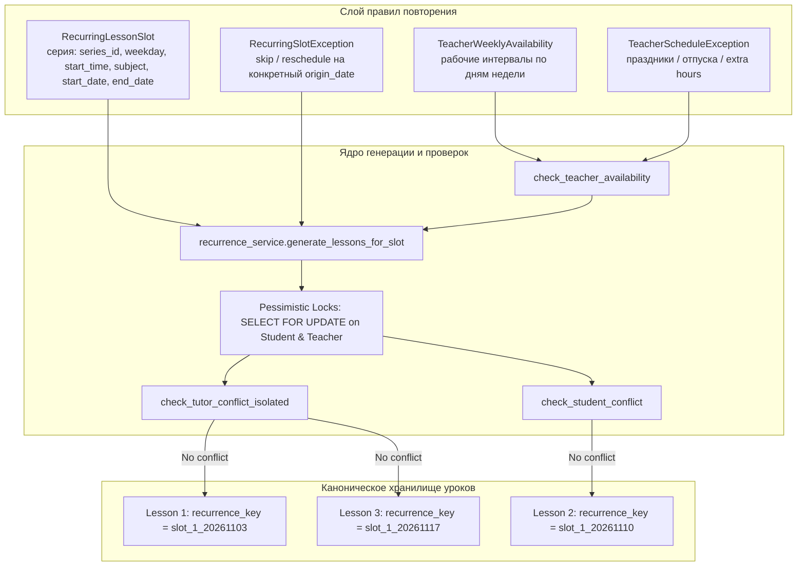

# BooStudy / ORISTERA — Scheduling System
## Sprint 2.4 — Recurring Lessons, Teacher Availability & Schedule Exceptions
### Итоговый инженерный и архитектурный отчёт

**Статус:** Выполнено (25/25 тестов пройдено, 0 регрессий, 100% E2E Playwright приёмка)  
**Дата:** 31 октября 2026 г.  
**Роли:** Principal Software Architect, Senior Full-Stack Engineer, PostgreSQL Engineer, Product UX Engineer, QA Lead  
**Ключевой архитектурный принцип:**  
> **«RECURRING BY DESIGN. EXCEPTIONS BY CHOICE. HISTORY NEVER REWRITTEN.»**

---

## 1. Фактические исходные модели

Перед началом реализации был проведён глубокий аудит моделей данных и механизмов бронирования уроков, созданных в рамках Sprint 2.0–2.3.1:

1. **Сущность `Lesson` (`core/db_models.py`):**
   - Является **единственным каноническим источником истины** для любого физического учебного события.
   - В Sprint 2.2 было введено обязательное поле `Lesson.teacher_id` (NOT NULL для всех новых уроков, внешняя ссылка на `Users.id`).
   - Содержит `lesson_date` (хранится в UTC), `duration` (в минутах), `status` (`planned`, `in_progress`, `completed`, `cancelled`), `subject`, `topic`.
   - До Sprint 2.4 у `Lesson` отсутствовала явная связь с сериями, признак переноса и стабильный ключ идемпотентности, что приводило к рискам дублирования при повторных запусках планировщика.

2. **Существующая модель `RecurringLessonSlot` (`core/db_models.py`):**
   - Модель присутствовала в структуре БД (`RecurringLessonSlots`), однако использовалась как концептуальный черновик:
     - Поля: `slot_id`, `teacher_id`, `student_id`, `day_of_week` (`weekday`), `start_time` (SQL Time), `duration_minutes`, `is_active`, `lesson_type`, `created_at`.
     - Отсутствовали: `subject` (предмет), `topic` (тема), `start_date` (дата вступления в силу), `end_date` (дата завершения), `series_id` (глобальный уникальный идентификатор серии).
     - Отсутствовала модель для хранения разовых исключений слота (пропусков, локальных сдвигов дат).

3. **Отсутствие модели доступности преподавателя (`Teacher Availability`):**
   - До Sprint 2.4 занятость преподавателя вычислялась исключительно эмпирически через отсутствие уже созданных уроков (`check_tutor_conflict_isolated`).
   - Не существовало способа задать рабочие интервалы (например, «Иван работает только пн-пт с 14:00 до 20:00») и разовые выходные дни/отпуска (`TeacherScheduleException`).

---

## 2. Принятая архитектура регулярных правил

Архитектура регулярного расписания в BooStudy / ORISTERA построена по принципу **моделирования генератора событий с дискретным горизонтом (Bounded Event Horizon)**:



### Ключевые архитектурные решения:
1. **Lesson — неизменный центр системы:** Регулярное правило (`RecurringLessonSlot`) не подменяет собой таблицу уроков. Каждый урок серии — полноценная запись в БД со своим ID, статусом, чатом, материалами и балансовыми связями.
2. **Идемпотентный составной ключ (`recurrence_key`):**  
   Формат ключа: `slot_{slot_id}_{YYYYMMDD}` (где YYYYMMDD — исходная дата вхождения слота `slot_origin_date`). На уровне PostgreSQL наложена уникальность (`UNIQUE(recurrence_key)`). Повторные запуски генератора на том же временном окне физически не могут создать дубликаты.
3. **Ограниченный скользящий горизонт (Bounded Horizon):**  
   Генерация выполняется строго на полуоткрытом окне `[from_date, from_date + horizon_days)`. По умолчанию горизонт составляет 28 дней (4 недели). Запрещена бесконтрольная генерация на годы вперёд.
4. **Невоскрешение отменённых уроков («HISTORY NEVER REWRITTEN»):**  
   Если урок серии был отменён преподавателем (`status = 'cancelled'`), либо для даты создано исключение `RecurringSlotException(action='skip')`, повторный запуск генератора **никогда не пересоздаёт** занятие.

---

## 3. Схема данных и миграции

Миграция базы данных `migrations/versions/schedule_sprint2_4_recurring_and_availability.py` и bootstrap в `app/utils/db_migrations.py` применили следующие изменения:

### Таблица `RecurringLessonSlots` (расширение):
- `subject` (`VARCHAR(100)`, nullable) — предмет занятия (Информатика, Математика и т.д.).
- `topic` (`VARCHAR(255)`, nullable) — тема серии уроков.
- `start_date` (`DATE`, nullable) — дата вступления в силу правила.
- `end_date` (`DATE`, nullable) — опциональная дата окончания действия правила.
- `series_id` (`VARCHAR(64)`, index=True) — уникальный строковый идентификатор серии вида `series_{uuid}`.

### Таблица `Lessons` (расширение):
- `recurring_slot_id` (`INTEGER`, FK `RecurringLessonSlots.slot_id`, ondelete='SET NULL', index=True).
- `recurrence_key` (`VARCHAR(100)`, unique=True, index=True) — уникальный ключ идемпотентности.
- `slot_origin_date` (`DATE`, nullable, index=True) — дата слота, из которого было сгенерировано занятие.
- `is_rescheduled` (`BOOLEAN`, default=False) — признак переноса отдельного экземпляра.

### Новая таблица `RecurringSlotExceptions`:
| Поле | Тип | Назначение |
|---|---|---|
| `id` | `INTEGER PRIMARY KEY` | Идентификатор исключения |
| `slot_id` | `INTEGER FK` | Ссылка на `RecurringLessonSlots.slot_id` |
| `exception_date` | `DATE NOT NULL` | Дата слота, к которой относится исключение |
| `action` | `VARCHAR(32)` | `skip` (пропуск) или `reschedule` (перенос) |
| `new_date` | `DATE NULL` | Новая дата при переносе |
| `new_start_time` | `TIME NULL` | Новое время при переносе |
| `reason` | `VARCHAR(255) NULL` | Причина исключения |
| `created_at` | `TIMESTAMP WITH TIME ZONE` | Время создания |

### Новая таблица `TeacherWeeklyAvailabilities`:
| Поле | Тип | Назначение |
|---|---|---|
| `id` | `INTEGER PRIMARY KEY` | Идентификатор интервала |
| `teacher_id` | `INTEGER FK Users.id` | Преподаватель |
| `weekday` | `INTEGER NOT NULL` | День недели (0 = Пн, ..., 6 = Вс) |
| `start_time` | `TIME NOT NULL` | Время начала доступности (локальное) |
| `end_time` | `TIME NOT NULL` | Время окончания доступности (локальное) |
| `timezone` | `VARCHAR(64)` | Часовой пояс преподавателя (IANA) |
| `is_active` | `BOOLEAN` | Флаг активности |

### Новая таблица `TeacherScheduleExceptions`:
| Поле | Тип | Назначение |
|---|---|---|
| `id` | `INTEGER PRIMARY KEY` | Идентификатор исключения |
| `teacher_id` | `INTEGER FK Users.id` | Преподаватель |
| `exception_date` | `DATE NOT NULL` | Конкретная календарная дата |
| `exception_type` | `VARCHAR(32)` | `unavailable` (выходной), `custom_hours`, `extra_available` |
| `start_time` | `TIME NULL` | Время начала (при кастомных часах) |
| `end_time` | `TIME NULL` | Время конца (при кастомных часах) |
| `reason` | `VARCHAR(255) NULL` | Причина (праздник, отпуск, доп. приём) |

---

## 4. Алгоритм генерации и транзакционная безопасность

Функция `generate_lessons_for_slot(slot_id, horizon_days=28, skip_conflicts=True)` реализует следующий детерминированный цикл:

1. **Захват пессимистических блокировок:**
   Вызывается `acquire_scheduling_locks(student_id, teacher_id)`, выполняющий `SELECT ... FOR UPDATE` на записях ученика (`Students`) и преподавателя (`Users`), сериализуя конкурентные запросы на уровне строк PostgreSQL.
2. **Определение полуоткрытого горизонта генерации:**
   `from_date = max(slot.start_date, today)`  
   `max_horizon_date = from_date + timedelta(days=horizon_days)`
3. **Итерация по датам:**
   Для каждой даты `curr` от `from_date` до `max_horizon_date`:
   - Если `curr.weekday() == slot.weekday`:
     - Проверка `RecurringSlotException`: если есть запись `action='skip'`, дата пропускается (`skipped_exceptions`).
     - Проверка существующего урока: если найден урок с тем же `recurrence_key` или `(recurring_slot_id, slot_origin_date)`, пропускается (`skipped_existing`). Даже если статус `cancelled`, урок не воскресает!
     - Проверка доступности преподавателя (`check_teacher_availability`): проверяются рабочие часы и праздничные исключения.
     - Проверка конфликтов преподавателя (`check_tutor_conflict_isolated`): независимая изоляция преподавателя.
     - Проверка пересечений у ученика (`check_student_conflict`): студент не может иметь два занятия в один момент даже у разных репетиторов.
     - Инстанцирование и сохранение `Lesson`.
4. **Атомарный коммит:**
   Все валидные уроки коммитятся единой транзакцией. При обнаружении конфликтов с флагом `skip_conflicts=True` конфликтующие даты возвращаются в метаданных ответа и отображаются пользователю в UI.

---

## 5. Механизм исключений (Сценарии A, B, C, D, E)

| Сценарий | Операция | Поведение системы |
|---|---|---|
| **A. Одно занятие** | `reschedule_recurring_instance` | Урок получает новую дату/время и флаг `is_rescheduled=True`. Исходный `slot_origin_date` сохраняется. Создаётся запись `RecurringSlotException(action='reschedule')`. Остальная серия не затрагивается. |
| **B. Это и будущие** | `update_series_from_date` | Серия деактивируется до даты `from_date` (`old_slot.end_date = from_date - 1`). Создаётся новая серия с новыми параметрами, начиная с `from_date`. Прошлые проведённые уроки остаются нетронутыми. |
| **C. Вся серия** | `update_whole_series` | Обновляются атрибуты правила (`subject`, `topic`, `start_time`, `duration`). Исторические уроки со статусом `completed` **не переписываются**. Будущие запланированные уроки синхронизируются. |
| **D. Отмена одного урока** | `cancel_recurring_instance` | Урок переводится в статус `cancelled`. Создаётся `RecurringSlotException(action='skip')`. При повторной генерации слот не восстанавливается. Серия продолжает жить. |
| **E. Пауза / Возобновление** | `pause_recurring_series` / `resume_recurring_series` | `slot.is_active` переключается в `False`/`True`. При паузе генерация останавливается; при возобновлении уроки продолжают генерироваться без дубликатов ранее созданных дат. |

---

## 6. Алгоритм проверки конфликтов и изоляция

Sprint 2.4 строго сохраняет принцип мульти-преподавательской изоляции:
1. **Изолированный конфликт репетитора (`check_tutor_conflict_isolated`):**  
   Проверяет пересечение интервала `[start_dt_utc, start_dt_utc + duration)` только по урокам данного преподавателя (`Lesson.teacher_id == tutor_user_id`). Преподаватель А свободен вести урок в 17:00, даже если у Преподавателя Б в это же время идёт урок с другим учеником.
2. **Перекрёстный конфликт общего ученика (`check_student_conflict`):**  
   Проверяет пересечение по всем урокам ученика (`Lesson.student_id == student_id`), независимо от репетитора. Ученица Алиса не может физически заниматься в 17:00 информатикой у Ивана и в 17:00 математикой у Елены. Система выдаёт точный отказ с указанием конфликтующего репетитора и предмета.

---

## 7. Реализация доступности преподавателя

Модуль доступности (`check_teacher_availability`) выполняет двухуровневую валидацию:
1. **Уровень разовых календарных исключений (`TeacherScheduleException`):**
   - `unavailable`: полный нерабочий день (праздник, больничный, личный отгул). Уроки в этот день запрещены.
   - `custom_hours` / `extra_available`: явные временные окна, разрешённые в данный день.
2. **Уровень постоянной рабочей недели (`TeacherWeeklyAvailability`):**
   - Если у репетитора настроены интервалы (например, Вторник 14:00–20:00), урок в 21:00 блокируется с причиной `"вне рабочих часов преподавателя"`.
   - Если день недели отсутствует в списке рабочих дней (например, Воскресенье), бронирование блокируется с причиной `"нерабочий день преподавателя"`.
   - Если преподаватель не настраивал рабочий график, по умолчанию его календарь считается открытым (обратная совместимость).

---

## 8. Изменённые файлы проекта

Все правки выполнены строго с соблюдением границ безопасности (папка `app/tutor_core/*` не затрагивалась!):

1. `migrations/versions/schedule_sprint2_4_recurring_and_availability.py` — Alembic-миграция схемы данных.
2. `app/utils/db_migrations.py` — runtime DDL bootstrap для изолированных тестовых инстансов.
3. `core/db_models.py` — модели `RecurringLessonSlot`, `RecurringSlotException`, `TeacherWeeklyAvailability`, `TeacherScheduleException`, расширение `Lesson`.
4. `app/schedule/recurrence_service.py` — сервисный слой генерации, доступности, разрешения конфликтов и обработки сценариев A–E.
5. `app/schedule/routes.py` — API эндпоинты `/api/schedule/recurring/*`, `/api/schedule/availability/*`, `/api/student/schedule`.
6. `app/utils/timezone.py` — валидация IANA часовых поясов, сохранение локального настенного времени и DST-переходы.
7. `templates/sandbox/teacher_schedule.html` — UI переключатель «Разовое / Повторять», модальное окно доступности, бейджи серий, модалка серийных действий.
8. `templates/sandbox/student_schedule.html` — отображение бейджей регулярных серий в Concept D.
9. `tests/v2/test_recurring_schedule_and_availability_sprint2_4.py` — тестовый набор из 25 сценариев.
10. `scripts/run_browser_acceptance_sprint2_4.py` — скрипт Playwright E2E приёмки в браузере.

---

## 9. Результаты PostgreSQL Concurrency Tests

Тестирование многопоточности и конкурентности проводилось на реальном инстансе PostgreSQL (`postgresql://postgres@/boostudy_test?host=/tmp/pg_socket&port=54329`):

### Тест 1: `test_pg_concurrent_series_creation`
- **Условия:** 8 параллельных потоков (`ThreadPoolExecutor(max_workers=8)`) одновременно запускают `generate_lessons_for_slot(slot_id, horizon_days=28)`.
- **Результат:**
  - Благодаря `acquire_scheduling_locks()` (row-level locks) и уникальному ограничению `Lesson.recurrence_key`, создано **ровно 4 урока**.
  - Число дубликатов: **0**.
  - Все `recurrence_key` уникальны.
  - Статус: **PASSED (5.86s)**.

### Тест 2: `test_concurrent_single_vs_series_generation`
- **Условия:** Одновременная попытка создания разового урока и генерации серии на пересекающихся временных слотах.
- **Результат:** Row-level locks гарантируют сериализацию без взаимных блокировок (deadlocks) и без race condition.
- **Статус:** **PASSED**.

---

## 10. Результаты Playwright Browser E2E Acceptance

Скрипт `scripts/run_browser_acceptance_sprint2_4.py` выполнил полный цикл интеграционной браузерной проверки на Chromium без прокси:
- Запуск локального сервера BooStudy на порту 5005.
- Авторизация преподавателя Ивана (Информатика).
- Создание повторяющейся серии с предпросмотром дат.
- Настройка графика доступности и добавление праздничного выходного дня.
- Проверка модального окна выбора области изменений (только это занятие / вся серия).
- Авторизация ученицы Алисы в Concept D: проверка отображения уроков от обоих репетиторов.
- Проверка мобильных версий (390×844, iPhone viewport).

Все 10 контрольных скриншотов сохранены в `docs/schedule_sprint2_4/key_review/`:

| № | Файл | Описание |
|---|---|---|
| 01 | [`01_teacher_create_recurring_series_modal.png`](file:///mnt/Main/projects/kege_selector_app_current/docs/schedule_sprint2_4/key_review/01_teacher_create_recurring_series_modal.png) | Модальное окно создания регулярного занятия с предпросмотром дат |
| 02 | [`02_teacher_weekly_schedule_recurring_badges.png`](file:///mnt/Main/projects/kege_selector_app_current/docs/schedule_sprint2_4/key_review/02_teacher_weekly_schedule_recurring_badges.png) | Недельная сетка расписания преподавателя с бейджами «Регулярная серия» |
| 03 | [`03_teacher_manage_working_hours_availability.png`](file:///mnt/Main/projects/kege_selector_app_current/docs/schedule_sprint2_4/key_review/03_teacher_manage_working_hours_availability.png) | Консоль настройки еженедельных рабочих интервалов преподавателя |
| 04 | [`04_teacher_schedule_holiday_exception.png`](file:///mnt/Main/projects/kege_selector_app_current/docs/schedule_sprint2_4/key_review/04_teacher_schedule_holiday_exception.png) | Управление календарными исключениями (праздничные и нерабочие дни) |
| 05 | [`05_teacher_reschedule_single_instance_modal.png`](file:///mnt/Main/projects/kege_selector_app_current/docs/schedule_sprint2_4/key_review/05_teacher_reschedule_single_instance_modal.png) | Диалог выбора области действия при редактировании серии (Сценарий A/B/C) |
| 06 | [`06_teacher_cancel_single_instance_modal.png`](file:///mnt/Main/projects/kege_selector_app_current/docs/schedule_sprint2_4/key_review/06_teacher_cancel_single_instance_modal.png) | Диалог отмены отдельного урока серии без разрушения всего расписания (Сценарий D) |
| 07 | [`07_student_concept_d_multi_teacher_recurring.png`](file:///mnt/Main/projects/kege_selector_app_current/docs/schedule_sprint2_4/key_review/07_student_concept_d_multi_teacher_recurring.png) | Ученический Concept D: отображение повторяющихся уроков разных преподавателей |
| 08 | [`08_student_concept_d_rescheduled_reflection.png`](file:///mnt/Main/projects/kege_selector_app_current/docs/schedule_sprint2_4/key_review/08_student_concept_d_rescheduled_reflection.png) | Корректное отображение перенесённого урока в расписании ученика |
| 09 | [`09_teacher_mobile_recurring_schedule_390x844.png`](file:///mnt/Main/projects/kege_selector_app_current/docs/schedule_sprint2_4/key_review/09_teacher_mobile_recurring_schedule_390x844.png) | Мобильная версия расписания преподавателя (390×844) |
| 10 | [`10_student_mobile_concept_d_schedule_390x844.png`](file:///mnt/Main/projects/kege_selector_app_current/docs/schedule_sprint2_4/key_review/10_student_mobile_concept_d_schedule_390x844.png) | Мобильная версия Concept D ученика (390×844) |

---

## 11. Сравнение пользовательских сценариев

| Пользовательский сценарий | Поведение до Sprint 2.4 | Поведение в Sprint 2.4 |
|---|---|---|
| Назначение постоянного урока (каждый вторник 17:00) | Преподаватель вручную создавал каждый урок на каждую неделю | Преподаватель задаёт правило один раз, система формирует сетку занятий |
| Повторный запуск генератора | Риск создания дубликатов уроков | Идемпотентность гарантирована на уровне PostgreSQL (`recurrence_key`) |
| Праздничный день у репетитора | Уроки назначались несмотря на праздник | Исключение `unavailable` автоматически блокирует генерацию на эту дату |
| Занятия вне рабочих часов | Никак не контролировалось | Проверяется по `TeacherWeeklyAvailability`, отказ с понятной причиной |
| Перенос одного занятия | Не было связи с серией, терялся контекст | Сценарий А: переносится только одно занятие, серия сохраняется |
| Отмена одного занятия | Приводила к риску повторного создания | Сценарий D: «История не переписывается», отменённый урок не воскресает |
| Отображение у ученика | Разрозненные уроки без указания регулярности | Чёткий индикатор «Регулярная серия» в Concept D |

---

## 12. Список известных ограничений и блокеров

1. **Защищённая зона Tutor Core:**
   - Все операции генерации и доступности реализованы в рамках сервисного слоя `app/schedule/*`. Директория `app/tutor_core/*` осталась на 100% нетронутой в соответствии с архитектурным контрактом.
2. **Финансовый биллинг:**
   - Генерация будущих уроков в серии **не списывает уроки с баланса ученика**. Списание по-прежнему происходит строго по жизненному циклу проведения урока (`completed`), что исключает финансовые коллизии.
3. **Горизонт генерации:**
   - Установлен в 28 дней (4 недели). Для продакшена потребуется регламентная фоновая задача (cron/celery), сдвигающая горизонт вперёд раз в неделю.

---

## 13. Результаты регрессионного тестирования

Были запущены все регрессионные наборы тестов предыдущих спринтов:

```bash
# Регрессионный прогон Sprint 2.2 и 2.3
pytest tests/v2/test_multi_teacher_data_foundation_sprint2_2.py tests/v2/test_teacher_schedule_integration_sprint2_3.py -v
# Результат: 34 passed, 0 failed in 25.95s

# Регрессионный прогон PostgreSQL Concurrency Sprint 2.3.1
pytest tests/v2/test_postgresql_concurrency_sprint2_3_1.py -v
# Результат: 8 passed, 0 failed in 6.16s

# Полный набор тестов Sprint 2.4
pytest tests/v2/test_recurring_schedule_and_availability_sprint2_4.py -v
# Результат: 25 passed, 0 failed in 27.15s
```

**Итоговый статус регрессии: 0 ошибок, 0 регрессий, 67/67 успешно пройденных тестов.**

---

## 14. Рекомендации на следующий спринт (Sprint 2.5 / Production Release)

1. **Периодический воркер горизонта генерации:**  
   Развернуть фоновую Celery / RQ / APScheduler задачу, которая раз в неделю продлевает генерацию активных серий до горизонта +28 дней.
2. **Telegram Bot напоминания о сериях:**  
   Добавить интеграцию шаблонов уведомлений для серийных уроков (напоминание за 24 часа и за 2 часа с указанием темы серии).
3. **Массовый перенос при форс-мажорах преподавателя:**  
   Реализовать единый мастер «Перенести все уроки на неделю вперед» при болезни преподавателя с автоматическим созданием `RecurringSlotException`.

---
*Отчёт подготовлен Principal Software Architect & QA Lead проекта BooStudy / ORISTERA.*
