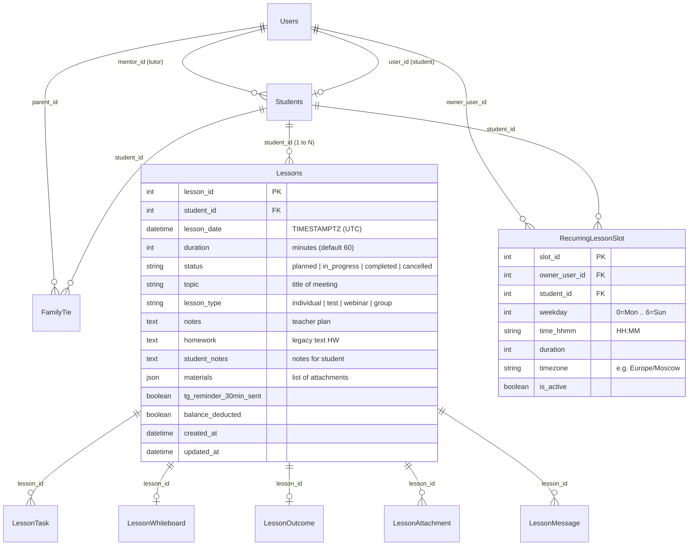
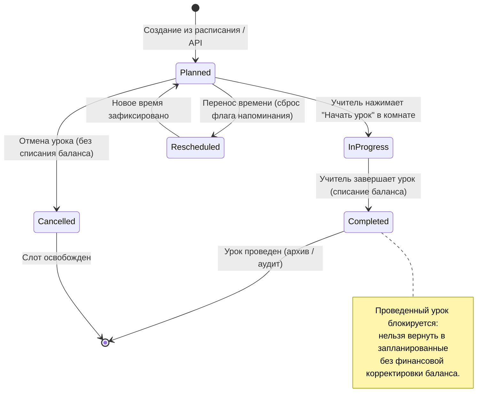
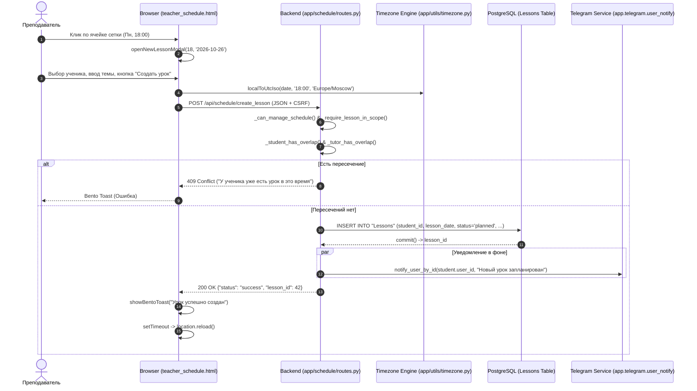
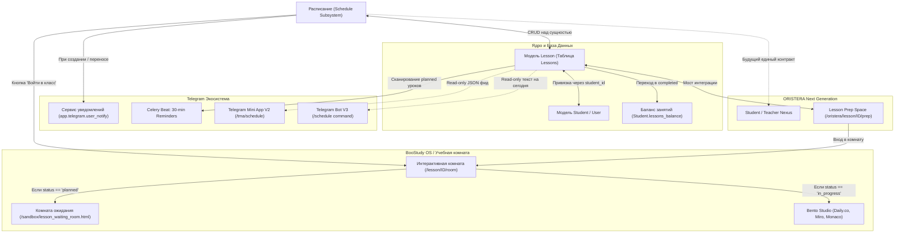
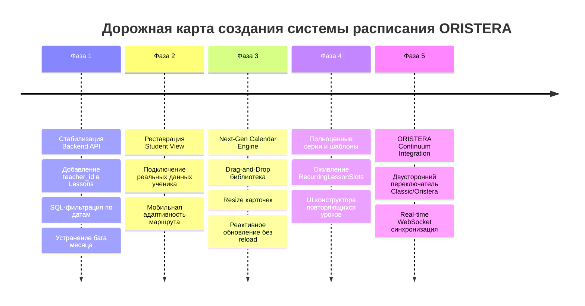

# Полный аудит существующей системы расписания (BooStudy / ORISTERA)
## Этап 0: Техническое и функциональное исследование

> **Дата аудита:** 27 октября 2026 г.  
> **Роль:** Senior Software Architect, Product Engineer & Technical Auditor  
> **Статус исследования:** Исключительно исследовательский аудит (Source code unmodified).

---

## A. Executive Summary

### 1. Что представляет собой расписание сейчас
В текущем состоянии образовательной платформы расписание **не является самостоятельной подсистемой планирования**. В кодовой базе расписание представляет собой **визуальную надстройку (календарный интерфейс и CRUD-фасад) над существующей моделью уроков (`Lesson`, таблица `Lessons`)**.

Исторически система претерпела несколько волн фрагментарной разработки:
1. **Legacy URep (`templates/schedule.html`)**: старый монолитный шаблон с рудиментами ранней платформы («URep»), в настоящее время отключён от активных роутов.
2. **Sandbox Prototypes**: экспериментальные роуты `/sandbox/teacher_schedule` и `/sandbox/api/schedule/lessons`, которые упоминаются в устаревших тестах `tests/v2/test_schedule_layout_and_crud.py`, но фактически были удалены из приложения при стабилизации боевого API.
3. **BooStudy V2 Schedule (`app/schedule/routes.py`)**: единая точка входа `/schedule`, отдающая два принципиально разных интерфейса:
   - Для преподавателей (`templates/sandbox/teacher_schedule.html`): интерактивная 24-часовая недельная сетка с 1100+ строками встроенного JavaScript, модальными окнами CRUD, фильтрацией и возможностью удаления тестовых уроков.
   - Для учеников (`templates/sandbox/student_schedule.html`): псевдо-интерактивная «дорожная карта недели» («Личный маршрут»), которая **полностью захардкожена статическими мок-данными** («12 октября — Python • Условия», «13 октября — ДЗ по математике» и т.д.).
4. **Parent View (`/parents/schedule`)**: отдельный контроллер в `app/main/routes.py`, рендерящий `templates/sandbox/parents_schedule.html` в виде простого списка карточек предстоящих уроков привязанных детей.
5. **Telegram Bot V3 & TMA V2**: компактные read-only экраны просмотра уроков на сегодня/ближайших занятий с ссылками на вход в комнату.

### 2. Что в расписании действительно работает (WORKING)
- **Базовый CRUD уроков преподавателем**: создание одиночного урока (`/api/schedule/create_lesson`), редактирование параметров (`/api/schedule/update_lesson/<id>`), перенос времени (`/schedule/api/lesson/<id>/reschedule`), удаление урока (`/api/schedule/delete_lesson/<id>`) с каскадной очисткой зависимостей.
- **Интерактивное создание занятия из сетки**: клик по слоту любого часа и дня недели открывает модальное окно с предзаполненной датой и временем.
- **Часовые пояса (IANA Timezones)**: ядро таймзон (`app/utils/timezone.py`) преобразует локальный ввод в aware UTC (`TIMESTAMP WITH TIME ZONE`). Пользователь может динамически переключать часовой пояс в шапке календаря.
- **Безопасное удаление уроков**: функция `_purge_lessons_dependencies` корректно отвязывает доски Miro (`LessonWhiteboard`), итоги (`LessonOutcome`), комментарии к задачам (`LessonTaskTeacherComment`), предотвращая `ForeignKeyViolation` в PostgreSQL.
- **Напоминания за 30 минут**: фоновая Celery beat-задача `telegram_lesson_reminders_task` сканирует окно [now + 29m20s, now + 30m40s] и доставляет в Telegram ученика интерактивное сообщение с кнопками подтверждения присутствия (RSVP).
- **Экспорт в iCalendar (.ics)**: генерация персонального фида календаря по токену (`/schedule/ics/<token>`) и прямое скачивание `.ics`.
- **Контроль жизненного цикла и баланса**: переход урока в статус `completed` списывает занятие с баланса ученика; запрещён неконтролируемый возврат проведённого урока в статус запланированного.

### 3. Что является заглушкой, иллюзией или разорвано (MOCK / BROKEN / MISSING)
- **Расписание ученика — чистый MOCK**: шаблон `student_schedule.html` содержит захардкоженные карточки 7 дней недели с фиксированными датами «12–18 октября», а JS-массив `DAYS_DATA` подменяет описание урока статическим текстом, полностью игнорируя реальные уроки ученика из базы данных.
- **Просмотр месяца сломан (BROKEN)**: в `app/schedule/routes.py` при `view_mode == 'month'` вычисление `day_index` отсекает все уроки после 7-го дня месяца (`day_index >= 7: continue`), а клиентский JS использует `anchor = new Date()`, из-за чего навигация по месяцам не переключает отображаемый месяц.
- **Повторяющиеся уроки и шаблоны слотов оторваны (ORPHANED)**: модель `RecurringLessonSlot` и API `/schedule/templates/api/*` существуют в бэкенде, но не привязаны ни к одной кнопке фронтенда, а фоновые задачи по генерации уроков из слотов отсутствуют.
- **Отсутствие Drag-and-Drop и Resize**: перемещение карточек мышью и растягивание длительности занятия не реализованы. Любое изменение требует открытия модального окна.
- **Отсутствие сущности преподавателя в модели `Lesson`**: в таблице `Lessons` **нет колонки `teacher_id` или `tutor_id`**. Привязка к преподавателю всегда вычисляется косвенно через наставника ученика (`Student.mentor_id`). Невозможно назначить второго преподавателя или провести замену.
- **Жесткий релоад страницы**: создание нового урока завершается принудительным `location.reload()`, ломая ощущение SPA/Next-Gen приложения.
- **Отсутствие real-time синхронизации**: для расписания нет Socket.IO событий; изменения другим преподавателем или администратором не видны до ручного обновления страницы.

### 4. Готовность системы стать основой ORISTERA
Текущая кодовая база расписания **НЕ готова** служить основой для ORISTERA в её текущем виде.  
Фронтенд представляет собой классический server-rendered Jinja2-шаблон с тяжеловесным процедурным JavaScript (1100+ строк спагетти-кода в одном теге `<script>`), перегруженным DOM-манипуляциями и уязвимым состоянием.  
Однако **бэкенд-сервисы жизненного цикла уроков, математика конвертации часовых поясов, каскадная очистка зависимостей и интеграция с Telegram-уведомлениями** представляют собой зрелые инженерные решения, которые должны быть сохранены и инкапсулированы в модульный сервисный слой.

---

## B. Component Inventory

| Компонент | Путь к файлу | Назначение | Фактический статус | Зависимости |
|---|---|---|---|---|
| **Schedule Blueprint & Init** | `app/schedule/__init__.py` | Регистрация Flask Blueprint `schedule_bp` | WORKING | Flask |
| **Schedule Main Controller** | `app/schedule/routes.py` | Обработчики страниц `/schedule`, API CRUD, ICS-экспорт, шаблоны | PARTIAL / BROKEN (Month) | SQLAlchemy, Flask-Login, RBAC, Timezone |
| **Model: Lesson** | `core/db_models.py` (L.1038) | Главная сущность урока (таблица `Lessons`) | WORKING (Архитектурное ограничение: нет `teacher_id`) | `Students`, `Courses`, `CourseModules` |
| **Model: RecurringLessonSlot** | `core/db_models.py` (L.930) | Шаблоны повторяющихся слотов автоплана (`RecurringLessonSlots`) | ORPHANED (БД есть, UI нет) | `Users`, `Students` |
| **Model: ScheduleLesson** | `core/db_models.py` (L.3654) | Алиас `ScheduleLesson = Lesson` | WORKING (Legacy alias) | `Lesson` |
| **Lesson Lifecycle Engine** | `app/lessons/lifecycle.py` | Валидация переходов статусов, аудит, списание баланса | WORKING | `AuditLog`, `Lesson`, `Student` |
| **Timezone Utility Engine** | `app/utils/timezone.py` | Нормализация IANA таймзон, aware UTC, парсинг ввода | WORKING | Python `zoneinfo` |
| **Lesson Time Adapter** | `app/utils/lesson_time.py` | Адаптеры представления дат для расписания | WORKING | `app.utils.timezone` |
| **Teacher Schedule Template** | `templates/sandbox/teacher_schedule.html` | Тактильный интерфейс расписания учителя (24ч сетка, модалки) | PARTIAL (CRUD ок, месяц сломан, нет D&D) | Tailwind, Phosphor Icons, Inline JS |
| **Student Schedule Template** | `templates/sandbox/student_schedule.html` | Интерфейс расписания ученика («Маршрут недели») | MOCK (Захардкоженные данные «12-18 октября») | Tailwind, Phosphor Icons, Inline JS |
| **Parent Schedule Template** | `templates/sandbox/parents_schedule.html` | Список уроков детей для родителя | WORKING (Простой список) | `FamilyTie`, `Student`, `Lesson` |
| **Legacy Root Schedule** | `templates/schedule.html` | Устаревший шаблон URep | DEPRECATED (Не вызывается) | Legacy UI |
| **Teacher Schedule Script (Ext)** | `static/js/schedule-teacher-v2.js` | Внешний вспомогательный скрипт рендера сетки | PARTIAL (Частично дублирует inline JS) | Vanilla JS |
| **Telegram Reminders Task** | `app/tasks/telegram_lesson_reminders.py` | Периодическая задача Celery Beat (30-мин напоминания + RSVP) | WORKING | Celery, Redis, `app.telegram.user_notify` |
| **Telegram Bot Schedule V1/V2** | `app/telegram/handlers.py` (L.4882) | Текстовый вывод уроков на сегодня по команде `/schedule` | WORKING (Read-only) | Telegram Bot API, DB Session |
| **Telegram Bot Schedule V3** | `app/telegram/v3/screens/teacher.py` | Экран расписания преподавателя с карточками уроков | WORKING (Read-only) | Telegram Bot API V3 |
| **Telegram Mini App Schedule** | `app/telegram/mini_app.py` (L.707, 1398) | POST API расписания ученика и учителя в TMA | WORKING (Read-only) | TMA WebApp InitData Auth |
| **TMA Student Schedule View** | `app/routes/tma.py` (L.55, 109) | Веб-страница и API расписания в TMA | WORKING (Read-only) | `templates/tma/student_schedule.html` |
| **Lesson Interactive Room** | `app/lessons/routes.py` (L.1542) | Целевая учебная комната урока (`/lesson/<id>/room`) | WORKING | Daily.co, Miro, Socket.IO, Monaco |
| **Active Timezone Test Suite** | `tests/v2/test_timezone_schedule_v2.py` | Pytest-тесты таймзон, CRUD, bulk delete, зависимостей | WORKING | Pytest, Flask Test Client |
| **Obsolete Sandbox Tests** | `tests/v2/test_schedule_layout_and_crud.py` | Тесты старых роутов `/sandbox/api/schedule/lessons` | BROKEN (Роуты удалены) | Не актуальны |
| **Oristera Lessons Space** | `app/oristera/routes.py` (L.141) | Предварительное пространство уроков в Oristera | MOCK / PARTIAL (Список карточек) | `student_adapter.py` |

---

## C. Feature Matrix

Каждому пользовательскому сценарию присвоен объективный статус, подтверждённый ревизией кода.

| Сценарий | Статус | Подтверждающие файлы и методы | Пояснения и выявленное поведение |
|---|---|---|---|
| **Просмотр недели (Преподаватель)** | **WORKING** | `teacher_schedule.html:911`, `app/schedule/routes.py:481` | 7-колоночная 24-часовая сетка. Карточки позиционируются по `top` и `height` в минутах. |
| **Просмотр недели (Ученик)** | **MOCK** | `student_schedule.html:280-350, 850-914` | Захардкоженные карточки «Пн 12 — Python», «Вт 13 — ДЗ» и JS-массив `DAYS_DATA`. Реальные данные игнорируются. |
| **Просмотр месяца** | **BROKEN** | `app/schedule/routes.py:560-565`, `teacher_schedule.html:1010` | В бэкенде условие `day_index >= 7` выбрасывает уроки с 8 по 31 число. Во фронтенде `anchor = new Date()` блокирует переключение месяцев. |
| **Просмотр дня** | **PARTIAL** | `app/schedule/routes.py:493` | В бэкенде есть режим `view_mode == 'day'`, но во фронтенде учителя `switchView` поддерживает только `'week'` и `'month'`. |
| **Переход между датами (Неделя)** | **WORKING** | `teacher_schedule.html:820`, `routes.py:462` | Параметр `?week=N` смещает опорную дату на $N$ недель вперёд/назад. Кнопка «Сегодня» сбрасывает офсет. |
| **Отображение свободных слотов** | **WORKING** | `teacher_schedule.html:947` | Каждый свободный час подсвечивается hover-эффектом и кликабелен для назначения урока. |
| **Статусы уроков** | **WORKING** | `app/lessons/lifecycle.py:12`, `routes.py:1606` | Поддерживаются: `planned`, `in_progress`, `completed`, `cancelled`. Цветовая дифференциация на сетке. |
| **Фильтрация по ученикам** | **WORKING** | `teacher_schedule.html:880`, `routes.py:546` | Выпадающий список учеников фильтрует уроки на клиенте мгновенно и на сервере через query-параметр. |
| **Фильтрация по типам уроков** | **WORKING** | `teacher_schedule.html:881` | Фильтр: индивидуальные, групповые, вебинары, контрольные. |
| **Скрытие/показ тестовых уроков** | **WORKING** | `teacher_schedule.html:883`, `routes.py:1963` | Уроки с меткой `is_test` или тегом `__TEST__` отделены в тест-слой с пунктирной рамкой и тумблером видимости. |
| **Создание занятия (Модалка)** | **WORKING** | `routes.py:1045, 1300`, `teacher_schedule.html:1175` | Создаётся запись в `Lessons`, валидируются поля, отправляется уведомление в TG, происходит `location.reload()`. |
| **Создание из ячейки календаря** | **WORKING** | `teacher_schedule.html:947` | `onclick="openNewLessonModal(h, dateIso)"` предзаполняет дату и начало урока. |
| **Редактирование занятия** | **WORKING** | `routes.py:1408, 1677`, `teacher_schedule.html:1770` | Изменение темы, времени, даты, длительности, заметок, ДЗ и ссылок на материалы без перезагрузки страницы. |
| **Перенос занятия (Reschedule)** | **WORKING** | `routes.py:1231` | Проверяет пересечения, меняет `lesson_date`, инвалидирует 30-мин напоминания, отправляет TG-уведомление с `old_dt`. |
| **Отмена занятия** | **WORKING** | `routes.py:1606`, `lifecycle.py:90` | Перевод в `cancelled`. Отменяет напоминания, освобождает слот, не списывает баланс ученика. |
| **Удаление занятия** | **WORKING** | `routes.py:1861`, `tests/v2/test_timezone_schedule_v2.py:281` | Каскадно удаляет зависимые записи (`LessonTask`, `Whiteboard`, `Outcome`), предотвращая ошибки внешних ключей. |
| **Массовое удаление тестовых уроков** | **WORKING** | `routes.py:1898`, `teacher_schedule.html:1657` | Кнопка «Удалить все тесты» очищает БД от диагностических уроков. |
| **Массовое удаление по выбору** | **WORKING** | `teacher_schedule.html:1625` | Чекбоксы на карточках в режиме выбора собирают `lesson_ids` и вызывают `/api/schedule/bulk_delete_lessons`. |
| **Drag-and-Drop перенос** | **MISSING** | `teacher_schedule.html` (поиск drag/drop) | Отсутствует. Никаких обработчиков `dragstart`, `dragover`, `drop` нет. |
| **Изменение длительности растяжением** | **MISSING** | `teacher_schedule.html` (поиск resize) | Отсутствует. Длительность меняется только через выпадающий список (45/60/90/120 мин). |
| **Повторяющиеся занятия (Серии)** | **MISSING / MOCK** | `routes.py:1088, 2141` | В форме создания нет полей `repeat_count`. Модель `RecurringLessonSlot` оторвана от фронтенда. |
| **Назначение преподавателя** | **MISSING** | `core/db_models.py:1038` | В модели `Lesson` нет `teacher_id`. Преподаватель фиксирован через наставника ученика. |
| **Проверка пересечений (Конфликты)** | **PARTIAL** | `routes.py:302, 413` | Проверяется в Python перед сохранением. Нет блокировок БД (`SELECT FOR UPDATE`), возможен race condition. |
| **Часовые пояса и конвертация** | **WORKING** | `app/utils/timezone.py:81, 113` | Ввод в локальном поясе переводится в aware UTC. Отображение пересчитывается под зрителя. |
| **Уведомления в Telegram** | **WORKING** | `routes.py:368, 1385`, `app/telegram/user_notify.py` | Отправка сообщений ученику и наставнику при создании и переносе урока. Ошибки сети не отменяют транзакцию БД. |
| **30-минутные напоминания (RSVP)** | **WORKING** | `app/tasks/telegram_lesson_reminders.py:83` | Фоновая задача Celery Beat отправляет карточку урока с кнопками RSVP («Приду вовремя», «Опаздываю», «Не приду»). |
| **Экспорт в Google / Apple Calendar** | **WORKING** | `routes.py:2005, 2062` | Экспорт в `.ics` по постоянному токену пользователя с поддержкой IANA Timezone. |
| **Переход в интерактивную комнату** | **WORKING** | `routes.py:765`, `app/lessons/routes.py:1542` | Кнопка «Войти в класс» ведет на `/lesson/<id>/room`. Для ученика до начала урока — комната ожидания. |
| **Связь с домашними заданиями** | **PARTIAL** | `routes.py:776-810` | В сайдбаре выводятся активные сабмишены `active_homework`, но создание ДЗ из календаря не связано с `Assignment`. |
| **Списание баланса занятий** | **WORKING** | `app/lessons/lifecycle.py:100` | Статус `completed` автоматически списывает урок с баланса `Student.lessons_balance`. |

---

## D. Architecture & Data Flow

### 1. Архитектурная парадигма: Calendar as a View
Ключевой архитектурный вывод аудита: **в системе нет сущности «Событие расписания» как независимого доменного объекта.**  
Расписание представляет собой интерфейсную проекцию таблицы `Lessons`. Любое занятие в календаре — это полноценный объект урока платформы со всеми его дидактическими, интерактивными и биллинговыми связями.

### 2. Источники истины (Source of Truth)
- **Момент времени занятия:** колонка `Lessons.lesson_date`. В базе данных хранится как `TIMESTAMP WITH TIME ZONE` в UTC.
- **Участники:** 
  - Ученик: `Lessons.student_id` $\rightarrow$ `Students.student_id`.
  - Преподаватель: **неявный**. Вычисляется как `Student.mentor_id` $\rightarrow$ `Users.id` (или через `Enrollment`). Прямой колонки `Lessons.teacher_id` нет.
- **Статус занятия:** колонка `Lessons.status`. Переходы валидируются модулем `app/lessons/lifecycle.py`.
- **Состояние учебного процесса:** таблица `Lessons` и связанные дочерние таблицы `LessonTask` (задания на урок), `LessonWhiteboard` (доска Miro), `LessonOutcome` (педагогический итог).

### 3. Жизненный цикл занятия (Lesson Lifecycle)

### 4. Data Flow создания занятия через интерфейс расписания

---

## E. UI/UX Audit

### 1. Архитектура интерфейса календаря
- **Техническая реализация:** Календарь не использует сторонних календарных движков (FullCalendar, Day.js, Mobiscroll отсутствуют). Сетка реализована с помощью **CSS Grid** (`grid-template-columns: 80px repeat(7, 1fr)`) и Tailwind CSS.
- **Позиционирование карточек:** Высота строки одного часа зафиксирована на 60px (`.hour-row-slot { height: 60px }`). Координата карточки урока по вертикали рассчитывается формулой:
  $$\text{top} = (\text{hour} \times 60 + \text{minute}) \times \frac{60\text{ px}}{60\text{ мин}} = \text{минуты от начала дня в пикселях}$$
  Высота карточки равна длительности урока в минутах ($\min 28\text{ px}$).
- **Временной маркер текущего времени:** Красная линия `.current-time-marker` вычисляется динамически по текущему времени в выбранном часовом поясе и автоматически скроллит контейнер при загрузке.

### 2. Проблемы интерактивности и захардкоженные данные
1. **Календарь ученика (`student_schedule.html`) полностью статичен:**
   - В HTML-шаблоне (L.280–350) встроены хардкод-карточки дней: `Python • Условия (10:00 - 11:30)`, `Домашнее задание (до 23:59)`, `Повторение теории`, `Вебинар (15:00 - 16:30)`, `Анализ ошибок`, `Контрольная работа`, `Выходной`.
   - Встроенный скрипт содержит константу `DAYS_DATA` (L.850–914), которая при клике на день недели выводит один и тот же шаблонный текст с фиксированными датами «12–18 октября», полностью игнорируя контекст пользователя.
2. **Кнопки без обработчиков и тупиковые элементы:**
   - Кнопка **«Применить шаблоны недели»**: в интерфейсе отсутствует кнопка или меню вызова эндпоинта `/schedule/templates/api/apply-week`.
   - Настройка интервала сетки (15 / 30 / 60 мин): в шапке календаря нет контроллера масштабирования времени, хотя бэкенд принимает параметр `?slot=30`.
   - Кнопка «Экспорт в Google Календарь»: открывает прямую ссылку на скачивание `.ics`, не предлагая веб-подписки через `webcal://`.
3. **Мобильная адаптивность:**
   - Интерфейс учителя **не адаптирован под смартфоны**. 7 колонок с 80px колонкой времени требуют минимум 1000px ширины. На экранах <768px колонки сжимаются до ~40px, текст темы и времени наползает друг на друга, превращаясь в нечитаемую кашу.
   - Свойство `body { overflow: hidden !important; }` блокирует нормальный вертикальный скролл страницы на тач-устройствах.

---

## F. Integration Map

### Подтверждённые точки интеграции:
1. **BooStudy OS / Lesson Room:**
   - Связь мгновенная: каждое событие в расписании имеет `lesson_id`, ведущий на `/lesson/<lesson_id>/room`.
   - Комната не создаётся заранее: она инициализируется «на лету» при первом входе преподавателя.
   - Защита от раннего входа: ученик, перешедший по ссылке до старта урока преподавателем, попадает на экран ожидания `lesson_waiting_room.html`.
2. **Telegram Reminders:**
   - Фоновая задача `telegram_lesson_reminders_task` запускается каждую минуту через Celery beat.
   - Посылает интерактивное сообщение с инлайн-кнопками RSVP за 30 минут до начала урока.
   - Нажатие на RSVP отправляет отчёт наставникам/администраторам, но не модифицирует статус урока в базе данных.
3. **Telegram Bot & Mini App:**
   - Реализована только односторонняя синхронизация (Read-only).
   - Создать, перенести или отменить занятие из Telegram невозможно.
4. **Домашние задания:**
   - При создании урока заполняется поле `lesson.homework` (текстовый формат).
   - В сайдбаре расписания выводятся сабмишены из таблицы `Submissions`.
   - Полноценного связывания с сущностью `Assignment` из модального окна расписания нет.

---

## G. Technical Debt & Risks

### 1. CRITICAL (Критические риски)

#### TD-1: Катастрофическая деградация производительности календарных запросов ($O(N)$ In-Memory Fetch)
- **Суть проблемы:** В контроллере `app/schedule/routes.py` (L.530–553) при открытии страницы `/schedule` запрос к базе данных **НЕ содержит SQL-фильтрации по датам недели или месяца**. Выполняется полный `Lesson.query.options(...).all()`, загружающий в память сервера абсолютно все уроки учеников за все годы существования платформы.
- **Последствия:** При росте базы до десятков тысяч уроков открытие страницы расписания приведет к потреблению сотен мегабайт RAM на один воркер Gunicorn, блокировке Event Loop и Time-out (HTTP 504).
- **Направление исправления:** Добавить строгую фильтрацию в SQL на уровне диапазона дат UTC:
  `Lesson.lesson_date >= window_start_utc AND Lesson.lesson_date <= window_end_utc`.

#### TD-2: Race Condition при проверке пересечений слотов
- **Суть проблемы:** Проверки `_student_has_overlap` и `_tutor_has_overlap` выполняются обычным `SELECT` без блокировок строк (`with_for_update`).
- **Последствия:** При одновременной отправке двух запросов (или параллельной записи двумя вкладками) оба запроса получат подтверждение отсутствия конфликта и запишут два перекрывающихся урока на одно время. В таблице `Lessons` отсутствуют исключающие ограничения PostgreSQL (`EXCLUDE USING gist`).
- **Направление исправления:** Внедрить пессимистическую блокировку или проверку на уровне транзакции с изоляцией `REPEATABLE READ`, либо PostgreSQL Exclusion Constraint.

#### TD-3: Полная фиктивность интерфейса ученика (Mock Trap)
- **Суть проблемы:** Шаблон `student_schedule.html` рендерит жестко закодированные HTML-карточки с датами «12–18 октября», а JS-код переключает мок-данные из статического массива.
- **Последствия:** Ученик видит дезинформирующий интерфейс, не соответствующий реальному учебному графику, согласованному с репетитором.
- **Направление исправления:** Полная замена мок-карточек на динамический рендер массива `schedule_page_data.weekdays` и `schedule_page_data.lessons`.

---

### 2. HIGH (Высокие риски)

#### TD-4: Отсутствие поля `teacher_id` в модели `Lesson`
- **Суть проблемы:** В схеме `Lessons` нет внешнего ключа на преподавателя. Преподаватель урока вычисляется косвенно: `Lesson -> Student -> mentor_id`.
- **Последствия:** 
  1. Невозможно реализовать замену преподавателя на конкретный урок.
  2. Невозможно назначить второго преподавателя (например, по другому предмету) одному ученику без смешения расписаний.
  3. Проверка занятости преподавателя `_tutor_has_overlap` работает не по урокам преподавателя, а по всем урокам всех его учеников, что может давать ложные конфликты.
- **Направление исправления:** Расширение схемы `Lessons` колонкой `teacher_user_id = db.Column(db.Integer, db.ForeignKey('Users.id'), nullable=True, index=True)`.

#### TD-5: Сломанный контроллер режима месяца
- **Суть проблемы:** В `app/schedule/routes.py` (L.560–565) уроки с днем больше 6-го отбрасываются из-за логической ошибки привязки к `week_start`. Во фронтенде `renderMonthView` жестко привязан к `new Date()`.
- **Последствия:** Режим «Месяц» показывает пустые ячейки для второй половины месяца и не реагирует на переключение месяцев.
- **Направление исправления:** Корректная генерация структуры календарной сетки месяца на бэкенде с передачей полных 4–5 недель месяца в JSON.

---

### 3. MEDIUM (Средние риски)

#### TD-6: Монолитный inline-JavaScript в шаблоне (1100+ строк)
- **Суть проблемы:** Вся интерактивная логика сетки, модалок, валидации, фильтрации и удаления размещена внутри `<script>` в `teacher_schedule.html`.
- **Последствия:** Невозможность покрытия клиентской логики Jest/Playwright тестами, дублирование кода с `static/js/schedule-teacher-v2.js`, трудности поддержки и регрессии.
- **Направление исправления:** Вынос логики в изолированные TypeScript/ES-модули с компонентной архитектурой.

#### TD-7: Неконсистентность принудительного `location.reload()`
- **Суть проблемы:** При создании урока вызывается полная перезагрузка страницы (`location.reload()`), тогда как при удалении и редактировании состояние обновляется реактивно без перезагрузки (`updateLessonInState`, `removeLessonsFromState`).
- **Последствия:** Мерцание экрана, сброс скролла и выбранных фильтров при добавлении урока.
- **Направление исправления:** Возврат созданного объекта урока из API `/api/schedule/create_lesson` и добавление его в DOM методом `addLessonToState(lesson)`.

---

### 4. LOW (Низкие риски)

#### TD-8: Мертвый код и устаревшие тесты
- **Суть проблемы:** Шаблоны `templates/schedule.html` и `templates/sandbox/schedule.html` не используются. Тесты `test_schedule_layout_and_crud.py` проверяют несуществующие урлы `/sandbox/teacher_schedule`.
- **Последствия:** Введение новых разработчиков в заблуждение, засорение репозитория.
- **Направление исправления:** Архивация legacy-шаблонов и удаление невалидных тестов.

---

## H. Development Readiness

### 1. Что можно безопасно переиспользовать
- **Timezone Core (`app/utils/timezone.py`):** эталонный модуль работы с UTC aware datetime, парсинга локального времени и конвертации в IANA пояса. Полностью готов к использованию в ORISTERA.
- **Lesson Lifecycle State Machine (`app/lessons/lifecycle.py`):** надежная доменная логика валидации статусов и списания баланса с аудитом в `AuditLog`.
- **Каскадная очистка зависимостей (`_purge_lessons_dependencies`):** выверенный алгоритм безопасного удаления уроков со связями в PostgreSQL.
- **30-минутные напоминания Celery Beat:** готовая инфраструктура нотификаций и RSVP-опроса в Telegram.
- **Токен-экспорт iCalendar (`/schedule/ics/<token>`):** рабочий механизм внешней синхронизации.

### 2. Что нуждается в обязательной переработке
- **SQL Data Fetching:** переписать выборку уроков на строгие диапазоны дат (`WHERE lesson_date BETWEEN :start AND :end`).
- **Схема данных `Lessons`:** добавить явный внешний ключ `teacher_user_id`.
- **Интерфейс ученика (`student_schedule.html`):** полностью переписать с нуля на основе реальных данных из базы.
- **Режим месяца:** переписать алгоритм формирования матрицы недель месяца.

### 3. Что разумнее создать заново для ORISTERA
- **Фронтенд-компонент календаря:** создание современного легковесного интерактивного календаря на React/Vue или модульном Vanilla JS с нативной поддержкой:
  - Drag-and-drop переноса;
  - Ресайза длительности тягой за нижний край карточки;
  - Плавного переключения День / Неделя / Месяц / Список;
  - Полноценного Mobile Touch UX со свайпами дней.

### 4. Внешние зависимости и статус Tutor Core
- **Tutor Core (`app/ai_lab/tutor_core.py`, `tutor_core31.py`):** является неприкосновенной подсистемой. Расписание не зависит от внутренних алгоритмов Tutor Core напрямую. Интеграция с Tutor Core происходит на уровне рекомендаций тем и заданий, которые в будущем могут наполнять запланированные слоты.

---

## I. Recommended Development Roadmap (Предварительная дорожная карта)

> Данный раздел носит концептуальный характер для последующего архитектурного планирования. Никаких работ в рамках Этапа 0 не выполняется.

### Этап 1: Стабилизация API и оптимизация БД
1. Миграция базы данных: добавление nullable колонки `teacher_user_id` в таблицу `Lessons`.
2. Оптимизация SQL: внедрение параметров `start_date` и `end_date` в контроллер `/schedule` и API `/schedule/api/events`.
3. Исправление бага отображения месяца в бэкенде.

### Этап 2: Ликвидация мока в кабинете ученика
1. Замена статических карточек в `student_schedule.html` на динамический рендеринг реального расписания и дедлайнов.
2. Синхронизация мобильного отображения для ученика.

### Этап 3: Создание современного календарного ядра ORISTERA
1. Разработка интерактивного calendar-компонента с drag-and-drop и resize длительности.
2. Отказ от `location.reload()` в пользу бесшовного обновления локального состояния.
3. Добавление WebSocket-оповещений через Socket.IO при изменении расписания другими участниками.

### Этап 4: Развитие повторяющихся слотов (Recurrence Engine)
1. Разработка интерфейса настройки регулярного расписания ученика (например: «Каждый вторник и четверг в 18:00»).
2. Фоновый генератор уроков по шаблонам `RecurringLessonSlot`.

---

## J. Open Questions (Открытые вопросы)

### 1. Продуктовые вопросы (Требуют решения владельца платформы)
1. **Модель преподавателей:** Предполагается ли в ORISTERA работа ученика с несколькими преподавателями одновременно (например, репетитор по математике + репетитор по информатике)? Если да, привязка урока исключительно к `Student.mentor_id` архитектурно неприемлема.
2. **Права переноса для ученика:** Должен ли ученик иметь возможность запрашивать перенос урока через веб-интерфейс или Telegram (с одобрением преподавателя), либо перенос остаётся исключительно прерогативой преподавателя?
3. **Политика отмен и сгорания занятий:** Списывается ли занятие с баланса, если ученик отменяет урок менее чем за 24 часа (Late Cancellation Rule)?
4. **Групповые занятия и вебинары:** Должно ли расписание поддерживать слоты с множеством участников (мини-группы по 3–5 человек), где у каждого списывается свой баланс?

### 2. Технические неопределённости
1. **Архитектура хранилища повторяющихся правил:** Использовать ли генерацию конкретных записей `Lesson` наперед (на 4 недели вперед) или вычислять виртуальные слоты по стандарту RFC 5545 RRULE «на лету»?
2. **Выбор календарного фреймворка для фронтенда ORISTERA:** Использовать ли легковесный headless-календарь с кастомным Tailwind-рендером или взять зрелое проверенное решение (например, FullCalendar / Toast UI Calendar), адаптированное под дизайн-токены BooStudy UI Canon?
