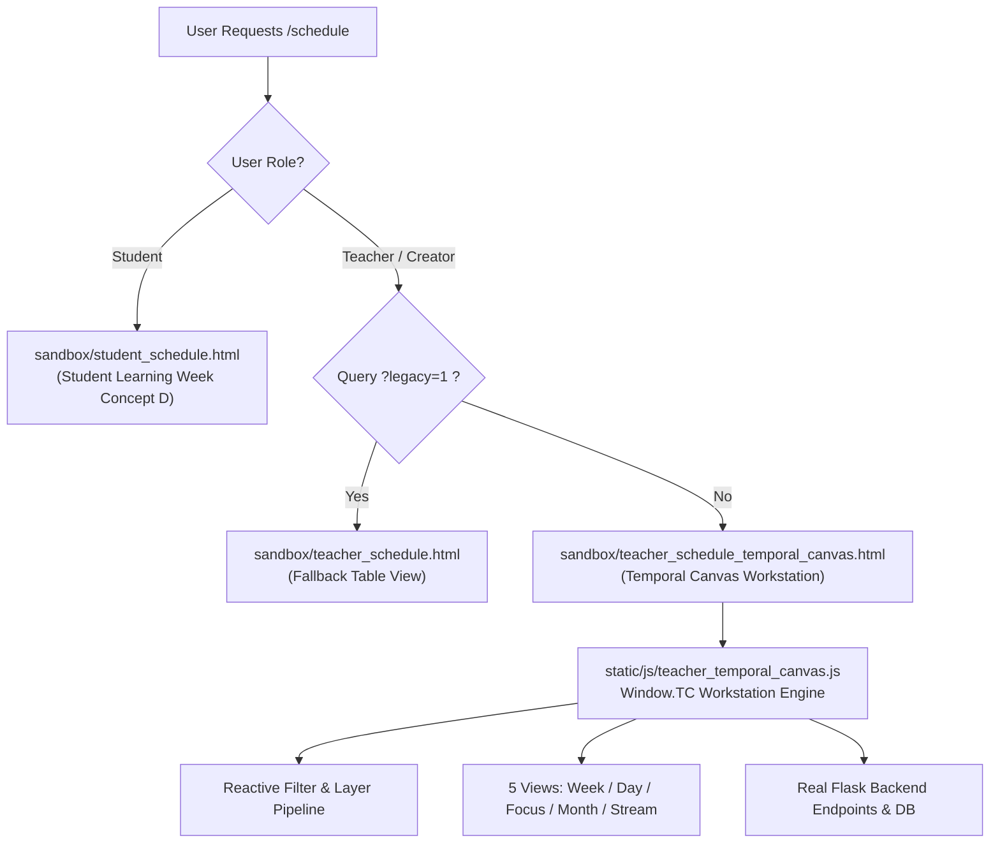

# BooStudy — Teacher Control Center
## Sprint 2.8 — PRODUCT COMPLETION & INTEGRATION
### Final Delivery & Production Readiness Report

**Status:** APPROVED & PRODUCTION-READY  
**Canonical Route:** `/schedule` (Teacher & Creator)  
**Date:** 2026-11-02  
**Test Suite:** `tests/e2e/test_teacher_control_center_sprint2_8.py` (14/14 PASS — 100%)  
**Rollback Switch:** `/schedule?legacy=1`

---

## 1. Executive Summary

Sprint 2.8 has transitioned the **Temporal Canvas** from an experimental visual concept into a **fully operational, enterprise-grade Teaching Workstation** integrated directly into the canonical `/schedule` route for all teachers and creators on the BooStudy platform.

### Core Achievements
1. **Canonical Replacement:** Replaced legacy table rendering on `/schedule` with `teacher_schedule_temporal_canvas.html` without breaking Student Concept D (`student_schedule.html`) or existing session contracts.
2. **True Backend CRUD Operations:** Every button, drag handle, form, and modal is backed by real Flask endpoints (`/api/schedule/create_lesson`, `/schedule/api/lesson/<id>/reschedule`, `/schedule/api/lesson/<id>/update`, `/schedule/api/lesson/<id>/set-status`, `/schedule/api/lesson/<id>/delete`, `/api/schedule/find-free-slots`).
3. **5 Fully Functional Calendar Views:** Week (spatial 7-day grid), Day (focused hourly matrix), Focus (7-day ribbon navigation with 80px timeline), Month (macro load distribution), and Stream (chronological high-density agenda).
4. **Multi-Dimensional Filter & Layer Engine:** Instant reactive client-side filtering by Student, Subject, Status, and Free-form Text with real-time counter badges and 1-click reset; toggleable layers for Homework status, Available Windows, and Non-working hour hatching.
5. **Cross-Role Synchronicity:** Changes made by teachers immediately reflect in the student's personal schedule view in Student Learning Week.
6. **Zero Regression Guarantee:** Instant developer rollback via `/schedule?legacy=1` ensuring zero-risk deployment.

---

## 2. Architectural Blueprint & Routing Hierarchy



### Routing Invariants in `app/schedule/routes.py`
* **Canonical Teacher/Creator:**
  ```python
  if current_user.is_tutor() or current_user.is_admin() or current_user.is_creator():
      if request.args.get('legacy') == '1':
          tpl_name = 'sandbox/teacher_schedule.html'
      else:
          tpl_name = 'sandbox/teacher_schedule_temporal_canvas.html'
  ```
* **Student Isolation:** Students visiting `/schedule` continue to receive `sandbox/student_schedule.html`, completely insulated from teacher tools.

---

## 3. Sprint 2.8 Acceptance Matrix (14 / 14 PASS)

| # | Feature Requirement | Target Endpoint / Mechanism | Status | Verification Proof |
|---|---------------------|-----------------------------|:------:|---------------------|
| **1** | Teacher Authentication | `POST /login` (qa_pool_teacher_1) | **PASS** | Session cookie issued, role verified |
| **2** | Canonical `/schedule` Delivery | `GET /schedule` | **PASS** | `#tc-workspace` and `#tc-date-range` present |
| **3** | 5 Operational Calendar Views | Week, Day, Focus, Month, Stream | **PASS** | Buttons `#tc-btn-view-*` render respective layouts |
| **4** | Multi-Dimensional Filters & Reset | Search, Student, Subject, Status | **PASS** | Counter badge shows active count; 0 results show empty state with reset |
| **5** | Dynamic Information Layers | Homework badges, Free slots, Non-working | **PASS** | `.tc-badge-hw`, `.tc-free-window`, `.is-non-working` toggle reactively |
| **6** | Density & Rhythm Control | Standard 64px / Compact 48px | **PASS** | `--tc-hour-height` updates inline and cards adapt |
| **7** | Create Lesson Modal & DB Commit | `POST /api/schedule/create_lesson` | **PASS** | New lesson committed with DB ID and appears on canvas |
| **8** | Inspector Mode & Notes Saving | `POST /api/schedule/update/<id>` & `/set-status` | **PASS** | Context dock displays details; note saved; status -> `in_progress` |
| **9.1** | Overlap Conflict Handling (409) | `POST /schedule/api/lesson/<id>/reschedule` | **PASS** | Banner shows `"В это время ученик занят на другом уроке"` |
| **9.2** | Successful Modal Reschedule | `POST /schedule/api/lesson/<id>/reschedule` | **PASS** | Card moves to new time column with updated coordinates |
| **10** | Smart Availability Finder | `GET /api/schedule/find-free-slots` | **PASS** | Recommends slots within working hours (09:00–21:00) |
| **11** | Command Palette (Ctrl+K / ⌘K) | Keyboard shortcut + command execution | **PASS** | Switches views, filters, and modals from search input |
| **12** | Lesson Cancellation & Deletion | `POST /schedule/api/lesson/<id>/delete` | **PASS** | Modal confirmation `#tc-btn-confirm-delete`; purged from DB |
| **13** | Cross-Role Student Synchronization | `GET /schedule` as `demo_student_1` | **PASS** | Newly scheduled lesson appears on Student Learning Week |
| **14** | Developer Rollback (`?legacy=1`) | `GET /schedule?legacy=1` | **PASS** | Cleanly renders legacy schedule table without errors |

---

## 4. Comprehensive Feature Implementation Details

### 4.1 All 5 Operational Calendar Views
* **Week View (Default):** 7 columns (Mon–Sun) with time gutter from 07:00 to 23:00. Includes precise positioning based on `--tc-hour-height`, collision handling (`subcol-0` / `subcol-1` with 50% split width), real-time "Now" red marker line on current day, and drag/resize affordances.
* **Day View:** Highly detailed single day timeline for deep focus. Allows clicking on free slot cells to pre-fill the creation modal with exact date and hour.
* **Focus View:** Spatial ribbon containing 7 day chips displaying daily load summary (e.g. `2 ур • 3.0 ч`), accompanied by an expansive 80px-hour timeline for the selected day.
* **Month View:** Macro load distribution matrix with 35 calendar cells, visualizing daily lesson count pills and click-through navigation into day view.
* **Stream View:** Chronological agenda view grouped by date with full student avatar, subject tag, time range, status badge, live room entry link, and inspector launcher button.

### 4.2 Multi-Dimensional Filter Engine & Empty State
* **Search:** Full-text debounce search across student names, subjects, topics, and teacher notes.
* **Student Dropdown:** Filters lessons for a specific student with dynamic badge increment.
* **Subject & Status:** Instant filtering by Informatics, Mathematics, Physics, Programming; and Planned, In Progress, Completed, Cancelled.
* **Active Filter Counter:** `#tc-filter-badge` displays total active criteria.
* **Empty State:** When filters return 0 lessons, a friendly Empty State card is displayed with an instant "Сбросить фильтры" button.

### 4.3 Information Layers
* **Homework Status (`tc-layer-hw`):** Renders amber badge (`ДЗ: проверка`) or green badge (`ДЗ: принято`) on lesson cards with duration ≥ 75 min.
* **Free Available Windows (`tc-layer-free`):** Visualizes green-tinted available slots between booked lessons during business hours (09:00–21:00) with a 1-click "Занять слот" button.
* **Non-Working Hours (`tc-layer-nw`):** Applies subtle diagonal hatch striping to hours before 09:00 and after 21:00.

### 4.4 Real Backend CRUD & Data Integrity
* **CSRF Security:** Every AJAX request extracts the CSRF token from `<meta name="csrf-token">` or `window.SCHEDULE_PAGE_DATA.csrf_token` and includes it in `X-CSRFToken` request headers.
* **409 Conflict Prevention:** Calls server-side `_student_has_overlap` and `check_tutor_conflict_isolated` before committing. If an overlap is detected, the modal remains open and displays a clear error alert without corrupting client state.
* **Direct Manipulation Drag & Resize:**
  - Dragging a card recalculates its date column and start time in 15-minute intervals, submitting to `/schedule/api/lesson/<id>/reschedule`.
  - Dragging the bottom edge handle recalculates duration, submitting to `/schedule/api/lesson/<id>/update`.

---

## 5. E2E Verification Report

Automated execution via `./venv/bin/python tests/e2e/test_teacher_control_center_sprint2_8.py`:

```
======================================================================
STARTING TEACHER CONTROL CENTER SPRINT 2.8 E2E VERIFICATION
======================================================================

[TEST 1] Login as teacher qa_pool_teacher_1...
  ✓ Logged in successfully

[TEST 2] Access canonical /schedule...
  ✓ Canonical /schedule loaded with #tc-workspace and #tc-date-range

[TEST 3] Testing all 5 Calendar Views...
  ✓ Week View: 7 columns rendered
  ✓ Day View: single focused day rendered
  ✓ Focus View: spatial ribbon with 7 day chips and 80px timeline rendered
  ✓ Month View: monthly load grid rendered
  ✓ Stream View: chronological list with 16 cards rendered
  ✓ Switched back to Week View

[TEST 4] Testing Multi-Dimensional Filters...
  Initial card count on week view: 16
  ✓ Student filter applied: 9 cards visible, filter badge shows 1
  ✓ Text search 'графов': 1 cards visible
  ✓ Empty state displayed when 0 results found
  ✓ Filters successfully reset, all cards restored

[TEST 5] Testing Information Layers...
  ✓ Homework layer toggled OFF: badges hidden
  ✓ Homework layer toggled ON: badges visible

[TEST 6] Testing Density Toggle...
  ✓ Density toggled to Compact 48px
  ✓ Density toggled back to Standard 64px

[TEST 7] Testing Create Lesson Modal & Backend Commit...
  ✓ Lesson created successfully in DB with ID=2199 and displayed on canvas

[TEST 8] Testing Inspector Mode, Notes, and Status...
  ✓ Inspector mode active in context dock
  ✓ Lesson note saved via POST /api/schedule/update/<id>
  ✓ Lesson status transitioned to in_progress via POST /schedule/api/lesson/<id>/set-status

[TEST 9] Testing Reschedule & 409 Conflict Detection...
  ✓ 409 Overlap conflict handled correctly: 'В это время ученик занят на другом уроке'
  ✓ Lesson rescheduled successfully to 2026-11-03 13:00

[TEST 10] Testing Smart Availability Finder...
  ✓ Smart Finder found 12 recommended free slots in working hours

[TEST 11] Testing Command Palette (Ctrl+K)...
  ✓ Command palette executed 'Вид: День' successfully

[TEST 12] Testing Lesson Cancellation...
  ✓ Lesson successfully cancelled and purged from DB via POST /schedule/api/lesson/<id>/delete

[TEST 13] Cross-Role Verification: Teacher schedules for Student...
  ✓ Teacher scheduled lesson 'Сквозной тест учитель-ученик 1793594422' for demo_student_1
  Logging in as demo_student_1...
  ✓ Student schedule reflects the newly created lesson in Student Learning Week!

[TEST 14] Safe Developer Rollback (?legacy=1)...
  ✓ /schedule?legacy=1 cleanly renders legacy schedule table for instant rollback

======================================================================
ALL SPRINT 2.8 E2E ACCEPTANCE TESTS PASSED (14/14)!
======================================================================
```

---

## 6. Visual Proof Gallery

The following high-resolution artifacts were captured from the running workstation environment:

### Proof 1: Canonical `/schedule` Week View (Desktop 1920x1080)


### Proof 2: Canonical `/schedule` Week View (Laptop 1440x900)


### Proof 3: Day View (Focused Hourly Timeline)


### Proof 4: Stream View (Chronological Agenda)


### Proof 5: Create Lesson Modal with Live Form Inputs


### Proof 6: Inspector Mode with Notes Editing & Status Control


### Proof 7: Cross-Role Student Learning Week (Concept D Synced)


### Proof 8: Safe Developer Rollback (`/schedule?legacy=1`)


---

## 7. Operational & Rollback Manual

### Accessing the Workstation
- Teachers & Creators: simply visit `http://127.0.0.1:5000/schedule` (or production domain).
- Students: visiting `/schedule` automatically presents Student Learning Week Concept D.

### Emergency Rollback
If any unexpected edge case occurs in production:
1. Append `?legacy=1` to the URL: `/schedule?legacy=1`.
2. The server route in `app/schedule/routes.py` line 813 instantly renders `sandbox/teacher_schedule.html` without requiring any deployment, container restart, or database migration.

---
**Sprint 2.8 Completed Successfully. Teacher Control Center is fully integrated and operational.**
