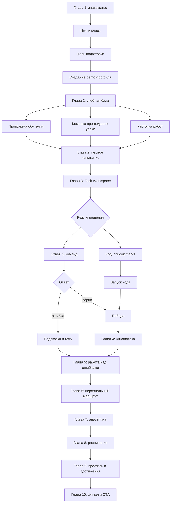

# BooStudy Demo Experience — полный сценарий

Источник: текущая рабочая копия проекта. Документ фиксирует канонический guided demo v5, включая авторские реплики Бу, экраны, CTA, микро-действия, серверные события и альтернативные ветки.

## 1. Общая логика

Пользователь проходит последовательность:



На странице всегда присутствуют: HUD «Демо · пример через полгода», Бу, визуальное выделение следующего элемента, блокирующее затемнение для guided objective и кнопка помощи.

## 2. Входной экран — Глава 1 «Знакомство»

### Постоянный текст

- `BooStudy`
- `Демо-версия`
- `Знакомство`
- `Соберём твой маршрут`
- `Привет! Я Бу!`
- `Добро пожаловать в BooStudy!`
- `Здесь ты сможешь подготовиться к ЕГЭ/ОГЭ, улучшить навыки программирования и получить поддержку на каждом этапе.`
- `Это последовательная демоверсия: я покажу путь кадр за кадром.`
- `Глава 1 · Знакомство`
- `Слушать`

### Реплика и выбор

Заголовок: `О! Кажется, у нас гость!`

Реплика:

> Привет! Я Бу — твой помощник на платформе. Здесь ты сможешь подготовиться к ЕГЭ/ОГЭ, изучить программирование и прокачать свои навыки. Я буду рядом, чтобы помогать, поддерживать и радоваться твоим успехам!

Промпт:

- `А теперь скажи...`
- `Что ты хочешь узнать о BooStudy прямо сейчас?`

Варианты:

1. `Да, показывай, что у вас тут!` — `Давай сразу посмотрим, как всё устроено.`
   Реакция: `Отлично! Покажу твою учебную базу и первый маршрут.`
2. `Я просто осматриваюсь` — `Хочу понять, с чего начать.`
   Реакция: `Конечно. Можно спокойно осмотреться — я подскажу, когда понадобится.`
3. `А ты вообще кто такой?` — `Расскажи немного о себе.`
   Реакция: `Я Бу — твой проводник. Давай познакомимся и соберём маршрут.`

Кнопка: `Продолжить`.

### Ввод имени и класса

Заголовок: `Рад познакомиться!`

Реплика:

> Как мне к тебе обращаться? Имя сохранится только внутри этой демосессии.

Поля и подписи:

- `Твоё имя`
- placeholder `Например, Никита`
- `В каком ты классе?`
- `1–4 класс`
- `5–8 класс`
- `9 класс`
- `10 класс`
- `11 класс`
- `Выпускник`

Кнопка: `Дальше`.

Если имя не введено, переход не выполняется: фокус возвращается в поле имени.

### Выбор цели

Заголовок: `Настроим маршрут`

Реплика:

> К какой цели идём? Все страницы останутся частью одной демоверсии BooStudy, а формулировки подстроятся под твой ответ.

Цели:

- `ЕГЭ 80+`
- `ЕГЭ 90+`
- `ОГЭ на 5`
- `научиться программировать`
- `пока выбираю`

Кнопки:

- `Guided demo с Бу`
- `Свободный просмотр платформы`

Состояние отправки: `Открываю демо…`

Ошибка: `Не удалось открыть демо-кабинет. Попробуй ещё раз.`

После успеха создаются demo-пользователь, ученик, задания, урок, аналитика, теория и профильные демонстрационные данные. Пользователь автоматически входит в систему.

## 3. Глава 1 в companion-режиме

После запуска guided demo Бу дополнительно говорит:

> Привет! Я Бу — твой персональный цифровой проводник в BooStudy. Я помогу тебе освоиться на платформе и подготовиться к максимуму на экзамене!

Кнопка: `Привет, Бу! Начнём`.

Следом:

> Как тебя зовут? Напиши своё имя, чтобы мы могли общаться по-человечески.

Цель:

> Приятно познакомиться, {name}! Скажи, к чему ты планируешь готовиться?

Fallback без имени:

> Приятно познакомиться! Скажи, к чему ты планируешь готовиться?

Варианты старого declarative-слоя:

- `ЕГЭ по информатике на 90+`
- `ОГЭ на пятёрку`
- `Изучить программирование`
- `Просто смотрю платформу`

После выбора:

> Отличный выбор, {name}! Сейчас покажу не обещание, а пример твоего кабинета спустя полгода регулярной работы. Это демонстрационный маршрут по информатике — пройдём его вместе, шаг за шагом.

Fallback:

> Отличный выбор! Сейчас покажу пример кабинета спустя полгода регулярной работы — это демонстрационный маршрут по информатике. Пойдём шаг за шагом.

CTA: `Перейти в кабинет`.

## 4. Глава 2 — учебная база

### Кинематографическое вступление

- kicker: `Глава 2 · Твоя учебная база`
- title: `Ты нашёл свою учебную базу.`
- message: `Уроки, задания и маршрут уже на своих местах. Теперь можно перейти в рабочую область и попробовать решить настоящую задачу — в своём темпе.`
- note: `Первое испытание готово`
- CTA: `Открыть первое испытание`
- points: `Учебная база открыта`, `Маршрут найден`, `Рабочая область ждёт`

### Вступительная реплика в кабинете

> {name}, добро пожаловать в свою учебную базу! Я уже кое-что для тебя подготовил. Здесь будут занятия, задания, результаты и всё, что поможет двигаться к цели. Давай вместе посмотрим, как всё устроено!

Fallback:

> Добро пожаловать в свою учебную базу! Здесь будут занятия, задания, результаты и всё, что поможет двигаться к цели.

Кнопка: `Показывай!`.

### Три обязательных открытия

HUD миссии показывает `0/3`, затем `1/3`, `2/3`, `3/3`.

#### 1. Программа обучения

Подсказка:

> Сначала откроем программу обучения. Там ты увидишь не обещание, а настоящий маршрут с модулями и темами.

После клика:

> А это твой учебный маршрут! Здесь видно, что уже пройдено и какие темы ждут впереди.

На каталоге:

> Это твоя программа обучения. В ней лежит не абстрактная схема, а твой реальный курс. Откроем его и посмотрим, как устроены модули и занятия.

Кнопка: `Открыть мой курс`.

Внутри курса:

> Это уже сам курс: сверху видна цель, а ниже — модули. Я покажу один из них: в нём занятия собраны в последовательность по теме.

Кнопка: `Показать модуль`.

После открытия модуля:

> Это один учебный модуль: внутри лежат занятия по одной теме, а курс собирает их в понятный порядок. Этого достаточно для знакомства — вернёмся к следующему кадру.

Кнопка: `Вернуться в кабинет`.

#### 2. Комната прошедшего урока

Подсказка:

> Программа уже открыта. Теперь посмотрим комнату уже прошедшего урока — это настоящее рабочее пространство, не экран ожидания.

На странице урока:

> Это комната уже прошедшего урока. Здесь собраны маршрут занятия, материалы и задания — заглянем внутрь, а затем Бу вернёт тебя в кабинет.

На карточке урока:

> Сейчас покажу комнату уже прошедшего урока. Это настоящее рабочее пространство BooStudy, и ждать начала не придётся.

Дополнительная реплика внутри комнаты:

> Вот маршрут прошедшего урока: подготовка, практика и итог. Рядом остаются теория, доска и материалы — всё занятие собрано в одном рабочем пространстве.

Кнопка: `Вернуться в кабинет`.

#### 3. Карточка работ

Подсказка:

> Урок посмотрели. Остался раздел работ — там тебя ждёт первое испытание.

После клика:

> Здесь собраны все твои работы. Кстати, я приготовил для тебя кое-что интересное!

После третьего открытия автоматически фиксируются:

- `demo:dashboard:lesson_explored`
- `demo:dashboard:assignments_explored`
- `demo:dashboard:program_explored`
- `demo:chapter2:trial_discovered`

## 5. Глава 3 — первое испытание

### Кинематографическая сцена

- kicker: `Глава 3 · Первое испытание`
- title: `Твоё первое испытание уже ждёт.`
- message: `Проследи за коротким алгоритмом и найди число, которое он напечатает. Его можно решить руками, а затем выбрать короткий ответ или код.`
- note: `Задача · След по алгоритму`
- CTA: `Открыть первое испытание`
- points: `Решается руками`, `Два режима решения`, `Подсказка рядом`

В рабочем пространстве появляется выбор:

- `Выбери способ решения`
- `Здесь можно быстро записать ответ или написать код. Это настоящие режимы рабочего пространства — начни с удобного для себя.`
- `Режим «Ответ»`
- `Режим «Код»`

### Режим «Ответ»

Реплика Бу:

> Ты выбрал режим «Ответ». Проследи исходный алгоритм вручную по пяти командам: начинаем с score = 0, после каждой команды запиши новое значение. В конце введи итог.

Кнопка: `Показать поле ответа`.

Инструкция:

> Введи ответ в поле ниже и нажми «Отправить ответ». Я моментально проверю твой результат!

Задача:

```text
score = 0
UP, UP, RIGHT, DOWN, RIGHT
UP: +2
RIGHT: +1
DOWN: −1
```

Правильная трассировка: `0 → 2 → 4 → 5 → 4 → 5`.

Правильный ответ: `5`.

### Неверный ответ — первая попытка

> Почти. Ошибка — обычная часть обучения. На четвёртой команде DOWN вычти 1 из текущего score. Запиши новое значение и продолжай.

Кнопка: `Попробовать ещё раз`.

Состояние: ответ сохраняется, штрафа нет.

### Неверный ответ — повторная ошибка

> Не сошлось — бывает. Вот решение по шагам: 0 → 2 → 4 → 5 → 4 → 5. После каждой команды меняй только текущее значение. Теперь покажу отдельную работу над ошибками: наставник поможет исправить ход, а не поставит крест на попытке.

Кнопка: `Перейти к работе над ошибками`.

### Правильный ответ

Кинематографическая карточка:

- title: `Первое испытание пройдено!`
- message: `Ты проследил алгоритм и проверил своё решение. Теперь на отдельной странице Бу покажет, как устроена поддержка, если ответ сначала не сходится.`
- note: `Заслуженная первая победа`
- CTA: `Посмотреть решение`
- points: `Ответ проверен`, `Ошибка не тупик`, `Разбор ведёт к росту`

Основная реплика declarative-слоя:

> Блестяще, {name}! Первое испытание пройдено на максимум (1 из 1 балла)! Ты почувствовал, как удобно сдавать задания в BooStudy. Прогресс зафиксирован.

Fallback:

> Блестяще! Первое испытание пройдено на максимум (1 из 1 балла)! Ты почувствовал, как удобно сдавать задания в BooStudy. Прогресс зафиксирован.

Варианты:

- `Открыть секретную библиотеку`
- `Смотреть решение`
- `Вернуться в кабинет`

## 6. Альтернативная ветка «Код»

Реплика:

> Ты выбрал режим «Код». Это отдельная мини-задача: напиши цикл, который сложит числа не меньше 3 из списка. Я покажу редактор, затем ты запустишь программу и увидишь результат.

Кнопка: `Показать редактор`.

Текст в редакторе:

> Мини-задача для режима «Код». Дан список `marks = [3, 1, 4, 1, 5]`. Напиши цикл, который сложит только числа не меньше `3`, и выведи результат.

> Ожидаемый результат после запуска — `12`. Сначала допиши цикл, затем нажми «Запустить».

Начальный код:

```python
marks = [3, 1, 4, 1, 5]
total = 0

# перебери marks и добавь в total числа >= 3

print(total)
```

Target label: `Напиши код и запусти`.

## 7. Глава 4 — секретная библиотека / теория

Кинематографическая карточка:

- kicker: `Глава 4 · Секретная библиотека`
- title: `За ответом всегда есть принцип.`
- message: `Бу открыл для тебя объяснение к первому испытанию. Здесь теория помогает читать алгоритм по шагам, а не угадывать результат.`
- note: `Открой разбор алгоритма`
- CTA: `Открыть теорию`
- points: `Разбор решения`, `Трассировка шагов`, `Мини-вопрос для закрепления`

На странице теории:

> Это разбор решения. Не нужно угадывать: открой материал, и я покажу, как читать алгоритм по шагам.

Кнопка: `Показать разбор`.

После открытия материала:

> В теории важен не только ответ: теперь ты видишь принцип, по которому строится решение.

Кинематографическое продолжение:

- title: `Теперь ты понимаешь, почему ответ работает.`
- message: `Ты не просто увидел число — ты разобрал принцип. Следующий шаг покажет, как BooStudy помогает спокойно исправлять ошибки.`
- note: `Принцип найден`
- CTA: `К работе над ошибками`
- points: `Теория открыта`, `Проверка пройдена`, `Следующая история готова`

## 8. Глава 5 — работа над ошибками

Вступительная карточка:

- kicker: `Глава 5 · Ошибаться — нормально`
- title: `Ошибка — это точка, с которой начинается рост.`
- message: `Сейчас откроется повторная попытка с подсказкой. Впиши новый ответ — это единственное действие этого кадра.`
- note: `Повторная попытка готова`
- CTA: `Открыть повторную попытку`
- points: `Подсказка рядом`, `Один ответ`, `Без штрафа`

На странице работ:

> Это отдельная работа над ошибками: сначала посмотрим комментарий наставника и неверный шаг, а затем откроем исправленную попытку.

Кнопка: `Показать разбор ошибки`.

После открытия:

- title: `Ты увидел, как ошибка становится навыком.`
- message: `Комментарий уже рядом с работой. Исправь ответ, а затем Бу покажет твой персональный маршрут — без давления и с понятными шагами.`
- note: `Попробовать ещё раз`
- CTA: `Исправить ответ`
- points: `Разбор открыт`, `Повторная попытка доступна`, `Навык можно закрепить`

В workspace:

> Это повторная попытка. Сначала переключимся в режим ответа, затем спокойно введи число и отправь его на проверку.

Кнопка: `Показать поле ответа`.

После правильного исправления:

> Готово — ты исправил именно тот шаг, где сбился счёт. Ошибка стала навыком. Теперь посмотрим, как регулярная практика отражается на прогрессе.

Кнопка: `Посмотреть аналитику`.

## 9. Глава 6 — персональный маршрут

Вступительная карточка:

- kicker: `Глава 6 · Твой маршрут`
- title: `Учёба становится понятнее, когда виден путь.`
- message: `Это не общий список тем. Бу собрал живую индивидуальную траекторию: что уже получилось, на чём сфокусироваться сейчас и что будет дальше.`
- note: `Открой свой путь`
- CTA: `Посмотреть маршрут`
- points: `Пройдено`, `В фокусе`, `Следующий шаг`

На каталоге:

> Это каталог твоих программ. Откроем единственный активный курс, а уже внутри я покажу один модуль маршрута.

Кнопка: `Открыть курс`.

На странице курса:

> Это твой маршрут. Я покажу один модуль — так видно, как темы и занятия складываются в понятную последовательность. В сами занятия сейчас не уходим.

Кнопка: `Показать модуль`.

После открытия модуля:

- title: `У каждого шага теперь есть своё место.`
- message: `Ты открыл модуль и увидел, что движение вперёд не обязано быть хаотичным. Осталось посмотреть, как это складывается в твои маленькие победы.`
- note: `Маршрут открыт`
- CTA: `Посмотреть победы`
- points: `Модуль открыт`, `Статусы понятны`, `Цель ближе`

Реплика после действия:

> Вот один модуль маршрута: занятия собраны в последовательность по теме. Мы не будем уходить в урок — сейчас важнее увидеть весь путь.

## 10. Глава 7 — аналитика и маленькие победы

Вступление:

- kicker: `Глава 7 · Маленькие победы`
- title: `Твои усилия можно увидеть.`
- message: `В аналитике задания, уроки и попытки складываются в историю прогресса. Здесь нет абстрактных цифр — только понятная картина твоего движения.`
- note: `Посмотри на прогресс`
- CTA: `Открыть аналитику`
- points: `Решённые задания`, `Динамика результатов`, `Ближайшая цель`

На странице аналитики:

> Это не задание и здесь ничего не нужно «решать». Посмотри на одну карточку прогресса: она собирает маленькие шаги в понятный результат.

Кнопка: `Показать прогресс`.

После открытия:

- title: `Рост виден в цифрах.`
- message: `За полгода в этом примере результат вырос с 48% до 74% благодаря регулярным урокам и практике. Теперь посмотрим, как такой ритм помещается в неделю.`
- note: `Рост без гонки`
- CTA: `Посмотреть расписание`
- points: `36 проведённых уроков`, `160 решённых задач`, `7 освоенных тем`

## 11. Глава 8 — расписание

Вступление:

- kicker: `Твой ритм · Расписание`
- title: `Регулярность — это посильный план.`
- message: `Здесь пример живой учебной недели: два вечерних занятия и короткая самостоятельная практика. Настоящее расписание в демо не меняется.`
- note: `Неделя без перегруза`
- CTA: `Открыть расписание`
- points: `Два занятия в неделю`, `Практика между ними`, `Ближайшее — вечером`

На расписании:

> Вот пример недели относительно текущей даты: два занятия вечером, самостоятельная практика между ними и ближайший урок через пару дней около 18:00. Настоящее расписание не меняется.

Кнопка: `Показать неделю`.

После открытия:

> Ты увидел пример недели и безопасный учебный ритм. Следом заглянем в профиль ученика.

Кнопка: `Посмотреть профиль`.

## 12. Глава 9 — профиль и достижения

Вступление:

- kicker: `Твой профиль · Достижения`
- title: `Посмотри, сколько уже получилось.`
- message: `Уровень, серия занятий и достижения отмечают путь, а не сравнивают тебя с другими. Заглянем в профиль — потом вернёмся к финальному выбору.`
- note: `Прогресс принадлежит тебе`
- CTA: `Открыть профиль`
- points: `Личный уровень`, `Серия занятий`, `Три достижения`

На странице профиля:

> Вот пример профиля после полугода занятий: личный уровень, серия и достижения. Это демонстрационные данные — они не меняют профиль.

Кнопка: `Показать достижения`.

После открытия:

> Ты увидел профиль и достижения — теперь можно перейти к финалу и выбрать удобный первый шаг.

Кнопка: `К финалу`.

## 13. Глава 10 — финал и конверсионные действия

Постоянные надписи:

- `Твой следующий шаг`
- `Ты справился!`
- `Теперь ты видел не обещание, а путь`
- `Как начнём?`

Главная реплика:

> {name}, теперь ты видел не обещание, а путь: цель, практика, поддержка и рост. Выбери, с какого первого шага начнём.

Кнопки:

- `Оставить заявку на вводный урок`
- `Посмотреть тарифы`
- `Написать Бу в Telegram`

### Форма заявки

Подводка:

> Оставь контакт и удобное время: куратор BooStudy свяжется с тобой и поможет выбрать формат. После отправки повторять заявку не нужно.

Поля:

- `Имя`
- `Класс`
- `Цель`
- `Telegram, телефон или email`
- placeholder `@username, +7 900 000-00-00 или email`
- `Удобные дата и время`
- `Согласен(на) на обработку данных и связь по заявке (политика)`

Кнопки:

- `Отправить заявку`
- `Назад к вариантам`

Если обязательное согласие не дано:

> Для отправки заявки нужно согласиться на обработку данных и связь.

Если поля не заполнены:

> Заполни имя, класс, цель, контакт и время.

Если контакт не распознан:

> Укажи Telegram с @, телефон или email — так Бу сможет связаться.

Если введён honeypot:

> Не удалось отправить заявку.

Если время некорректно:

> Не удалось прочитать выбранное время.

Если demo-профиль потерян:

> Демо-профиль не найден. Обнови страницу и попробуй снова.

Если сохранение не удалось:

> Не получилось отправить автоматически — напиши мне в Telegram, я всё равно помогу.

При успешной отправке заявка создаётся или обновляется, повторная отправка редактирует прежнюю заявку.

## 14. Сервисные фразы и микроповедение Бу

### Помощь

- На главе 1: `Введи своё имя и выбери цель подготовки, чтобы мы перешли в демонстрационный кабинет!`
- На главе 2: `Здесь собраны твои уроки и работы. Ты можешь изучить карточки или нажать «К первому заданию», чтобы перейти к тесту.`
- На главе 3: `Проследи за пятью командами по одной: начни со score = 0, затем применяй +2 для UP, +1 для RIGHT и −1 для DOWN. Так ты найдёшь ответ сам.`

### Навигационные ограничения

- `Бу ведёт сценарий`
- `Сюда пока не нужно.`
- `Сейчас важнее следующий кадр истории.`
- `Вернуться к кадру`
- `Сюда пока не нужно. Сейчас глава {номер} ведёт нас к следующему важному действию. Я подсвечу его после закрытия.`
- `Сюда вернёмся чуть позже. Сейчас нужен один небольшой шаг — «{следующий шаг}». После реплики я снова подсвечу его.`
- `Этот элемент пока не загрузился. Обнови страницу — я верну тебя к нужному месту.`
- `Этот шаг откроется из текущей сцены — воспользуйся основной кнопкой в истории.`
- `Эй, туда нам пока рановато! Этот раздел станет доступен после регистрации. Давай вернёмся к нашей миссии!`
- `Этот раздел станет доступен после регистрации. Давай вернёмся в учебный кабинет!`
- `Вернуться в кабинет`

### Companion controls

- `Демонстрация · кабинет через полгода`
- `Демо · пример через полгода · {название главы}`
- `Бу подсказывает`
- `Показать следующий шаг`
- `Скрыть подсказку`
- `Режиссёрский режим`
- `Быстрый переход по демо-сценам`
- `Анимации`
- `Сбросить демо`
- `Подсказка`
- `Тумблер анимаций`
- `Свернуть`
- `Поговорить с Бу`
- `Продолжить`

Режиссёрские главы: `Знакомство`, `Кабинет`, `Испытание`, `Разбор`, `Ошибки`, `Маршрут`, `Аналитика`, `Расписание`, `Профиль`, `Финал`.

## 15. Микро-действия пользователя и события

1. Открыть `/demo`.
2. Нажать один из трёх вариантов знакомства.
3. Нажать `Продолжить`.
4. Ввести имя.
5. Выбрать класс.
6. Нажать `Дальше`.
7. Выбрать цель.
8. Нажать `Guided demo с Бу` или `Свободный просмотр платформы`.
9. Дождаться создания demo-сессии и перехода в `/dashboard`.
10. Закрывать visual-novel реплики кнопкой `Продолжить`.
11. На dashboard открыть программу, урок и работы в заданном порядке.
12. На программе открыть курс.
13. В курсе открыть один модуль.
14. Вернуться в кабинет.
15. Открыть комнату прошедшего урока.
16. Вернуться в кабинет.
17. Открыть карточку работ.
18. Открыть первое испытание.
19. Выбрать `Режим «Ответ»` или `Режим «Код»`.
20. В режиме ответа ввести число и нажать отправку.
21. При ошибке прочитать подсказку и повторить.
22. При правильном ответе открыть решение.
23. Открыть теорию и материал.
24. Ответить на мини-вопрос теории.
25. Открыть работу над ошибками.
26. Открыть комментарий наставника.
27. Переключиться в режим ответа.
28. Ввести исправленный ответ.
29. Отправить исправление.
30. Открыть маршрут.
31. Открыть курс и один модуль.
32. Открыть аналитику.
33. Открыть карточку прогресса.
34. Открыть расписание.
35. Открыть неделю.
36. Перейти в профиль.
37. Открыть достижения.
38. Перейти к финалу.
39. Выбрать заявку, тарифы или Telegram.

Ключевые серверные действия: `demo:chapter2:started`, `demo:dashboard:program_explored`, `demo:dashboard:lesson_explored`, `demo:dashboard:assignments_explored`, `demo:chapter2:trial_discovered`, `demo:trial:opened`, `trial_attempt_failed`, `trial_completed`, `demo:library:material_opened`, `demo:mistakes:review_opened`, `demo:mistakes:corrected`, `demo:route:module_opened`, `demo:wins:analytics_opened`, `demo:schedule:week_opened`, `demo:profile:achievements_opened`, `demo:finale:shown`.

## 16. Что реально изменяется в данных

Создаются или обновляются только demo-данные: временный User с `is_demo_user=true`, Student, mentor relation, assignment, submissions, answers, lesson, course/program, theory material, analytics fixtures, achievements и CallRequest для финальной заявки.

Обычный пользователь не должен получать companion layer. Проверка ответа привязана к submission текущего demo-ученика. Неверный ответ сохраняется как попытка, правильный ответ переводит submission в `GRADED`.

## 17. Источники

- `templates/sandbox/demo_welcome.html`
- `static/js/demo/demo_welcome.js`
- `static/js/demo/demo_engine.js`
- `static/js/demo/demo_scenario.js`
- `static/js/demo/boo_companion.js`
- `app/demo/routes.py`
- `app/demo/service.py`
- `data/demo_scenario.json`

