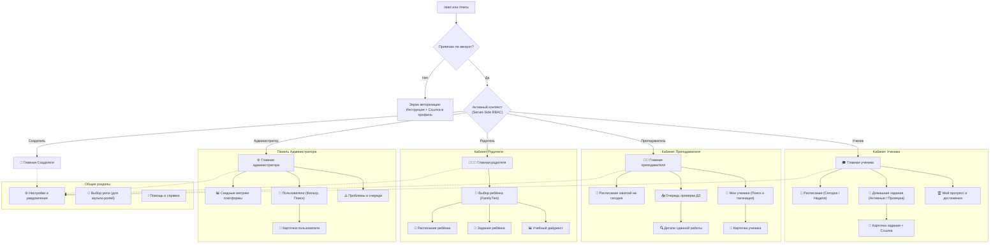

# BooStudy Bot V3 — Спецификация пользовательского интерфейса (UX/UI Spec)

> **Версия:** 3.0.0 (BooStudy Bot V3)  
> **Дата:** 2026-10-23  
> **Целевая аудитория:** Ученики, Преподаватели, Родители, Администраторы, Создатель  

---

## 1. Общие принципы дизайна интерфейса

1. **Telegram-native, а не веб-страница в чате:**
   - Никаких огромных портянок текста на 5 экранов прокрутки.
   - Компактные визуальные карточки с акцентом на самое главное (что нужно знать прямо сейчас).
   - Информативная типографика: полужирные заголовки, смысловые буллеты, точечные эмодзи-маркеры.
2. **Нулевой спам сообщениями:**
   - Каждое действие в меню обновляет текущее сообщение через `edit_message_text`.
   - В чате остаётся чистая история, а бот воспринимается как отзывчивое нативное приложение.
3. **Предсказуемая навигация:**
   - Каждый подэкран содержит кнопку `◀ Назад` (шаг вверх по иерархии) и `🏠 Главная` (быстрый сброс на домашний экран роли).
   - Длинные списки (задания, ученики, работы, пользователи) разбиваются на страницы фиксированного размера (по 4–5 элементов) с компактным навигационным блоком: `[◀ 1/3 ▶]`.
4. **Уважение к часовому поясу:**
   - Все даты и время уроков форматируются согласно часовому поясу пользователя (`UserProfile.timezone` или `Europe/Moscow`).
   - Для ближайших событий выводится относительное время: `«Сегодня, 17:30 (через 1 ч 20 мин)»`.
5. **Пустые состояния (Empty States):**
   - Если уроков нет: не пустота и не ошибка, а понятный статус: `«🎉 На сегодня уроков нет. Отличное время повторить теорию!»`.
   - Если нет ДЗ: `«✨ Все задания выполнены или ещё не назначены»`.

---

## 2. Иерархия экранов по ролям



---

## 3. Детальная спецификация экранов

### 3.1. Непривязанный пользователь (Unlinked)
- **Заголовок:** `🔒 BooStudy · Подключение аккаунта`
- **Текст:**
  ```text
  Здравствуйте! Ваш Telegram-аккаунт пока не привязан к платформе BooStudy.

  Подключите аккаунт, чтобы получать уведомления об уроках, смотреть расписание и управлять заданиями прямо в Telegram.
  ```
- **Кнопки:**
  - `[🔗 Открыть профиль BooStudy]` — URL: `http://127.0.0.1:5000/workspace/profile?telegram=connect`
  - `[🔄 Проверить статус]` — callback: `v3:nav:home`
  - `[ℹ️ Как это работает?]` — callback: `v3:set:help`

---

### 3.2. Кабинет Ученика (`student`)

#### Главный экран ученика
- **Заголовок:** `🎓 Личный кабинет · {Имя}`
- **Информационный блок:**
  - **Ближайший урок:** предмет, преподаватель, время, комната (если доступна).
  - **Задания:** количество требующих сдачи, количество на проверке.
  - **Сводка недели:** завершено уроков, стрик.
- **Инлайн-меню:**
  - `[📅 Расписание уроков]` — `v3:stu:sch:today`
  - `[📝 Мои домашние задания]` — `v3:stu:hw:p:1`
  - `[🏆 Прогресс и успеваемость]` — `v3:stu:prog`
  - `[⚙️ Настройки]` — `v3:set:home`

#### Экран расписания ученика
- **Переключатель:** `[Сегодня]` / `[Ближайшие]`
- **Карточка урока:**
  - Предмет, время (МСК / местное).
  - Имя преподавателя.
  - Кнопка перехода в видеокомнату урока `[🎥 Войти в урок]`.
- **Нижний бар:** `[◀ Назад]` `[🏠 Главная]`

#### Экран домашних заданий ученика
- **Фильтры:** `[Активные]` `[На проверке]` `[Сданные]`
- **Элементы списка:** Название задания, предмет, дедлайн, статус (🟢 Сдано, 🟡 На проверке, 🔴 Просрочено).
- **Пагинатор:** `[◀ Назад] [ 1 / 3 ] [Вперёд ▶]`
- **Карточка задания (при клике):** Детали, комментарий преподавателя, ссылка на платформу `[💻 Открыть на сайте]`.

---

### 3.3. Кабинет Преподавателя (`teacher`)

#### Главный экран преподавателя
- **Заголовок:** `👨‍🏫 Преподавательская · {Имя}`
- **Информационный блок:**
  - Занятия сегодня (количество и ближайшее).
  - Очередь на проверку (сколько работ ждут проверки).
  - Активных учеников.
- **Инлайн-меню:**
  - `[📅 Расписание на сегодня]` — `v3:tch:sch`
  - `[📥 Очередь проверки ДЗ (N)]` — `v3:tch:q:p:1`
  - `[👥 Мои ученики]` — `v3:tch:st:p:1`
  - `[⚙️ Настройки]` — `v3:set:home`

#### Очередь проверки работ
- **Список:** Ученик, название задания, дата сдачи, статус.
- **Пагинатор:** По 4 работы на страницу.
- **Карточка работы:** Дата сдачи, ответы ученика, прямая ссылка `[📝 Проверить в BooStudy]`.

#### Список учеников
- Компактный список учеников с пагинацией.
- Поиск ученика по имени.
- Карточка ученика: статус, следующий урок, выполненные задания, контакт.

---

### 3.4. Кабинет Родителя (`parent`)

#### Главный экран родителя
- **Заголовок:** `👨‍👩‍👧 Родительский кабинет · {Имя}`
- **Информационный блок:**
  - Список привязанных детей (подтверждённые `FamilyTies`).
  - Ближайшие уроки детей.
- **Инлайн-меню:**
  - Для каждого ребёнка: `[👧 {Имя ребёнка}]` — `v3:par:ch:sel:{id}`
  - `[⚙️ Настройки]` — `v3:set:home`

#### Карточка ребёнка
- **Сводка:** Расписание, домашние задания, последние результаты тестов, дайджест активности.
- **Кнопки:**
  - `[📅 Расписание ребёнка]`
  - `[📝 Задания]`
  - `[📊 Дайджест успеваемости]`
  - `[◀ Назад к списку детей]`

---

### 3.5. Операционная панель Администратора (`admin`)

#### Главный экран администратора
- **Заголовок:** `⚙️ Панель управления · {Имя}`
- **Краткие метрики платформы:**
  - Всего пользователей (ученики, учителя, родители).
  - Занятий проведено за неделю / сегодня.
  - Домашних заданий в работе.
  - Состояние очередей Telegram-доставок.
- **Инлайн-меню:**
  - `[📊 Сводные метрики]` — `v3:adm:metrics`
  - `[👥 Пользователи (фильтр и поиск)]` — `v3:adm:u:p:1:all`
  - `[⚠️ Очереди и проблемы]` — `v3:adm:probs`
  - `[⚙️ Настройки бота]` — `v3:set:home`

#### Экран управления пользователями (заменяет старый список из 717 человек)
- **Фильтры по ролям:** `[Все]` `[Ученики]` `[Учителя]` `[Родители]` `[Админы]`
- **Пагинатор:** По 5 пользователей на страницу (ID, username, роль, статус Telegram).
- **Карточка пользователя:** ID, email, имя, роль, привязанный Telegram, дата регистрации.

---

### 3.6. Кабинет Создателя (`creator`)

#### Главный экран Создателя
- **Заголовок:** `👑 Кабинет Создателя · {Имя}`
- **Текущий режим:** `🌟 Режим Создателя (Управление платформой)` или `👨‍🏫 Режим Преподавателя (Учебный процесс)`
- **Кнопка быстрого переключения:**
  - `[🔄 Переключить в режим Преподавателя]` / `[🔄 Переключить в режим Создателя]`
- **Инлайн-меню:**
  - `[📊 Операционный дашборд]` — `v3:adm:metrics`
  - `[👥 Управление пользователями]` — `v3:adm:u:p:1:all`
  - `[👨‍🏫 Перейти в кабинет Преподавателя]` — `v3:tch:home`
  - `[🎓 Перейти в кабинет Ученика]` — `v3:stu:home`
  - `[⚙️ Настройки]` — `v3:set:home`

---

### 3.7. Общие настройки и помощь (`settings`)

#### Главный экран настроек
- **Информация:** Логин в BooStudy, текущая активная роль, часовой пояс, статус уведомлений.
- **Кнопки:**
  - `[🔔 Настройка категорий уведомлений]` — `v3:set:notif:menu`
  - `[🔄 Сменить роль]` (если ролей несколько) — `v3:ctx:menu`
  - `[ℹ️ Справка и команды]` — `v3:set:help`
  - `[🔓 Отвязать Telegram-аккаунт]` — `v3:set:unlink:ask`
  - `[🏠 Главная]` — `v3:nav:home`

#### Настройка уведомлений
- Интерактивные toggle-кнопки (сохраняются сразу в `UserProfile`):
  - `[✅ Напоминания об уроках]` / `[❌ Напоминания об уроках]`
  - `[✅ Проверка домашних заданий]` / `[❌ Проверка домашних заданий]`
  - `[✅ Новые назначения уроков]` / `[❌ Новые назначения уроков]`
  - `[✅ Новости платформы]` / `[❌ Новости платформы]`

#### Отвязка аккаунта
- Обязательный экран подтверждения: `«Вы уверены, что хотите отвязать Telegram? Уведомления перестанут приходить.»`
- Кнопки: `[Да, отвязать]` (`v3:set:unlink:do`) и `[Отмена]` (`v3:set:home`).
