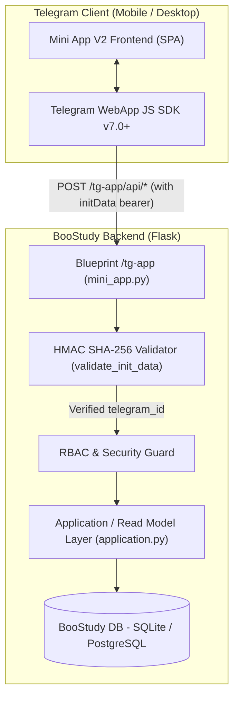

# BooStudy Telegram Mini App V2 — Архитектурная спецификация

**Версия документа:** 2.0.0  
**Статус:** Реализовано / Готово к приёмке  
**Дата:** 24 октября 2026  
**Подсистема:** `app/telegram/mini_app.py`, `templates/telegram/mini_app.html`, `app/telegram/application.py`

---

## 1. Введение и продуктовое позиционирование

**BooStudy Telegram Mini App V2 (TMA V2)** — это официальный мобильный клиент образовательной платформы BooStudy, функционирующий внутри Telegram WebView (Telegram WebApp).

### Трёхуровневая экосистема BooStudy Telegram:
1. **BooStudy Bot V3** — интерфейс мгновенных действий: текстовые карточки, быстрый приём команд, смена настроек, подтверждение кодов привязки, ролевые inline-меню.
2. **Mini App V2** — полноценный мобильный рабочий кабинет: визуальный календарь уроков, карточки домашних заданий с фильтрацией по статусам жизненного цикла, проверка работ для преподавателей, сводки успеваемости для родителей, операционный центр для администратора и создателя.
3. **BooStudy Web / BooStudy OS (`http://127.0.0.1:5000/` / production)** — полнофункциональная настольная образовательная среда: видеокомнаты уроков, интерактивные редакторы кода, сдача сложных работ и комплексная аналитика.

---

## 2. Архитектура подсистемы

---

## 3. Модель безопасности и авторизации (Authentication & Security)

### 3.1. Валидация Telegram `initData`
Каждый запрос к эндпоинтам `/tg-app/api/*` обязан содержать строку `initData`, сгенерированную клиентом Telegram.

1. **HMAC-SHA256 подпись:**
   - Секретный ключ вычисляется как `HMAC_SHA256(b"WebAppData", bot_token)`.
   - `data_check_string` формируется из всех полей `initData` (кроме `hash`), отсортированных лексикографически по ключам в формате `key=value\n`.
   - Вычисленный хэш сверяется с переданным `hash` через безопасное сравнение `hmac.compare_digest`.
2. **Проверка срока жизни (`auth_date`):**
   - Максимальный возраст `auth_date` ограничен `TELEGRAM_INIT_DATA_MAX_AGE` (по умолчанию 86400 сек / 24 часа; bounded от 60 до 604800 сек).
   - Защита от future timestamps (`auth_date > now + 60s`).
3. **Привязка к профилю платформы:**
   - По `telegram_id` из валидированного объекта `user` выполняется поиск в таблице `UserProfiles.telegram_chat_id`.
   - Если профиль не найден, возвращается ошибка `not_linked` (HTTP 404).
   - Если аккаунт заблокирован или деактивирован, запрос отклоняется (HTTP 403).
4. **Защита от XSS / CSRF:**
   - Mini App работает в режиме `SameOrigin / Telegram WebApp iframe`.
   - Токены бота никогда не передаются во frontend.
   - Все текстовые поля экранируются на клиенте и сервере.

---

## 4. Ролевая матрица и контексты (RBAC)

Mini App использует централизованный сервисный слой `app/telegram/application.py`. Доступные контексты строго контролируются правами пользователя:

| Контекст | Допустимые роли BooStudy | Основные разделы в Mini App V2 |
| :--- | :--- | :--- |
| **`student`** | `student` | Главная, Расписание, Домашние задания, Прогресс, Профиль |
| **`teacher`** | `teacher`, `tutor`, `creator` | Главная, Очередь проверки, Ученики, Расписание, Профиль |
| **`parent`** | `parent` | Главная, Дети (сводка/детали), Расписание, Профиль |
| **`admin`** | `admin`, `chief_admin`, `creator` | Главная, Проблемы/Репорты, Поиск пользователей, Доставка, Профиль |
| **`creator`** | `creator`, `chief_admin` | Главная, Аналитика платформы, Рассылки, Баг-репорты, Режим Учителя |

### Переключение контекста Создателя (Creator Mode):
Создатель (`creator`) имеет возможность на лету переключаться между управленческим кабинетом (`creator`) и преподавательским (`teacher`) через кнопку в шапке Mini App или эндпоинт `/tg-app/api/context/switch`. Состояние сохраняется на сервере.

---

## 5. Спецификация API эндпоинтов TMA V2

Все API-запросы выполняются методом `POST` с заголовком `Content-Type: application/json` и телом `{"init_data": "...", ...}`.

| Маршрут | Метод | Описание | Возвращаемые данные |
| :--- | :---: | :--- | :--- |
| `/tg-app/` | `GET` | HTML-оболочка Mini App | Рендерит шаблон `templates/telegram/mini_app.html` |
| `/tg-app/api/bootstrap` | `POST` | Единый стартовый запрос (профиль + контекст + дашборд) | `{user, context, today, notifications}` |
| `/tg-app/api/home` | `POST` | Ролевой Action Center и сводка | `{context, lessons, assignments, actions, ...}` |
| `/tg-app/api/context` | `POST` | Получение активного и доступных контекстов | `{active_context, available_contexts, timezone}` |
| `/tg-app/api/context/switch`| `POST` | Переключение роли создателя (teacher <-> creator) | `{active_context}` |
| `/tg-app/api/student/assignments` | `POST` | Список заданий ученика с фильтром категорий | `{assignments: [{id, title, status, category, deadline, percentage, url}]}` |
| `/tg-app/api/student/schedule` | `POST` | Расписание уроков ученика | `{schedule: [{lesson_id, topic, starts_at, duration, status, lesson_url}]}` |
| `/tg-app/api/progress` | `POST` | Аналитика успеваемости ученика | `{pending_homework, submissions, gradebook}` |
| `/tg-app/api/teacher/review-queue` | `POST` | Очередь проверки работ преподавателя | `{items: [{submission_id, student_name, assignment_title, submitted_at, deep_link}]}` |
| `/tg-app/api/teacher/students` | `POST` | Список прикреплённых учеников с поиском | `{students: [{student_id, name, active_assignments, in_review, deep_link}]}` |
| `/tg-app/api/teacher/schedule` | `POST` | Расписание уроков преподавателя | `{schedule: [{lesson_id, topic, starts_at, duration, status, student_name}]}` |
| `/tg-app/api/parent/children-summary` | `POST` | Сводка по подтверждённым детям | `{children: [{student_id, name, next_lesson, active_assignments, overdue_assignments}]}` |
| `/tg-app/api/parent/digest` | `POST` | Недельный дайджест успеваемости ребёнка | `{digest: {completed_count, active_count, overdue_count, latest_results}}` |
| `/tg-app/api/parent/context/switch` | `POST` | Выбор активного ребёнка | `{selected_student_id}` |
| `/tg-app/api/operations/summary` | `POST` | Метрики платформы для администратора | `{users, active_students, pending_reviews, open_bug_reports, pending_deliveries, ...}` |
| `/tg-app/api/operations/problems` | `POST` | Список нерешённых баг-репортов | `{problems: [{id, title, severity, status, created_at, deep_link}]}` |
| `/tg-app/api/operations/users/search` | `POST` | Быстрый поиск пользователей | `{users: [{user_id, username, role, deep_link}]}` |
| `/tg-app/api/profile` | `POST` | Данные профиля и статус подписки | `{profile: {id, username, name, email, subscription, unlink}}` |
| `/tg-app/api/profile/notifications` | `POST` | Чтение и изменение настроек уведомлений | `{notifications: {telegram_notifications_enabled, tg_notify_*}}` |
| `/tg-app/api/creator/stats` | `POST` | Расширенная статистика создателя (кросс-БД) | `{stats: {total_users, active_students, tg_linked, lessons_today, ...}}` |
| `/tg-app/api/creator/broadcasts` | `POST` | История рассылок создателя | `{broadcasts: [{broadcast_id, message_preview, status, sent_ok, total_planned}]}` |
| `/tg-app/api/broadcast/create` | `POST` | Запуск новой рассылки создателя | `{ok: true, broadcast_id, status}` |
| `/tg-app/api/creator/bug-reports/reply` | `POST` | Ответ на баг-репорт с отправкой в Telegram | `{ok: true, report_id, status}` |

---

## 6. Механизм Deep Linking

Mini App V2 поддерживает глубокие ссылки как через query-параметры браузера, так и через Telegram `startapp` (`tg.initDataUnsafe.start_param`):

1. **Формат параметров:**
   - `startapp=hw_123` -> открывает вкладку заданий и подсвечивает задание #123.
   - `startapp=lesson_45` -> открывает расписание на дате урока #45.
   - `startapp=review` -> открывает вкладку очереди проверки преподавателя.
   - `startapp=child_12` -> выбирает ребёнка #12 в родительском кабинете.
   - `startapp=profile` -> открывает вкладку профиля и настроек уведомлений.
2. **Серверная верификация прав:**
   Клиент передаёт целевой объект, но сервер заново валидирует права доступа пользователя перед выдачей данных. Прямой IDOR через подмену параметров в URL исключён.
