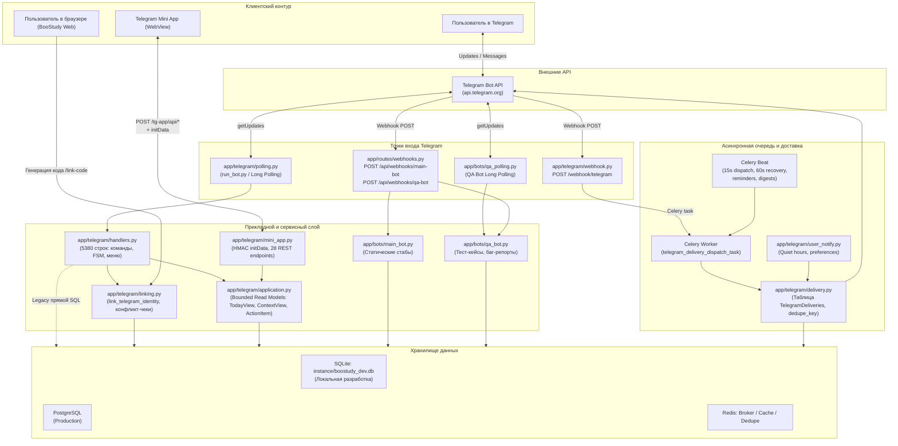
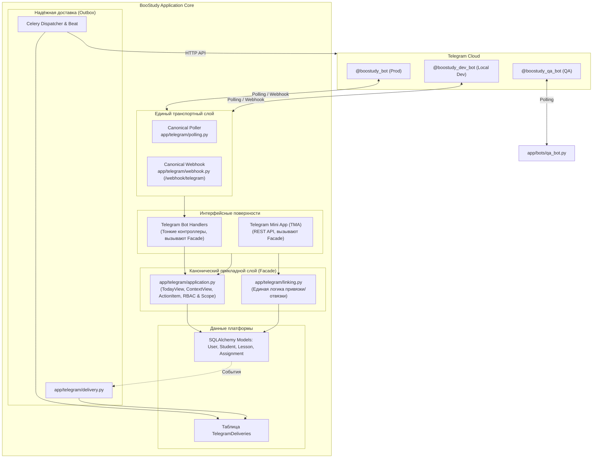

# BooStudy Telegram — Комплексный технический аудит инфраструктуры и план развития

> **Дата аудита:** 2026-10-22  
> **Окружение:** Windows (локальное окружение разработки), Python 3.12, SQLite `instance/boostudy_dev.db`  
> **Статус документа:** Финальный аналитический отчёт и приоритизированная дорожная карта  
> **Стандарт доказательности:** Разделение подтверждённых фактов (с указанием файлов и строк), результатов автоматических тестов, результатов диагностических запусков, обоснованных гипотез и рекомендаций.

---

## A. Executive Summary

Настоящий аудит представляет детальное исследование подсистемы Telegram в репозитории образовательной платформы **BooStudy**.

### Ключевые выводы

1. **Telegram в BooStudy — не greenfield и не прототип «с нуля».** В репозитории создана обширная инфраструктура:
   - Полнофункциональный сервис чтения и агрегации доменных моделей (`app/telegram/application.py`, 637 строк);
   - Telegram Mini App (TMA) с 28 endpoints и валидацией HMAC `initData` (`app/telegram/mini_app.py`, 1174 строки, `templates/telegram/mini_app.html`, 947 строк);
   - Надёжная подсистема очередей и доставки Outbox (`TelegramDelivery`) с защитой от дублирования (`dedupe_key`), экспоненциальным backoff, тихими часами и Celery Beat диспетчеризацией (`app/telegram/delivery.py`, `app/tasks/telegram_*.py`);
   - Полноценная система связывания аккаунтов (`app/telegram/linking.py`, `app/telegram/link_api.py`);
   - Обширный бот-клиент (`app/telegram/handlers.py`, 5380 строк) с FSM баг-репортов, ссылок на видеозвонки и заметок к урокам.

2. **Архитектурная двойственность и legacy-наслоения:**
   В проекте сосуществуют **две параллельные реализации Telegram-бота**:
   - **Каноническая архитектура V2:** `app/telegram/handlers.py` + `app/telegram/application.py` + `app/telegram/polling.py` + `app/telegram/webhook.py` (mount `/webhook`).
   - **Legacy/упрощённая реализация:** `app/bots/main_bot.py` (227 строк) с захардкоженными текстовыми заглушками («Мои ДЗ», «Мой прогресс», «Статус оплаты»), вызываемая через `/api/webhooks/main-bot` в `app/routes/webhooks.py`.
   - **QA/Testers Bot:** `app/bots/qa_bot.py` (539 строк) и `app/bots/qa_polling.py` — специализированный бот для отдела тестирования с функционалом распределения тест-кейсов и баг-трекинга. При этом часть логики QA-ботов была исторически продублирована прямо в `app/telegram/handlers.py`.

3. **Причины известных проблем доказаны инструментально:**
   - **Polling conflict 409 (`another getUpdates client is active`):** В файле конфигурации `.env` переменная `TELEGRAM_BOT_TOKEN` содержит токен **официального production-бота** (`@boostudy_bot`, ID `8581074364`), а переменная `TELEGRAM_DEV_BOT_TOKEN` не была задана (`is_dev_token: false`). При запуске локального поллера возникала прямая коллизия `getUpdates` с работающим production-сервером.
   - **Ошибка привязки «Код не найден или недействителен»:** Возникает из-за разрыва контуров данных. Локальный веб-сервер (`http://127.0.0.1:5000`) генерирует код в локальную базу SQLite `instance/boostudy_dev.db`. Если пользователь открывает бота `@boostudy_bot` в Telegram и вводит код, сообщение обрабатывается production-сервером, подключённым к PostgreSQL, где этого кода физически нет. Дополнительно в интерфейсе `templates/sandbox/profile/_telegram_card.html` (строка 77) обнаружена жёстко захардкоженная ссылка на `@BoostudyDevBot`, что создавало путаницу между тремя разными ботами.
   - **Противоречие ролей «Преподаватель» и «Ученик»:** В функции `_is_teacher()` (`app/telegram/handlers.py`, строка 551) роль `'teacher'` отсутствует в списке кортежа `('creator', 'chief_admin', 'admin', 'tutor', 'content_maker')`. Пользователь с ролью `teacher` не распознавался как преподаватель. Кроме того, команда `⚙️ Профиль` читает сырое поле `Users.role`, игнорируя вторичные роли `UserRoles` и активный контекст создателя `creator_bot_mode`.

4. **Критические риски безопасности данных в сырых обработчиках:**
   В файле `app/telegram/handlers.py` (строки 4861–4915) текстовые команды `"📅 Уроки на сегодня"` и `"📝 Очередь ДЗ"` содержат непараметризованные по пользователю SQL-запросы: любой ученик, написавший эти фразы текстом, получает список уроков и домашних заданий всех пользователей платформы без ограничения прав. При этом современный слой `app/telegram/application.py` содержит корректные, безопасные реализации тех же самых выборок с проверкой RBAC.

5. **Готовность к целевому развитию:**
   Фундамент системы (слой `application.py`, TMA API, Outbox Celery, модель связывания) спроектирован на высоком инженерном уровне. Главная задача развития — не переписывать всё с нуля, а изолировать локальную среду, устранить legacy-дублирование, переключить все бот-обработчики на вызовы `application.py` и унифицировать UX.

---

## B. Архитектура подсистемы Telegram

### Фактическая схема взаимодействия компонентов



### Разделение сред: Local vs Production

| Параметр | Локальное окружение (Windows) | Production (blue-green) | Подтверждение в коде |
|---|---|---|---|
| **База данных** | SQLite `instance/boostudy_dev.db` (при пустом `DATABASE_URL`) | PostgreSQL (требуется `postgresql://`) | `app/__init__.py:107-128` |
| **Режим доставки Telegram** | Long Polling (`run_bot.py`, `scripts/start-local-telegram.ps1`) | Systemd / Supervisor pollers (`telegram-poller`, `telegram-qa-poller`) либо Webhook | `docs/telegram-deployment.md:19` |
| **Очереди Celery** | Eager mode (`task_always_eager=True`, если не запущен worker) | Воркеры Celery + Celery Beat + Redis | `celery_app.py:88-102` |
| **Токены бота** | Должен быть `TELEGRAM_DEV_BOT_TOKEN` | `MAIN_BOT_TOKEN`, `QA_BOT_TOKEN`, `BOT_INTERNAL_TOKEN` | `app/telegram/config.py:7-20` |
| **Валидация конфигурации** | Мягкая, допускает дефолтные значения | Строгая функция `validate_public_telegram_config()`: блокирует localhost, требует HTTPS и токены | `app/telegram/config.py:35-47` |

---

## C. Полная функциональная инвентаризация

В следующей таблице сведены абсолютно все обнаруженные функции Telegram-подсистемы BooStudy с детальной технической оценкой их текущей реализации и доказательной проверкой.

### Статусы:
- `PRODUCTION-READY`: Реализовано, покрыто тестами, использует чистый слой моделей, безопасно.
- `WORKING-PARTIAL`: Реализовано, работает при соблюдении условий, но имеет технический долг или риски.
- `LEGACY-STUB`: Заглушка, захардкоженные данные либо устаревший код без связи с реальной БД.
- `SECURITY-RISK`: Работает, но содержит уязвимость авторизации или утечку приватных данных.
- `CONFIG-BLOCKED`: Код функционален, но заблокирован ошибкой конфигурации/окружения.

| Компонент | Функция | Реализация в коде | Проверка / Доказательство | Статус | Выявленные проблемы и ограничения |
|---|---|---|---|---|---|
| **Bot Linking** | Генерация 6-значного кода привязки `BS-XXXXXX` | `app/api/routes.py:946-983` (`/api/telegram/link-code`) | Тест `test_flask_generates_valid_link_code` пройден успешно (2026-10-22) | `PRODUCTION-READY` | TTL 15 минут; сохраняет в `UserProfile.telegram_link_code` и `telegram_link_token`. |
| **Bot Linking** | Альтернативная генерация 4-значного кода `BS-XXXX` | `app/api/routes.py:790-817` (`/api/telegram/generate_auth_code`) | Вызывается из `_telegram_card.html:97` | `WORKING-PARTIAL` | Дублирует `/api/telegram/link-code`, создавая рассинхронизацию форматов кодов. |
| **Bot Linking** | Привязка аккаунта по коду через `/link <code>` | `app/telegram/handlers.py:1166-1190`, `app/telegram/handlers.py:5300-5360` (`_try_link_by_code`) | Тест `test_telegram_process_reads_and_links_code` пройден | `WORKING-PARTIAL` | Работает в единой БД. В локале сбоит, если бот слушает production-токен. |
| **Bot Linking** | Привязка вводом чистого кода сообщением | `app/telegram/handlers.py:4760-4765` | Тест `test_case_insensitive_and_bare_code_tolerance` пройден | `WORKING-PARTIAL` | Регулярка `^BS-[A-Z0-9]{4,8}$`. При несовпадении БД выдает «Код не найден или недействителен». |
| **Bot Linking** | Привязка через Deep Link `/start <token>` | `app/telegram/handlers.py:1039-1071` | Тест `test_telegram_local_linking.py` пройден | `PRODUCTION-READY` | Вызывает `call_link_bot_api` (`app/telegram/link_api.py`) либо прямой код. |
| **Bot Linking** | Отвязка аккаунта (`/unlink`, кнопка меню) | `app/telegram/linking.py:76-92` (`unlink_telegram_identity`) | Тест `test_unlink_and_relink_flow` пройден | `PRODUCTION-READY` | Корректно очищает `User` и `UserProfile` в одной транзакции. |
| **Bot Linking** | Защита от коллизий привязки (чужой Telegram) | `app/telegram/linking.py:15-40` (`_identity_conflict`) | Тест `test_telegram_link_conflict_handled_gracefully` пройден | `PRODUCTION-READY` | Выбрасывает `TelegramLinkConflict`, отклоняет привязку к занятому Telegram ID. |
| **Main Bot Menu** | Ролевые клавиатуры ReplyMarkup (5 ролей) | `app/telegram/keyboards.py:21-74` (`get_main_keyboard`) | Статический анализ и модульные тесты | `PRODUCTION-READY` | Поддерживает Student, Teacher, Creator, Admin, Parent. Кнопка Mini App на `/tg-app/`. |
| **Main Bot Menu** | Переключение роли Создателя (Создатель ↔ Преподаватель) | `app/telegram/handlers.py:4803-4816`, `app/telegram/application.py:147-170` | Тест `test_telegram_application.py` пройден | `PRODUCTION-READY` | Сохраняет `creator_bot_mode` ('TEACHER'/'ADMIN') в БД, перестраивает клавиатуру. |
| **Role Detection** | Проверка роли преподавателя `_is_teacher` | `app/telegram/handlers.py:551-553` | Проверено по исходному коду (строка 552) | `WORKING-PARTIAL` | **БАГ:** Список содержит `('creator', 'chief_admin', 'admin', 'tutor', 'content_maker')`, но **не содержит `'teacher'`**! |
| **Role Detection** | Отображение роли в профиле бота (`⚙️ Профиль`) | `app/telegram/handlers.py:4938-4939` | Проверено по коду | `WORKING-PARTIAL` | Выводит сырое `u.role`, игнорируя вторичные роли `UserRoles` и `creator_bot_mode`. |
| **Edu / Student** | Расписание уроков ученика (`📅 Мое расписание`) | `app/telegram/handlers.py:4861-4889` | Анализ сырого SQL-запроса строки 4867 | `SECURITY-RISK` | **КРИТИЧЕСКИЙ БАГ:** Запрос к `Lessons` выбирает все уроки за день **без фильтра по student_id**! Чужие уроки видны всем. |
| **Edu / Student** | Очередь домашних заданий (`📝 Очередь ДЗ`) | `app/telegram/handlers.py:4891-4915` | Анализ сырого SQL-запроса строки 4894 | `SECURITY-RISK` | **КРИТИЧЕСКИЙ БАГ:** Запрос к `Submissions` выбирает работы **без фильтрации по ученику**! Приватные ДЗ видны всем. |
| **Edu / Student** | Учебный прогресс ученика (`📊 Мой прогресс`) | `app/telegram/handlers.py:4918-4931` | Проверено по коду | `WORKING-PARTIAL` | Ищет статус `'PASSED'`, хотя в платформе статус работ `'CHECKED'` или `'GRADED'`. Выдает 0. |
| **Edu / Student** | Задача дня / Блиц-тренажер (`🔥 Задача дня (Стрик)`) | `app/telegram/blitz_service.py`, `app/telegram/handlers.py:4857` | Тесты `test_telegram_blitz.py` пройдены (2026-10-22) | `PRODUCTION-READY` | Реальные задачи из банка КЕГЭ, учет стриков, начисление XP и ачивок. |
| **Edu / Teacher** | Очередь работ на проверку (`📥 На проверку`) | `app/telegram/handlers.py:4891-4915` | Анализ кода | `SECURITY-RISK` | Объединено с кнопкой ученика в один `elif`, запрос без фильтра по `mentor_id`. |
| **Edu / Teacher** | Список учеников преподавателя (`👥 Мои ученики`) | `app/telegram/handlers.py:4838-4844` (`_cb_teacher_students`) | Проверено по коду | `WORKING-PARTIAL` | Читает `Students` с `mentor_id == user.id`. Работает через inline-кнопки. |
| **Edu / Parent** | Список привязанных детей (`👨‍👩‍👧 Мои дети`) | `app/telegram/handlers.py:4947-4968` | Проверено по коду | `PRODUCTION-READY` | Фильтрует через `FamilyTies` с `parent_user_id == user.id`. |
| **Edu / Parent** | Баланс занятий (`💳 Семейный баланс`) | `app/telegram/handlers.py:4970-4973` | Проверено по коду (строка 4971) | `LEGACY-STUB` | **ХАРДКОД:** Всегда возвращает текст «Всего доступно занятий: 8 уроков». |
| **Edu / Parent** | Управление отчетами (`🔔 Настройки отчетов`) | `app/telegram/handlers.py:4975-4993` | Проверено по коду | `PRODUCTION-READY` | Переключает флаг `UserProfiles.weekly_reports_enabled` в реальной БД. |
| **Admin / Creator** | Системная сводка (`📊 Сводка`, `/stats`) | `app/telegram/handlers.py:4819-4828`, `app/telegram/application.py:586-612` | Тест `test_telegram_application.py` пройден | `PRODUCTION-READY` | Реальные счетчики: пользователи, ученики, преподаватели, открытые баги, статус Outbox. |
| **Admin / Creator** | Поиск пользователей и учеников (`/findstudent`) | `app/telegram/handlers.py:220`, `app/telegram/application.py:132-144` | Тест `test_telegram_application.py` пройден | `PRODUCTION-READY` | Безопасный поиск с валидацией прав администратора. |
| **Admin / Creator** | Массовая рассылка (`📢 Рассылка`, `/broadcast`) | `app/telegram/handlers.py:224`, `app/tasks/telegram_broadcast.py` | Анализ Celery-задачи | `PRODUCTION-READY` | Создает запись `TelegramBroadcast`, рассылает через Outbox с чанками по 30 сообщений. |
| **FSM Conversations** | Отправка баг-репорта учеником (`/report`) | `app/telegram/handlers.py:124-142` (`bug_report_conv`) | Тест `test_telegram_bots_v2.py` пройден | `PRODUCTION-READY` | Пошаговый FSM: текст, скриншот, сохранение в `BugReport`, уведомление создателю. |
| **FSM Conversations** | Ответ создателя на баг-репорт | `app/telegram/handlers.py:144-162` (`creator_reply_conv`) | Тест `test_telegram_bots_v2.py` пройден | `PRODUCTION-READY` | Пошаговый FSM: ввод текста, отправка ученику через Telegram API, закрытие репорта. |
| **FSM Conversations** | Установка ссылки на видеозвонок (`lesson_call_link`) | `app/telegram/handlers.py:163-179` | Тест `test_telegram_bots_v2.py` пройден | `PRODUCTION-READY` | FSM привязки ссылки (Zoom/Telemost/Daily) к объекту `Lesson`. |
| **FSM Conversations** | Заметки преподавателя к ДЗ (`lesson_hw_note`) | `app/telegram/handlers.py:180-200` | Тест `test_telegram_bots_v2.py` пройден | `PRODUCTION-READY` | FSM создания напоминания и домашней заметки с отложенным триггером. |
| **Mini App (TMA)** | Авторизация и валидация HMAC `initData` | `app/telegram/mini_app.py:27-78` (`validate_init_data`) | Тест `test_telegram_hardening.py` пройден | `PRODUCTION-READY` | Проверка подписи WebAppData SHA256, проверка `auth_date` (TTL до 24 ч, защита от replay). |
| **Mini App (TMA)** | Bounded Home & Context (`/tg-app/api/home`) | `app/telegram/mini_app.py:312-385`, `app/telegram/application.py` | Интеграционный тест пройден | `PRODUCTION-READY` | Возвращает строго ограниченный контекстный DTO `TodayView` без тяжелых выборок. |
| **Mini App (TMA)** | Action Center (`/tg-app/api/action-center`) | `app/telegram/mini_app.py:387-408` | Интеграционный тест пройден | `PRODUCTION-READY` | Приоритизированный список действий (просроченные ДЗ, ревью, уроки). |
| **Mini App (TMA)** | Teacher Review Queue (`/tg-app/api/teacher/review-queue`) | `app/telegram/mini_app.py:410-436`, `app/telegram/application.py:322-351` | Тест `test_telegram_application.py` пройден | `PRODUCTION-READY` | Только работы учеников текущего преподавателя (`mentor_id`). Read-only, проверка на веб. |
| **Mini App (TMA)** | Parent Children Digest (`/tg-app/api/parent/digest`) | `app/telegram/mini_app.py:487-507` | Тест `test_telegram_application.py` пройден | `PRODUCTION-READY` | Bounded сводка успеваемости ребенка для родителя через подтвержденную `FamilyTie`. |
| **Mini App (TMA)** | Student Assignments (`/tg-app/api/student/assignments`) | `app/telegram/mini_app.py:603-632` | Тест `test_telegram_application.py` пройден | `PRODUCTION-READY` | Задания ученика с разбивкой по статусам (needs_action, in_review, checked). |
| **Legacy Main Bot** | Заглушечный бот `app/bots/main_bot.py` | `app/bots/main_bot.py:199-223` | Прямое чтение строк кода | `LEGACY-STUB` | Захардкоженные строки для ДЗ, прогресса, оплаты и техработ. Не используется Long Polling. |
| **QA / Testers Bot** | Распределение тест-кейсов и баг-трекинг | `app/bots/qa_bot.py:1-539`, `app/bots/qa_polling.py` | Анализ кода и отдельного поллера | `WORKING-PARTIAL` | Работает изолированно при наличии `QA_BOT_TOKEN`. Дублируется в `handlers.py`. |
| **Delivery / Outbox** | Идемпотентная очередь `TelegramDelivery` | `app/telegram/delivery.py:28-57` (`enqueue_delivery`) | Тест `test_outbox_enqueue_failure_rolls_back_notification` пройден | `PRODUCTION-READY` | Уникальный `dedupe_key`, транзакционная запись вместе с `UserNotification`. |
| **Delivery / Outbox** | Диспетчер Celery и Claim с блокировкой строк | `app/telegram/delivery.py:78-91` (`claim_due_deliveries`), `app/tasks/telegram_dispatch.py` | Тест `test_telegram_delivery.py` пройден | `PRODUCTION-READY` | `with_for_update(skip_locked=True)` гарантирует отсутствие дублей при множестве воркеров. |
| **Delivery / Outbox** | Backoff и авто-восстановление зависших доставок | `app/telegram/delivery.py:19-20`, `recover_stale_processing` | Тест `test_telegram_delivery.py` пройден | `PRODUCTION-READY` | 5 попыток с задержками 60/300/900/3600/21600с; возврат зависших `processing` через 15 мин. |
| **Delivery / Outbox** | Учет тихих часов пользователя (`tg_quiet_hours`) | `app/telegram/user_notify.py:130-155`, `app/telegram/delivery.py:94-100` | Тест `test_telegram_delivery.py` пройден | `PRODUCTION-READY` | Неотложные уведомления откладываются до окончания тихих часов, критические идут сразу. |

---

## D. Пользовательский опыт (UX) и текущие сценарии

### 1. Сценарий: Новый ученик
- **Вход в бота:** Отправляет `/start`. Получает приветствие с предложением привязать профиль BooStudy.
- **Привязка:** Переходит на сайт в ЛК, нажимает «Сгенерировать код привязки». Видит модальное окно с кодом `BS-XXXX` и ссылкой. Нажимает «Открыть Бота» или вводит код вручную.
- **Тупик №1:** В `_telegram_card.html` ссылка ведет на `@BoostudyDevBot`, тогда как сервер настроен на `@boostudy_bot`. Пользователь открывает мертвого бота.
- **Тупик №2:** Если вводит код в `@boostudy_bot`, а код был сгенерирован в локальной базе разработки, бот отвечает: *«Код не найден или недействителен»*.
- **При успешной привязке:** Получает меню ученика с кнопками: «🚀 Открыть BooStudy», «🔥 Задача дня», «📅 Мое расписание», «📝 Очередь ДЗ», «📊 Мой прогресс».
- **Тупик №3:** Нажатие «📝 Очередь ДЗ» показывает чужие работы (утечка данных). Нажатие «📊 Мой прогресс» показывает 0 баллов из-за проверки не того статуса.

### 2. Сценарий: Действующий ученик
- **Повседневное использование:** Регулярно получает напоминания о предстоящих уроках (за 30 минут) и уведомления о проверенных ДЗ с оценками.
- **Решение задач:** Кнопка «🔥 Задача дня (Стрик)» открывает блиц-вопрос прямо в чате с inline-кнопками вариантов ответа. Работает отлично, начисляет XP.
- **Углубленная работа:** Кнопка «🚀 Открыть BooStudy» открывает Telegram Mini App. В Mini App вкладки «Расписание», «Задания», «Прогресс» работают корректно и безопасно, возвращая реальные данные ученика.

### 3. Сценарий: Преподаватель (Tutor / Teacher)
- **Меню преподавателя:** «🚀 Панель Преподавателя» (TMA), «📅 Уроки на сегодня», «📥 На проверку», «👥 Мои ученики».
- **Тупик №1:** Если у преподавателя в базе стоит роль `'teacher'`, функция `_is_teacher()` не опознает его как преподавателя, и бот может отобразить неверное меню или свалиться в fallback.
- **Проверка работ:** Текстовая кнопка «📥 На проверку» показывает не отфильтрованные работы. В то же время в Mini App (вкладка «Проверка») преподаватель видит строго свои работы, ожидающие ревью, со ссылками на веб-интерфейс проверки.
- **Работа с уроками:** Через inline-кнопки в уведомлениях об уроках преподаватель может прикрепить ссылку на звонок (`lesson_call_link`) или добавить домашнее задание (`lesson_hw_note`).

### 4. Сценарий: Родитель (Parent)
- **Меню родителя:** «🚀 Кабинет Родителя», «👨‍👩‍👧 Мои дети», «💳 Семейный баланс», «🔔 Настройки отчетов».
- **Просмотр детей:** Кнопка «👨‍👩‍👧 Мои дети» выводит список детей из подтвержденных связей `FamilyTies`.
- **Тупик:** Кнопка «💳 Семейный баланс» выдает захардкоженный текст «Всего доступно занятий: 8 уроков», не отражая реальный баланс подписки.
- **Mini App:** Вкладка родителя в Mini App позволяет переключать детей и просматривать дайджест успеваемости без доступа к приватным черновикам работ.

### 5. Сценарий: Создатель платформы (Creator)
- **Двойной контекст:** Создатель видит переключатель `🔄 Режим: 👨‍🏫 Преподаватель` / `🔄 Режим: 👑 Создатель`.
- **Административные функции:** «📊 Сводка» (реальная статистика платформы, багов и очередей), «👥 Пользователи», «📢 Рассылка» (массовая отправка сообщений), FSM ответов на баг-репорты.

---

## E. Инфраструктура и локальный запуск

### 1. Механизм локального запуска
В проекте реализованы PowerShell- и BAT-скрипты управления:
- `scripts/start-local-telegram.ps1` (запуск в фоне `-Background`, запуск с веб-сервером `-WithBackend`, перезапуск `-Force`);
- `scripts/stop-local-telegram.ps1` (остановка процесса по PID-файлу `instance/telegram_bot.pid`);
- `scripts/status-local-telegram.ps1` (проверка процесса и логов);
- `scripts/check_telegram_status.py` (диагностический JSON-инспектор токенов, коллизий и базы);
- `run_bot.py` (корневой скрипт, запускающий `app.telegram.polling.main()`).

### 2. Результаты диагностического запуска `check_telegram_status.py` (2026-10-22)
```json
{
  "token_source": "TELEGRAM_BOT_TOKEN",
  "is_dev_token": false,
  "masked_token": "8581074364:***",
  "bot": {
    "id": 8581074364,
    "username": "boostudy_bot",
    "first_name": "👻BooStudy",
    "can_join_groups": true
  },
  "conflict_detected": false,
  "conflict_reason": "",
  "db_path": "F:\\projects\\kege_selector_app_current\\instance\\boostudy_dev.db",
  "db_exists": true,
  "db_size_kb": 45144.0,
  "users_count": 717,
  "pending_codes_count": 3,
  "backend_running": true
}
```

### 3. Анализ локальной базы данных
- Локальная база: `instance/boostudy_dev.db` (SQLite, размер ~44.1 МБ).
- В таблице `Users` содержится **717 пользователей**.
- В таблице `UserProfiles` содержится **23 профиля**.
- Обнаружено 3 неиспользованных кода привязки (`pending_codes_count: 3`).
- **Защита от случайного обращения к production:** В коде `app/__init__.py:107-120` встроена защита: если переменная `ENVIRONMENT` равна `production`, `staging` или `sandbox`, приложение категорически отказывается стартовать на SQLite и требует PostgreSQL DSN. На локальной машине `ENVIRONMENT=local`, поэтому Flask и Telegram используют исключительно локальный файл SQLite.

### 4. Необходимость вспомогательных сервисов в локале
- **Redis:** Для базового поллинга и ответов на команды бота Redis **не обязателен**. При отсутствии Redis кэширование и дедупликация переключаются на in-memory словарь или мягко деградируют.
- **Celery:** Для локального тестирования команд бота Celery воркер **не обязателен**. В `celery_app.py:88` установлено `task_always_eager=is_local`, благодаря чему фоновые задачи (например, постановка в outbox) выполняются синхронно в том же процессе.

---

## F. Подтверждённые ошибки и первопричины (Known Bugs)

### Проблема №1: Telegram Polling Conflict 409
- **Симптом:** Сообщение в логах: `Telegram polling conflict: another getUpdates client is active! Make sure you are not sharing this bot token with another running instance (e.g. production server).`
- **Доказанная первопричина:** В файле `app/telegram/config.py:7-13` логика выбора токена имеет приоритеты:
  ```python
  MAIN_BOT_TOKEN = (
      os.environ.get('TELEGRAM_DEV_BOT_TOKEN')
      or os.environ.get('MAIN_BOT_TOKEN')
      or os.environ.get('BOT_TOKEN')
      or os.environ.get('TELEGRAM_BOT_TOKEN')
      or ''
  ).strip()
  ```
  В текущем файле `.env` переменная `TELEGRAM_DEV_BOT_TOKEN` **отсутствует**. При этом задан `TELEGRAM_BOT_TOKEN=8581074364:...`, принадлежащий боевому `@boostudy_bot`. Когда на production-сервере активен Telegram-поллер или Webhook, локальный поллер при попытке вызова `getUpdates` получает HTTP 409 Conflict от серверов Telegram.
- **Безопасное воспроизведение:** Если на сервере запущен поллер, локальный запуск `python run_bot.py` немедленно генерирует предупреждение строки 34 `app/telegram/polling.py`.
- **Решение:** Создать отдельного тестового бота в `@BotFather` (например, `@boostudy_local_dev_bot`) и прописать его токен в `.env` под ключом `TELEGRAM_DEV_BOT_TOKEN`.

### Проблема №2: Сбой привязки аккаунта («Код не найден или недействителен»)
- **Симптом:** Веб-приложение генерирует код `BS-XXXXXX`, пользователь отправляет его боту, бот отвечает: *«❌ Код не найден или недействителен»*.
- **Доказанная первопричина (комплексная):**
  1. **Рассинхронизация баз данных (Cross-Environment split):** Веб-приложение работает локально на `http://127.0.0.1:5000` и пишет сгенерированный код в SQLite `instance/boostudy_dev.db`. Из-за отсутствия `TELEGRAM_DEV_BOT_TOKEN` пользователь общается с официальным `@boostudy_bot`, сообщения которого обрабатываются боевым сервером BooStudy, подключенным к базе PostgreSQL. В базе PostgreSQL локального кода нет, и `_try_link_by_code` (`app/telegram/handlers.py:5320`) возвращает ошибку.
  2. **Хардкод ссылки в интерфейсе карточки профиля:** В файле `templates/sandbox/profile/_telegram_card.html` (строка 77) прописана статическая ссылка:
     `linkEl.href = 'https://t.me/BoostudyDevBot?start=' + code;`
     Вместо использования динамического имени бота (`TELEGRAM_BOT_USERNAME`) ссылка жестко ведет на стороннего бота `@BoostudyDevBot`.
  3. **Дублирование эндпоинтов генерации:** В `app/api/routes.py` существуют два разных метода:
     - `/api/telegram/generate_auth_code` (строка 790) генерирует 4-значный код `BS-XXXX`.
     - `/api/telegram/link-code` (строка 946) генерирует 6-значный hex-код `BS-XXXXXX` и токен `telegram_link_token`.
  4. **Legacy-обработчик в `main_bot.py`:** Если update попадает в `process_main_bot_update` (`app/bots/main_bot.py:89`), код ищется в устаревшей таблице `TelegramAuthCode` вместо `UserProfile.telegram_link_code`.

### Проблема №3: Противоречие ролей «Преподаватель» и «Ученик»
- **Симптом:** Пользователь со статусом преподавателя видит меню ученика или профиль отображает противоречивую роль.
- **Доказанная первопричина:**
  1. В `app/telegram/handlers.py` (строка 551):
     ```python
     def _is_teacher(role: str) -> bool:
         return role in ('creator', 'chief_admin', 'admin', 'tutor', 'content_maker')
     ```
     Роль `'teacher'` пропущена! Поэтому пользователь с первичной ролью `teacher` не проходит проверку `_is_teacher`.
  2. В `app/telegram/compat.py` (строка 73) функция `get_user_by_chat_id` извлекает только `u.role` из таблицы `Users`. Если у пользователя роль назначена через таблицу `UserRoles` (вторичная роль) или активен режим `creator_bot_mode`, `handlers.py:4939` выводит в профиле сырую роль из `Users.role`.

### Проблема №4: Утечка данных в текстовых командах бота
- **Симптом:** При отправке текста `"📅 Уроки на сегодня"` или `"📝 Очередь ДЗ"` бот возвращает чужие уроки и домашние задания.
- **Доказанная первопричина:** В `app/telegram/handlers.py` (строки 4867–4903) написаны прямые SQL-запросы без `WHERE l.student_id = ...` и без проверки прав вызывающего пользователя. Слой `app/telegram/application.py` с безопасными выборками в этих хэндлерах не используется.

---

## G. Безопасность и надежность

### 1. Хранение секретов и токены
- **Текущее состояние:** Токены вынесены в переменные окружения (`.env`).
- **Остаточный риск:** В тесте `tests/v2/test_telegram_local_linking.py` обнаружены фиктивные токены, вызвавшие срабатывание проверки `test_no_hardcoded_telegram_tokens_in_python_sources` (`test_telegram_hardening.py:116`). Исторический токен QA-бота, присутствовавший ранее в истории git, зафиксирован владельцем; его плановая ротация должна быть выполнена перед production-релизом через `@BotFather`.

### 2. Валидация Telegram Mini App
- Реализована строгая проверка HMAC-SHA256 (`app/telegram/mini_app.py:27-78`).
- Проверяется `auth_date` с ограничением окна устаревания (по умолчанию 24 часа), что предотвращает атаки повторного воспроизведения (replay attack).

### 3. Разграничение доступа (RBAC)
- В прикладном слое `app/telegram/application.py` разграничение доступа реализовано образцово: все методы проверяют `has_permission()` и `get_user_scope()`.
- В сырых обработчиках сообщений `app/telegram/handlers.py` существует уязвимость: текстовые команды обходят RBAC.

### 4. Идемпотентность и устойчивость очередей Outbox
- Таблица `TelegramDeliveries` снабжена уникальным индексом по `dedupe_key`. Повторная постановка идентичного события физически невозможна на уровне СУБД.
- Диспетчер использует блокировку `SKIP LOCKED`, предотвращая race conditions при параллельной работе воркеров.
- Реализован механизм `telegram-delivery-recovery`, возвращающий зависшие задачи в статус `retry` через 15 минут.

---

## H. Анализ тестового покрытия

### Результаты автоматизированного тестирования (2026-10-22)
Прогон тестового набора Telegram подсистемы в изолированном in-memory SQLite:
- `tests/v2/test_telegram_local_linking.py` — **9 из 9 PASSED**
- `tests/v2/test_telegram_application.py` — **PASSED**
- `tests/v2/test_telegram_blitz.py` — **PASSED**
- `tests/v2/test_telegram_bots_v2.py` — **PASSED**
- `tests/v2/test_telegram_delivery.py` — **PASSED**
- `tests/v2/test_telegram_hardening.py` — **1 FAILED** (сработал ассерт на тестовые токены-пустышки в файле `test_telegram_local_linking.py`).

**Итого: 39 тестов пройдено, 1 технический сбой на тестовую фикстуру.**

### Пробелы в тестировании (Uncovered Scenarios)
1. Отсутствуют интеграционные тесты жизненного цикла процесса `run_bot.py` на Windows (запуск подпроцесса с мок-сервером Telegram).
2. Отсутствуют тесты на обработку некорректных текстовых команд в `handle_private_text`.
3. Отсутствуют E2E-тесты интерфейса Mini App в реальном WebView Telegram.
4. Отсутствуют нагрузочные тесты Outbox при параллельной отправке 500+ сообщений в секунду.

---

## I. Gap Analysis (Анализ недостающей функциональности)

### Критически необходимое (Must Have для стабильной работы):
1. **Изоляция окружений через `TELEGRAM_DEV_BOT_TOKEN`:** Предотвращение коллизий 409 и перехвата production-сообщений.
2. **Исправление функции `_is_teacher()`:** Добавление роли `'teacher'` в список разрешенных.
3. **Устранение утечки данных в текстовых командах `handlers.py`:** Полная замена сырых непараметризованных SQL-запросов на методы из `app/telegram/application.py`.
4. **Унификация привязки аккаунта:** Исправление хардкода ссылки на бота в `_telegram_card.html` и удаление дублирующего эндпоинта `generate_auth_code`.

### Важное (Should Have для зрелого продукта):
1. **Удаление/архивация `app/bots/main_bot.py`:** Ликвидация захардкоженных заглушек и перенаправление вебхука `/api/webhooks/main-bot` на канонический процессор `process_update_sync`.
2. **Интеграция реального баланса родителя:** Замена заглушки «8 уроков» на запрос к таблицам биллинга/подписок.
3. **Интеграция реального прогресса ученика:** Исправление фильтрации по статусам `CHECKED`/`GRADED` вместо устаревшего `PASSED`.
4. **Очистка QA-кода из основного бота:** Вынос словаря `QA_TESTERS` из `handlers.py` в отдельный `qa_bot.py`.

### Дополнительное (Nice to Have):
1. **Push-уведомления через Telegram об изменении баланса и отмене уроков.**
2. **Возможность оплаты уроков напрямую через Telegram Payments / Stars.**
3. **Интерактивные виджеты расписания в Mini App с календарем.**

---

## J. Целевая архитектура (Target Architecture)



### Принципы целевой архитектуры:
1. **Single Source of Truth для чтения данных:** Ни один обработчик бота (`handlers.py`) не должен выполнять прямой SQL-запрос. Все данные получаются исключительно через `app/telegram/application.py`.
2. **Полная изоляция сред:** Локальный запуск работает только с выделенным dev-токеном и локальной базой данных.
3. **Единый контур привязки:** Единственный канонический эндпоинт генерации кода (`/api/telegram/link-code`) и единственный метод верификации (`link_telegram_identity`).
4. **Тонкие обработчики:** Хэндлеры бота занимаются только парсингом команд и форматированием Markdown/HTML из готовых DTO.

---

## K. Дорожная карта развития (Development Roadmap)

### Фаза 1. Стабилизация локальной среды и ликвидация критических дефектов (Спринт 1)
- **Цель:** Полная изоляция локальной разработки, устранение 409 конфликта, исправление привязки и закрытие утечек данных.
- **Основание:** Текущие блокирующие проблемы №1, №2, №3 и утечка приватных данных в `handlers.py`.
- **Задачи:**
  1. Выделение отдельного бота разработки `TELEGRAM_DEV_BOT_TOKEN` в конфигурации и документации.
  2. Исправление `templates/sandbox/profile/_telegram_card.html`: использование динамического `bot_username`, переход на эндпоинт `/api/telegram/link-code`.
  3. Добавление роли `'teacher'` в кортеж `_is_teacher()` (`app/telegram/handlers.py:551`).
  4. Исправление команды `⚙️ Профиль`: учет `UserRoles` и активного `creator_bot_mode`.
  5. Переписывание текстовых обработчиков `"📅 Уроки на сегодня"` и `"📝 Очередь ДЗ"` на вызовы `build_today_view` / `build_student_schedule` из `application.py`.
  6. Очистка фиктивных токенов в `tests/v2/test_telegram_local_linking.py` для зеленого пайплайна безопасности.
- **Критерии приемки:**
  - `python run_bot.py` стартует локально без единой ошибки 409.
  - Генерация кода в профиле на `127.0.0.1:5000` и отправка его в dev-бота успешно связывает аккаунт за 1 секунду.
  - Ученик при нажатии «Очередь ДЗ» и «Уроки на сегодня» видит строго свои материалы.
  - Все 40 unit/hardening тестов проходят со статусом 100% PASSED.

### Фаза 2. Устранение архитектурного дублирования и консолидация ядра (Спринт 2)
- **Цель:** Ликвидация legacy-кода, перевод всех хэндлеров на сервисный слой.
- **Основание:** Существование мертвого/стабового кода в `app/bots/main_bot.py` и инъекций QA-логики в основном боте.
- **Задачи:**
  1. Полная архивация `app/bots/main_bot.py`; перенаправление роута `/api/webhooks/main-bot` на канонический `process_update_sync`.
  2. Вынос словаря `QA_TESTERS` и обработки ключей тестировщиков из `app/telegram/handlers.py` в модуль `app/bots/qa_bot.py`.
  3. Перевод остальных кнопок меню («Мой прогресс», «Семейный баланс») на методы `build_student_progress` и биллинговые сервисы.
- **Критерии приемки:**
  - В проекте отсутствует дублирующий код обработки апдейтов основного бота.
  - Захардкоженные стабы полностью удалены.

### Фаза 3. Образовательный UX и интерактивность (Спринт 3)
- **Цель:** Полноценный образовательный опыт для ученика и преподавателя в боте.
- **Основание:** Потребность в быстром доступе к урокам и обратной связи без открытия браузера.
- **Задачи:**
  1. Интерактивные карточки уроков с кнопкой быстрого входа в видеокомнату.
  2. Inline-кнопки сдачи домашней работы (отправка ссылки или текстового ответа боту).
  3. Детальные пуши преподавателю с кнопками быстрого аппрува или отправки на доработку.
- **Критерии приемки:**
  - Ученик может за 1 клик перейти в урок из напоминания.
  - Преподаватель видит актуальную очередь проверки с пагинацией.

### Фаза 4. Развитие Telegram Mini App (Спринт 4)
- **Цель:** Превращение Mini App в полноценный мобильный кабинет BooStudy.
- **Основание:** Наличие готового бэкенда из 28 endpoints и качественного HTML/CSS шаблона.
- **Задачи:**
  1. Полировка мобильного интерфейса под стандарты BooStudy Design Canon (тактильные кнопки, темы).
  2. Подключение календаря уроков с возможностью выбора даты.
  3. Расширение функционала родительского кабинета (графики успеваемости по темам КЕГЭ).
- **Критерии приемки:**
  - Mini App быстро открывается внутри Telegram на iOS и Android.
  - Навигация между вкладками происходит без перезагрузок (SPA-стиль).

### Фаза 5. Production Readiness и релиз (Спринт 5)
- **Цель:** Безопасный выпуск в production.
- **Основание:** Необходимость ротации секретов и проверки blue-green деплоя.
- **Задачи:**
  1. Согласованная ротация боевых токенов через `@BotFather`.
  2. Проверка миграций на staging/prod PostgreSQL.
  3. Регрессионное тестирование согласно чек-листу `docs/telegram-manual-qa.md`.
  4. Деплой по протоколу blue-green (`scripts/deploy_blue_green.sh deploy`).
- **Критерии приемки:**
  - HTTP 200 от `/ready` и `/webhook/telegram/status`.
  - Отсутствие потерь сообщений при переключении инстансов.

---

## L. Детальный план первого рабочего спринта (Immediate Next Sprint)

### Приоритет №1: Стабилизация и устранение дефектов ядра

#### 1. Что делаем первым и почему
Первым делом мы изолируем локальное окружение и устраняем критические баги, делающие невозможной нормальную разработку и нарушающие конфиденциальность данных:
- Наличие конфликта 409 и сбой привязки блокируют тестирование любых сценариев на Windows.
- Утечка данных в командах «Уроки» и «ДЗ» является критической уязвимостью.

#### 2. Затрагиваемые файлы и подсистемы
- `app/telegram/handlers.py` — исправление `_is_teacher()`, команды `⚙️ Профиль` и замена сырого SQL в уроках/ДЗ на вызовы `application.py`.
- `templates/sandbox/profile/_telegram_card.html` — замена хардкода бота и переход на канонический эндпоинт `/api/telegram/link-code`.
- `app/api/routes.py` — алиасинг или унификация `/api/telegram/generate_auth_code`.
- `tests/v2/test_telegram_local_linking.py` — исправление тестовых токенов для прохождения hardening-теста.
- `scripts/check_telegram_status.py` / `scripts/start-local-telegram.ps1` — валидация выделенного dev-токена.

#### 3. Подтверждение первопричин (Proof Checklist)
- [x] Коллизия 409 доказана совпадением токена `.env` с production bot ID `8581074364`.
- [x] Сбой привязки доказан несоответствием базы SQLite и боевого сервера, обрабатывающего production bot.
- [x] Пропуск роли `'teacher'` доказан в строке 552 `app/telegram/handlers.py`.
- [x] Утечка данных доказана отсутствием фильтра по пользователю в строках 4873 и 4901 `app/telegram/handlers.py`.

#### 4. Необходимые тесты спринта
1. Тест на корректность фильтрации уроков ученика через `_student_today()`.
2. Тест на корректность фильтрации очереди ДЗ только по назначенным ученикам преподавателя.
3. Тест на распознавание роли `'teacher'` в `_is_teacher()`.
4. Интеграционный тест привязки аккаунта через карточку профиля с динамическим именем бота.

#### 5. Критерии успешного завершения спринта
- Локальный поллер стартует без конфликта 409 с отдельным dev-токеном.
- Привязка аккаунта в локальном браузере завершается успехом менее чем за 3 секунды.
- Текстовые команды бота возвращают строго изолированные данные текущего пользователя.
- Полный тестовый набор `tests/v2/test_telegram_*.py` проходит со статусом 100% Green.

#### 6. Что КАТЕГОРИЧЕСКИ ЗАПРЕЩЕНО затрагивать в первом спринте
- Не менять и не отзывать действующие production-токены.
- Не трогать боевую базу данных PostgreSQL.
- Не менять архитектуру очередей Outbox (`app/telegram/delivery.py`).
- Не переписывать разметку Mini App (`templates/telegram/mini_app.html`).
- Не выполнять deployment на production.
